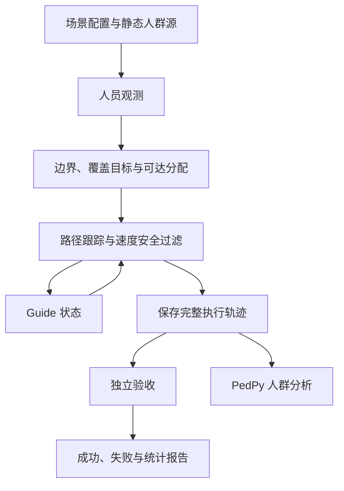

# 框架逻辑与代码位置

## 当前研究契约

Step 1：单一静态人群、已知封闭场地、全局观测、无限通信、无 crowd–guide 动力学交互。
人群初始化区域由仿真器持有。控制器从人员位置、半径和需求权重建立保守包络。
当前凸包会填平凹陷，不能据此声称准确重建非凸边界。需求权重还不是经验证的行为风险。

给定曲线是另一条输入，只供几何诊断。它从 `prepare_prescribed` 进入，并标明 `prescribed_diagnostic`。
普通 `prepare` 仍只调用 `estimate_boundary`。诊断曲线没有人员时，只评价曲线和目标几何；
人员、墙和路径保持未评价，不记成零违反。常数曲线密度也不等于每人权重为 1 的 Gaussian 映射。

## 数据流

人员位置在初始化后冻结；反馈回路更新的是 Guide 状态。验收不依赖控制器的 settled 标志。
PedPy 负责人群密度等分析，专用 evaluator 负责 Guide 的覆盖、到达与安全。

## 按责任查找代码

| 层 | 位置 | 输入 → 输出 |
|---|---|---|
| 配置 | `src/udc/experiments/config.py` | YAML → 严格校验后的配置 |
| 已知场地 | `src/udc/scene.py` | 场地尺寸 → 方形／矩形与墙边界 |
| 人群源 | `src/udc/crowd/sources.py` | JuPedSim 放置／网格／SQLite 首帧 → 冻结人员位置 |
| 环境与感知 | `src/udc/environment.py`, `interfaces.py` | 仿真私有数据 → 行人 ID、位置、半径、demand、零速度、时间；`demand_region` 只在初始化时冻结；控制器仍只收 `Observation` |
| 边界 | `src/udc/boundary/` | 人员圆盘 → 凸包、外偏移曲线、弧长；`estimate_disk_union` 是标明参数的圆盘并集，仍只读位置和半径；诊断用的给定曲线在 `prescribed.py`，不进入普通估计 |
| 部署 | `src/udc/deployment/` | 曲线、权重、数量 → Equal Arc、Average CVT、Mass CVT、DistMesh-inspired；`projected_mass` 与 RA-ABDC 共用同一投影规划 |
| 路径与指派 | `src/udc/navigation/` | 初态、目标、障碍 → 同一套保守自由空间上的可见图；重算时其他 Guide 是障碍，自身不是 |
| 安全 | `src/udc/safety/` | 当前状态、速度 → 过滤速度、整段距离，以及不进入保守规划障碍的半平面 |
| 总控制器 | `src/udc/controller/abcg.py` | 观测、Guide 状态 → 期望速度、安全速度与恢复状态 |
| 资源分配接口 | `interfaces.ResourceAllocator` | Step 2 类型缝；Step 1 不调用，没有分配算法 |
| 实验编排 | `src/udc/experiments/runner.py` | 完整配置 → 执行、结果、resume、离线复判 |
| 公平比较 | `src/udc/experiments/comparison.py` | 因子表 → 仅方法不同的 fixed-N 任务 |
| 来源追溯 | `src/udc/experiments/provenance.py` | 代码、配置、输入 → commit 和 SHA-256 |
| 独立评价 | `src/udc/evaluation/acceptance.py`, `coverage.py` | 保存轨迹 → 九类验收；阶段诊断；共享的需求加权覆盖与热点诊断（不进入验收） |
| 批量协议 | `src/udc/experiments/validation.py` | manifest → 独立任务、多进程、CSV／JSON |
| 人群分析 | `src/udc/analysis/pedestrian.py` | 快照或 SQLite → 密度、邻域与分析配置 |
| 实验统计 | `src/udc/analysis/summary.py` | 全部结果 → 成功率、Wilson 区间、成功任务时间统计 |
| 可视化 | `src/udc/visualization/` | 保存结果或实时状态 → 图像与演示 |

根目录 `run.py`、`live_demo.py`、`visualization.py` 和 `experiments/validation_runner.py`
只调用包内的 CLI。开发时修改对应模块，避免在入口中新增控制算法。

## 数据与失败记录

每次运行生成 `config.yaml`、`trajectory.npz`、`planning.json`、`metrics.json`、`state.json`。
NPZ 禁用 pickle；人群行索引是冻结快照中的稳定人员身份，SQLite 首帧按原始 id 排序。
记录三类净距离：Guide–Guide、Guide–human、Guide–wall。人员半径按最大半径保守处理。
成功同时要求几何、资源、规划、路径、安全、到达保持、曲线距离和最大间隙通过。
`ceil(L/H_p)` 只是数量下界；满足它不能证明存在可行方案。搜索耗尽记录为未找到方案，除非下界或间距上界被违反。

资源不足、非法偏移、路径不可达、超时、恢复预算耗尽是科学失败。
程序异常保存 `runner_error.txt`，单独记为 `EXPERIMENT_ERROR`，不会被删除。
统计时间时注明仅成功任务，成功率的分母保留全部任务。

## 现有示例与后续阶段

`configs/step1/static_50.yaml` 固定相同 5×10 网格，关闭人员动力学，改用统一部署与验收。
它的 Guide 初态、偏移和控制器与旧 CSV 案例不同，因此不直接比较历史耗时。

`Perception` 在 Step 1 提供稳定行人 ID、冻结位置和零速度。控制器消费的仍是 `Observation(positions, radii, demand)`。
`ResourceAllocator` 与 `LocalPolicy` 没有实现，Step 1 运行不会调用它们。
公平比较因子表现为六种方法、4860 个任务，尚未整表运行。投影消融（360 任务）已跑完，只用于机制诊断。
`estimate_disk_union` 是一条标明闭运算半径和外偏移的非凸估计，只读人员位置和半径。它不替换凸包，也不是 alpha、radial 或 bootstrap 的比较。

导航的保守自由空间由 `navigation_domain` 构建，初始指派和执行中重算共用它。`segment_in_free` 对整段线段做几何判定：先用 `free.covers`，离开物理自由空间则拒绝，否则只允许深入保守障碍不超过原 1e-7 m。这一容差是原有的端点数值容差。实际运动区间仍按人、Guide 和墙的中心距检查。`free.covers` 可能拒绝距离边界为 0 的坐标；这种起点用既有的 1e-8 m 规划节点进入可见图，执行路径仍从真实位置开始。可见图边本身仍要求 `free.covers`，不把规划裕度里的弦当成静态边。房间内缩和人群多边形的第一层缓冲使用墙距 0.55 m：人群多边形已经包含人员半径，因此这一层对应 Guide 中心到人员中心 0.75 m。随后的 `simplify(0.10)` 和 `buffer(0.11)` 只是可见图的规划裕度，不是安全距离。安全过滤仍按中心距检查人、Guide 和墙，并拒绝把下一步推进保守障碍内部。已分配路径重算时，其他 Guide 按中心距 0.75 m 成为障碍，正在规划的那一台不进入自身障碍。1e-7 m 只用于边界上的浮点判定。
本次未迁入 Crowd-Management 的双环、未闭合 safe-geodesic、简化 gather 模型和静态多群实验。
Step 2 再加入动态群体 ID、分裂／合并、跨群分配和 crowd–guide 响应；Step 3 才限制感知与通信。
Vadere 后续先接离线轨迹，实时交互需要另建 backend 适配。
`projected_mass` 是固定浓度 1 的间隙投影。RA-ABDC 在此之上才减半浓度。本轮凸曲线上两者目标相同。demand 仍不是经验证风险。

## 源码依据

部署、导航、恢复和独立验收基于 `Wu-kaixin/ABCG-controller` 的 `a18480c`（MIT）。
原仓库冻结统计属于原实现；本次改变模块路径、Mass CVT 核密度和实验追溯，必须重新验证。
主仓库分支基于 `6d9bc09`，保留该提交的依赖与 Notebook 修改。
