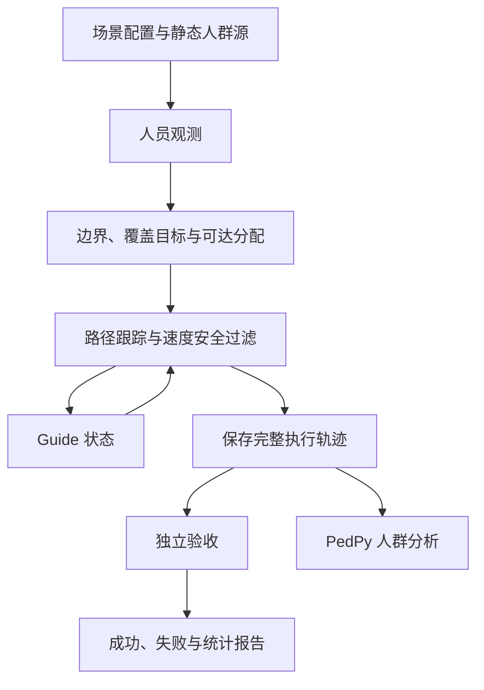

# 框架逻辑与代码位置

## 用户停止长期目标后的最终交接

2026-10-29最新指令：删除定时器、停止长期目标，并参考完整目标只做最后一次实验。
step-1-25已删除，初次暂停后get_goal已返回goal:null，当前没有进行中的目标；下文历史“继续／active／下一步”不再是自动研究授权。
最后一次协议`configs/step1/final_evaluation_v1.yaml`冻结48物理块、1296条50步序列及预声明公共接口验证；不重试、不追加批次。
当前服务门控仍隔离，F4一般误差原参考证书与F10独特性没有完成。
可复用闭环、Step2/3接口及准入条件见[最终交接](STEP1_FINAL_HANDOFF.zh.md)，结果以`reports/step1_final_20261029/`收尾报告为准。

## 2026-10-29 实际精度选择器及尺度下界条件框

`analysis/native_precision_selectors.py`调用固定GEOS DLL的真实静态选择器，以临时点及extent核验供应同一envMax标量。
`multigroup/lower_scale_enclosure.py`在给定实际归一化尺度S≥L≥1及有限运算条件下，以有理数传播n次量化位移。
7560旧阶段测得L最低10000；条件量化外扩仅约0.0004%–0.0052%，全部保存坐标检查与冻结复判一致。
这仅是保存源框之后的量化范围，不能当作完整观测外包；117临界条件显示朴素十进制推算不够，全部未知世界的L尚未证明。
无新完整buffer／overlay或人群运动，门控未改；见[精度选择研究](STEP1_SCALE_SELECTOR.zh.md)。

## 2026-10-29 默认多边形联合及重采样传递

`multigroup/union_coordinate_enclosure.py`补充给定Polygon分量上界的级联联合框及任意框内边的插值外扩。
默认C API采用Classic联合策略，含零buffer回退；零距离复制环及缩放后整数极值不变性将每层预算从两次量化收紧为一次。
两版本均核验同720旧输入／2520群及全部冻结复判；v2全部为v1子框，宽度和缩小64–256倍。
仍有469–1296倍宽度膨胀，且初始／后续分量数与全部世界有限域未证明，不是原参考／服务证书；门控继续隔离。
见[联合与重采样条件契约](STEP1_UNION_COORDINATE_ENCLOSURE.zh.md)。

## 2026-10-29 声明质量集合的联合服务预算

`multigroup/mass_ambiguity.py`在给定单元质量区间及共同总质量界上，用精确有理数最大化有符号预算残差。
`analysis/mass_ambiguity_audit.py`以角点／总质量超平面顶点枚举另算最大值，21780条件及原运行阈值的7260复核均一致。
仅为声明质量集合的条件基础件，不读取人员数据、不证明原参考外包、未接入控制器。
文献初审确认质量模糊集和触发覆盖均有先例，尚无本项目独特性结论；见[联合质量契约](STEP1_MASS_AMBIGUITY.zh.md)。

## 2026-10-29 默认圆角buffer坐标来源组合

`multigroup/round_buffer_source_enclosure.py`将有限法向、圆弧、段求交、舍入辅助闭合点及正参数精度组合成条件轴框。
输入简化／删除与图组装按已审查的坐标复制路径处理；不假设辅助点仍在理想实数凸包。
全部720旧输入／2520群／7560保存阶段／4705946坐标的只读检查及公式复判一致，0新原生几何或独立人群／运动。
源BBox来自离线保存阶段，不能用评价真值直接供运行控制器；所有输入有限域、布尔连接和原参考质量仍未闭合。
门控保持隔离，见[圆角源坐标组合](STEP1_ROUND_BUFFER_SOURCE_ENCLOSURE.zh.md)。

## 2026-10-29 不依赖最短边长的有限分支偏置界

`multigroup/finite_offset_enclosure.py`利用正计算平方和的最小值及非负平方支配关系，给出约sqrt(1.5)倍距离的条件法向界。
不要求输入族最短边长，但明确不证明全部输入q>0／有限；旧33整族拒绝保留，门控未改。
176条件／2288源码表达式重现及全复判一致，2250有限分支、37零范数、1有限域拒绝；无新原生几何调用或运动。
极短受控边出现0.4m距离对应约0.489898m分量，反驳理想单位法向界，不推断旧人群曾发生同类问题。
推导与范围见[有限偏置分支契约](STEP1_FINITE_OFFSET_ENCLOSURE.zh.md)。

## 2026-10-29 未知正精度参数与默认点buffer的粗组合

`multigroup/universal_precision_enclosure.py`按整数化零／非零分支推导C=2(1+u)²的尺度无关坐标界，
条件为有限正参数、有限运算；再按审查的默认Point源／结点／图坐标流组合至多两阶段。
176控制路径中169准入、7有限域拒绝；211原生点调用及冻结复判一致，2894旧源框闭式组合一致。
相对浮动源框宽度和膨胀44–171倍，不能作为可用原参考服务界；所有门控继续隔离。
布尔／后续偏置、精度关联收紧和需求质量仍待完成，见[统一精度界](STEP1_UNIVERSAL_PRECISION.zh.md)。

## 2026-10-29 人员框到初始圆盘源坐标

`multigroup/circle_source_enclosure.py`在binary64中心、实际距离和单位范围三角分量条件下，
用最终舍入极值包围分离／融合圆弧投影；可显式再接声明的点精度模型，未连接默认门控。
同4116旧世界／633966人员实例的257868次实际Point.buffer调用及16761420坐标点逐位复判一致，
完整圆盘输出的有限源框传递反例0；不是所有BufferOp回退或未知原参考证明。
本批只有一种实际半径／q16，18观测历史／16物理指纹，0新独立输入／运动，见[初始圆盘契约](STEP1_CIRCLE_SOURCE_ENCLOSURE.zh.md)。

## 2026-10-29 观测历史到人员中心框

`multigroup/static_person_enclosure.py`只用静态观测、稳定ID、准确身体属性及房间，给出有理人员中心外包。
`disk_pair_enclosure.py`保留两圆盘关联，用有理交点／坐标极点外包补独立坐标传播的松弛；未接运行门控。
v1／v2均检查同4116旧允许世界／633966人员成员，188个跨预算见证全部保留；全复判一致。
v2有459步两圆盘收紧、336/2894人员案例框更小；相比v1宽度和仅额外降约0.00984%，不是服务质量收益。
18种旧观测历史、16物理指纹，0新独立输入／运动；人员框尚未传播为原曲线／质量界，见[人员位置契约](STEP1_STATIC_PERSON_ENCLOSURE.zh.md)。

## 2026-10-29 固定精度标量与条件轴框闭包

`multigroup/precision_enclosure.py`建模GEOS3.14.1精度归一化、向+∞中点取整及binary64乘除，
显式区分请求网格、内部gridSize和报告网格；有理单调范围／位移界不采用请求半网格假设。
声明的点量化及零平移缩放量化可共同检查轴框不变性，供已证明保持轴框的操作组合使用。
30开发条件／16650原生点调用／33300坐标界检查及210叠加全部复判一致；
210叠加是70组唯一名义输入的重复，57空结果分开记账，0新人员输入／运动。
这不是整个SnapRoundingNoder或BufferOp回退证明；人员世界映射和原参考有符号质量仍待完成，
默认服务门控保持回退，见[固定精度条件契约](STEP1_FIXED_PRECISION.zh.md)。

后续`multigroup/snapround_enclosure.py`按固定源码逐项追踪交点、近顶点、像素、取整线串和拆分坐标，
给出单次SnapRoundingNoder及零平移ScaledNoder包装的条件像集外包，不依赖重复量化幂等。
189旧坐标框／378输出框／1512极值的独立标量表达式核对一致，直接原生noder调用0。
这是源码层条件推导，人员世界输入框、全部回退scale及整个BufferOp仍未闭合，见[结点坐标来源契约](STEP1_SNAPROUND_SOURCE_CONTRACT.zh.md)。

## 2026-10-29 实际原生求交返回点的结构外包

`multigroup/intersector_enclosure.py`覆盖GEOS3.14.1无精度／FLOATING模型的正常包围盒检查及端点回退输出，
不假设DD结果是正确舍入的精确交点；给出返回点集合，不保证相交存在或定位误差。
`analysis/native_geos_segment.py`实际调用并hash绑定本项目DLL；13条件／269次C API调用及再次原生复判一致，167点、102无交点。
1mm端点框已有粗返回点外包，0.12m仍因上游退化未认证；均不是人员观测／原参考服务证书。
BufferOp另有固定精度／snap-rounding内部回退，不能将本局部无量化契约直接推广到所有buffer，见[原生求交契约](STEP1_NATIVE_INTERSECTOR.zh.md)。

## 2026-10-29 局部偏置区间与法向依赖约束

`multigroup/offset_interval.py`提供条件binary64偏置运算区间和另一个“精确相交再舍入”原型，未接默认门控。
有理运算、向外格点投影、次正规舍入项和零分母拒绝均显式处理；v2用推导的法向分量上界收紧依赖过宽。
两个版本各136个旧边局部条件／2504条表达式重现及全部工件复判一致；101有限外包、35拒绝，33拒绝有允许零长度见证。
v2的25个外包严格收紧，1mm端点框条件的最宽坐标区间由约4.36m减至0.802m；不是人员误差／原参考服务认证。
GEOS简化、实际DD求交、结点、人员世界到端点框及原需求质量仍未覆盖，见[局部区间契约](STEP1_OFFSET_INTERVAL.zh.md)。

## 2026-10-29 全凸包面法向发现闭运算实现反例

`analysis/exact_convex_hull.py`用整数定向构造源凸包全部面法向；独立Fraction复判验证凸包证书与支撑。
v3首批8个复用输入均在闭运算包含阶段被反驳，569方向判断、378分离法向；预定720输入中712未执行。
它们来自同一旧物理场景，8/8不是总体或独立样本比例；与v2阶段坐标逐位相同，旧16方向均遗漏这些违反。
一个保存案例的局部负偏置／精确相交／坐标舍入可逐位重现输出，但尚无整个GEOS管线的普适误差界。
该结果不恢复运行门控，也不推断旧安全／服务已违反，见[全凸包面审计](STEP1_CONVEX_FACET_AUDIT.zh.md)。

## 2026-10-29 重采样支撑反例与条件插值外包

保存二进制重采样点可略超保存偏置多边形的凸包；已保存1/2^49的精确支撑违反并逐位重现坐标插值。
`multigroup/interpolation_enclosure.py`仅对给定端点和声明binary64运算给出有理数插值外包，不连接默认门控。
旧输入v1遇反例停止：8/720输入、15/2520群；v2另版本完成720输入、2520群的16方向／10080阶段组，无反例。
完整算术复判10080阶段组／161280方向判断全部一致，有限方向通过不等于普适包络证明；见[插值外包契约](STEP1_INTERPOLATION_ENCLOSURE.zh.md)。

## 2026-10-29 buffer实现前提缺口与活动版本显式回退

通用q16圆角buffer的cos(π/64)内包含前提有精确有理点分类反例；
原80物理输入／640观测／2520群边界扫描未找到同类管线反例，但不能完成普适实现证明。
新活动`reference_support.build_support`标记`UNPROVEN_GENERIC_BUFFER_BOUND`，
`certificate`返回`UNCERTIFIED / support_enclosure_transfer_unproven`，稳定更新使用贪心回退。
几何、q16／q32规则及验收阈值未改；旧冻结代码的轨迹与经验数据保留，不再沿用为新版本保证或保持收益。
新4077记录／81序列回退回归及全复判已完成，差异0、认证0；270组匹配chunk的三策略轨迹文件逐字节相同。
复用三个旧输入，0新独立样本，当前活动版本没有保持收益证据。
推导、精确反例、原族扫描及连续集合恒等式的适用边界见[实现前提审计](STEP1_BUFFER_ENCLOSURE_AUDIT.zh.md)。

## 2026-10-29 一般非零误差的可辨识性搜索扩展

保持原20对后验选定旧动作、四帧观测及两布局，扩大到误差圆盘交集内的整体／逐群刚性平移。
4096个候选均通过原物理与参考检查，13对有188个跨0.002预算见证；13对最强见证已精确检查二进制观测误差球并用另一服务积分重建。
另行冻结的4116世界全量只读复判已全部一致，精确误差球全部通过、原25候选见证全部保留；两积分最大差4.662069341687669e−16。
搜索结果不是总体比例、运行证书或新增独立样本。
这些候选属于同一静态观测契约，不能将证书拒绝全部解释为算法过度保守，见[可辨识性研究](../reports/step1_foundation_20261029/FEASIBLE_WORLDS.zh.md)。

## 2026-10-29 精确观测的定量证书补充原型

`multigroup/exact_reference_certificate.py`在声明误差严格为0时，从观测重建原参考并用有理细分包围有符号质量损失。
非零误差直接UNCERTIFIED，未替换默认门控；10对旧动作的另条件开发8对接纳，但只有1对是非相同布局。
两个seed2210超预算反例拒绝、0.12m输入0/10接纳；一般误差下旧0/640和F4未完成状态保持。
模型、算术范围与限制见[精确观测契约](STEP1_EXACT_REFERENCE_CERTIFICATE.zh.md)，不能将其用作未知原曲线证书。

## 2026-10-29 受控人数／墙距部署完成与服务几何下界

216次公共API部署全部交付并通过物理／会计审计，36完整成功、180部分服务；24基础块、72配对场景不能混算。
近墙两条件均无完整成功。`analysis/wall_service_bound.py`用原参考在服务扩展Guide中心矩形外的需求质量，
给出任意机器人数量下的必要未覆盖下界，48/48近墙场景均为正，原保存服务没有反驳。
该模块只用于评价，不把真值下界输入控制器，不改变原参考或F4的损失保证。
物理不可覆盖下界、有限候选规划局限和程序失败分开解释，见[受控结果](../reports/step1_foundation_20261029/POPULATION_WALL.zh.md)。
全部研究目标仍未闭合；下一阶段优先解决低资源可用证书及候选／服务边界。

## 2026-10-29 200步全复判通过与受控人数／墙距开发

200步开发64908/64908条记录全部决策／轨迹复判一致，324/324序列完成；18387认证帧无声明界反例。
低资源两门控仍各0/7200认证，见[开发结果](../reports/step1_foundation_20261029/LONG_HORIZON.zh.md)。
`multigroup/controlled_scenarios.py`提供只在模拟／评价层使用的固定P方格世界及观测安全初始化。
`experiments/population_wall_study.py`封存K1／3／5、P9／25／49／81和三种墙距条件，
24生成块、72配对场景、216单次部署；同基础块的墙距条件不是独立样本。
公共静态会话保存实际事件，独立journal审计评价全运动和原服务，详见[人数／墙距协议](../reports/step1_foundation_20261029/POPULATION_WALL.zh.md)。
该批仅开发，不裁剪原参考、不放宽安全，不把近墙部分服务计作完整成功。

## 2026-10-29 公共会话完整整合通过与200步开发

公共API完整50步整合的108/108会话、5508/5508事件和108份物理／会计审计全部一致，
1947完整成功、3561部分服务；432次为同worker内的完整事件关闭／恢复，不是进程崩溃次数。
见[接口整合结果](../reports/step1_foundation_20261029/SESSION_INTEGRATION.zh.md)。
`sequential_deployment.py`只对显式新协议`foundation_sequence_long_development_v1`及开发证据标签开放200步，
原确认协议仍固定50步。配套episode复判和完整分母界读取封存的steps，不改旧快照。
新长序列开发使用K1／K3、凹形／不规则形、12物理输入与三资源／三模式／三策略；
它不是新独立确认、无限时域证明或公共API200步试验，仍需各自完成工件和全决策／轨迹复判。

## 2026-10-29 独立连续确认完成与低资源辨识见证

80新物理块的108240/108240记录、2160/2160连续50步序列及全量决策／轨迹复判已完成，差异0。
声明主要比较的路程差−155.972788m，低资源门控仍各0/12000认证；见[确认范围](../reports/step1_foundation_20261029/CONFIRMATION.zh.md)。
`analysis/feasible_world_witness.py`只在评价层固定旧观测与布局搜索允许静态世界；
20对选定开发动作中5对找到跨服务预算的可行真值，660世界重建和另一服务积分交叉核验一致。
它不是运行证书或新独立确认，见[辨识边界](../reports/step1_foundation_20261029/FEASIBLE_WORLDS.zh.md)。
`experiments/session_integration.py --full-confirmation-reuse`封存四个已确认输入，
覆盖全部三资源／三扰动／三策略、完整50更新和四次完整事件恢复；本批是108会话5508事件整合开发，不能算新增独立输入。
完整功能与稳定性目标仍active，低资源定量界、长时域／规模和最终发布仍待闭合。

## 2026-10-29 完整事件恢复与独立确认启动

混合执行的16308条开发记录已全量重建一致，324条序列均完成；80个新物理块的108240条独立确认正在运行。
新会话journal schema 3使用运动前intent、提交checkpoint、header／事件链哈希和排他写锁。
`multigroup/session_recovery.py`只恢复同源码／环境、同逻辑仿真epoch、实际终态吻合的完整事件。
执行中退出或半写事件拒绝原地续跑，原记录保留；见[恢复契约](STEP1_SESSION_RECOVERY.zh.md)。
恢复开发不等于实时机器人接管，也没有注入已经冻结的连续确认。
低资源定量损失界仍未完成，当前推导任务见[原参考损失界研究](STEP1_GENERAL_LOSS_BOUND_RESEARCH.zh.md)。

## 2026-10-29 包络开发和版本化静态会话

`multigroup/sandwich_reference_support.py`提供显式可选的原参考单调内外包络，
`collective_identity.py`提供观测不确定域集体覆盖的充分连通证书；默认支持域与身份方法不变。
两者对原640对动作的开发审计无原参考遗漏，但低资源服务认证仍为0，不能宣称问题已闭合。
见[包络契约](STEP1_REFERENCE_SANDWICH.zh.md)。
`foundation_contract.py`、`session.py`与`session_artifacts.py`接入稳定ID、时间、实际终态反馈和不可覆盖事件日志。
独立评价位于`analysis/session_audit.py`，不把控制器交付当作真实完整成功。
见[静态会话契约](STEP1_FOUNDATION_SESSION.zh.md)。动态或通信受限输入仍须显式新协议。

## 2026-10-29 完整基础研究启动

用户授权继续Step 1完整功能与稳定性研究，范围和逐项证据门槛见
[基础研究计划](../reports/step1_foundation_20261029/PLAN.zh.md)。
`multigroup/joint_reconfiguration.py`提供显式同步区间安全检查、静态可行指派搜索和串行回退。
`experiments/continuous_recovery.py`只从旧连续失败的实际状态导出冻结开发动作，不改写原结果。
`sequential_deployment.py`默认仍使用原反向串行；只有显式选择
`execution_policy: joint_reassigned_then_reverse_v1`的新协议才使用新混合策略。
`experiments/foundation_sequence.py`将执行和独立复判都绑定冻结源码快照；
`analysis/foundation_progress.py`核验进程身份并只读统计已落盘chunk，不将状态扫描称作全hash审计。
旧动作开发成功不等于连续新历史或新输入确认成功，低资源原参考证书仍待研究。

## 2026-10-29 审查交付范围

本次静态多群扩展的预定实验与离线复判已完成，入口见[审查包](../reports/step1_review_20261029/README.md)。
历史章节中的“运行中”描述保留其当时语境；当前原确认已经安全停止，新确认已完成记账。
下文单群基线、`multigroup/`静态扩展和远端已有的Step 2a模块属于不同协议，不能混用证据。
整合远端代码不重写各实验的冻结源码；公开证据包另存原科学快照和修复后的只读分析快照。

## 2026-10-28 未完成阶段的新版本

`multigroup/safe_routing.py`提供逐边/逐实际区间独立验证、端点支撑外接圆盘和反向装配串行部署；
`multigroup/reference_support.py`对原世界参考构造一般有界误差下的支持域充分界，不使用锚定参考替代原指标。
`multigroup/stable_update.py`实现仅相位与数量/相位联合门控，控制器仍只读观测、当前机器人和已知几何。
`experiments/recovery_study.py`区分旧动作开发；`deployment_recovery.py`冻结独立新输入；
`sequential_deployment.py`保持连续实际状态，`episode_artifacts.py`每5步写不可覆盖chunk。
`analysis/sequential_audit.py`重建观测决策与全部保存区间，`closure_reports.py`按完整分母报告。
新协议和原停止确认分开，旧输入/源码/失败不变。推导与队列见[继续实验计划](../reports/step1_closure_20261028/PLAN.zh.md)。

## 2026-10-28 保存与等价计算后端

按用户请求先暂停并核验存档，再使用独立封存的`multigroup/accelerated_execution.py`后端。
该后端索引原自由空间、按需计算同一有限图的可见边，保持原边权/严格松弛/破同分与原执行政策。
原科学源码快照文件不修改，实际后端版本由`backend_policy.json`及单元receipt明确绑定。
`analysis/parallel_frozen_replay.py`只并行调度原验收函数；
`analysis/path_failure_census.py`负责旧工件的只读几何分类，不执行新动作。
保存与等价性条件、测量范围见[后端契约](STEP1_ACCELERATED_EXECUTION.zh.md)。

## 2026-10-27 用户授权的全核运行修订

原多群确认因固定2进程而推进缓慢。按用户全核请求，`experiments/frozen_resume.py`
保留完整receipt，跳过完整单元，以32个独立进程调用原快照的`_unit_worker`；
`scripts/frozen_unit_worker.py`是薄进程入口，科学计算仍全部来自原封存源码。
`experiments/cpu_affinity.py`把工作进程分配至32个逻辑处理器，避免Windows把后台计算集中在部分核心。
原协议/清单不改写；并行度修订及中断恢复单独记录，不声称始终保持原2进程配置。
当前路径见[运行修订](../reports/static_service_audit_20261026/runtime_amendment.json)，
测量与限制见[验证记录](VALIDATION.zh.md)。

## 2026-10-27 连续评分与布局保留

`multigroup/phase_retention.py`在相同候选、固定数量下比较三种服务评分，
并提供有显式观察服务预算的名义布局保留。`experiments/static_phase_retention.py`
独立封存静态重观测输入与实际重部署；新分析/复判位于`analysis/phase_retention_*`。
原Step 1单次冻结观测及原v2确认不调用该模块。
范围、界和限制见[方法契约](STEP1_PHASE_RETENTION.zh.md)，
实测见[科研评估](../reports/static_phase_retention_20261027/ASSESSMENT.zh.md)。

## 2026-10-27 服务机制与静态扰动

`multigroup/service.py`提供声明折线/分段线性需求的连续服务积分，
`total_allocation.py`提供同候选目录上的总需求比较器，
`partition_stability.py`提供观测连通分群的充分稳定证书。
独立实验入口为`experiments.service_audit`、`static_mechanism`、`static_stability`和`static_pressure`；
新统计、完整账本识别界和离线复判位于`analysis/service_audit*`。
详见[服务契约](STEP1_SERVICE_AUDIT.zh.md)与[开发报告](../reports/static_service_audit_20261026/DEVELOPMENT.zh.md)。
原v2确认继续使用其封存源码快照；新增方法不进入原冻结清单。

## 2026-10-26 显式扩展版 Step 1

静态多群、有界位置误差与固定资源预算现在使用独立入口
`python -m udc.experiments.static_multigroup`，协议为 `configs/step1/static_multigroup_v2.yaml`。
真实状态与冻结观测分离；观测连通分群、保守边界、有限候选目录和不足资源 minimax 分配位于
`src/udc/multigroup/`。真值评价与完整任务成功不使用部分服务结果替代。
详见[扩展契约](STEP1_MULTIGROUP.zh.md)。以下原有章节仍描述单群集成基线；
原控制器及历史协议没有被静态多群入口替换。旧 `ResourceAllocator` 类型缝仍未被原循环调用。

## 2026-10-23 本地重建后的入口

活动环境统一为根目录 `.venv`，独立CPython3.12.15，每个项目独立安装，不使用Conda。
环境设置在 `scripts/setup_env.ps1`，完整Windows依赖锁在 `requirements/locks/windows-py312.txt`。
需求／资源／截止诊断模块已合并到 `src/udc/experiments/`，统计位于 `src/udc/analysis/`，
协议位于 `configs/step1/`。最新研究入口为[证据图谱](STEP1_EVIDENCE_MAP.zh.md)。

维护编排 `scripts/rebuild_missing_data.py` 调用已有生成器、规划器、runner和独立验收，
输出在 `runs/reconstructed_20261023/`，历史源码快照在其 `sources/`。
报告分析脚本与既有协议保留证据路径。原件、重建数据及缺口见[重建日志](PROJECT_REBUILD.zh.md)。

## 当前研究契约

Step 1：单一静态人群、已知封闭场地、全局观测、无限通信、无 crowd–guide 动力学交互。
人群初始化区域由仿真器持有。控制器从人员位置、半径和需求权重建立保守包络。
当前凸包会填平凹陷，不能据此声称准确重建非凸边界。需求权重还不是经验证的行为风险。

给定曲线是另一条输入，只供几何诊断。它从 `prepare_prescribed` 进入，并标明 `prescribed_diagnostic`。
普通 `prepare` 仍只调用 `estimate_boundary`。诊断曲线没有人员时，只评价曲线和目标几何；
人员、墙和路径保持未评价，不记成零违反。常数曲线密度也不等于每人权重为 1 的 Gaussian 映射。

## 数据流

人员位置在初始化后冻结；反馈回路更新的是 Guide 状态。验收不依赖控制器的 settled 标志。
PedPy 负责人群密度等分析，专用 evaluator 负责 Guide 的覆盖、到达与安全。

## 按责任查找代码

| 层 | 位置 | 输入 → 输出 |
|---|---|---|
| 配置 | `src/udc/experiments/config.py` | YAML → 严格校验后的配置 |
| 已知场地 | `src/udc/scene.py` | 场地尺寸 → 方形／矩形与墙边界 |
| 人群源 | `src/udc/crowd/sources.py` | JuPedSim 放置／网格／SQLite 首帧 → 冻结人员位置 |
| 环境与感知 | `src/udc/environment.py`, `interfaces.py` | 仿真私有数据 → 行人 ID、位置、半径、demand、零速度、时间；`demand_region` 只在初始化时冻结；控制器仍只收 `Observation` |
| 边界 | `src/udc/boundary/` | 人员圆盘 → 凸包、外偏移曲线、弧长；`estimate_disk_union` 是标明参数的圆盘并集，仍只读位置和半径；诊断用的给定曲线在 `prescribed.py`，不进入普通估计 |
| 部署 | `src/udc/deployment/` | 曲线、权重、数量 → Equal Arc、Average CVT、Mass CVT、DistMesh-inspired；`projected_mass` 与 RA-ABDC 共用同一投影规划 |
| 路径与指派 | `src/udc/navigation/` | 初态、目标、障碍 → 同一套保守自由空间上的可见图；重算时其他 Guide 是障碍，自身不是 |
| 安全 | `src/udc/safety/` | 当前状态、速度 → 过滤速度、整段距离，以及不进入保守规划障碍的半平面 |
| 总控制器 | `src/udc/controller/abcg.py` | 观测、Guide 状态 → 期望速度、安全速度与恢复状态 |
| 资源分配接口 | `interfaces.ResourceAllocator` | Step 1 类型缝；Step 1 不调用，没有分配算法 |
| Step 2a 纯分配 | `src/udc/allocation/` | 已确定的两群成员和下界 → 一次性 Guide 身份分配；不读出生多边形，不调用部署 |
| Step 2a 规划预检 | `src/udc/preflight/` | 冻结身份、各群凸包、下界、纯分配、共同静态域和同群路径。入口 `experiments/step2a_preflight.py` 只转发 |
| Step 2a 开发执行 | `src/udc/execution/` | `fixed_paths_no_recovery_v1`：只读预检、固定路径、一次联合安全过滤、群级与系统级验收。入口 `experiments/step2a_execute.py` 只转发 |
| 实验编排 | `src/udc/experiments/runner.py` | 完整配置 → 执行、结果、resume、离线复判 |
| 公平比较 | `src/udc/experiments/comparison.py` | 因子表 → 仅方法不同的 fixed-N 任务 |
| 来源追溯 | `src/udc/experiments/provenance.py` | 代码、配置、输入 → commit 和 SHA-256 |
| 独立评价 | `src/udc/evaluation/acceptance.py`, `coverage.py` | 保存轨迹 → 九类验收；阶段诊断；共享的需求加权覆盖与热点诊断（不进入验收） |
| 批量协议 | `src/udc/experiments/validation.py` | manifest → 独立任务、多进程、CSV／JSON |
| 人群分析 | `src/udc/analysis/pedestrian.py` | 快照或 SQLite → 密度、邻域与分析配置 |
| 实验统计 | `src/udc/analysis/summary.py` | 全部结果 → 成功率、Wilson 区间、成功任务时间统计 |
| 可视化 | `src/udc/visualization/` | 保存结果或实时状态 → 图像与演示 |

根目录 `run.py`、`live_demo.py`、`visualization.py` 和 `experiments/validation_runner.py`
只调用包内的 CLI。开发时修改对应模块，避免在入口中新增控制算法。

## 数据与失败记录

每次运行生成 `config.yaml`、`trajectory.npz`、`planning.json`、`metrics.json`、`state.json`。
NPZ 禁用 pickle；人群行索引是冻结快照中的稳定人员身份，SQLite 首帧按原始 id 排序。
记录三类净距离：Guide–Guide、Guide–human、Guide–wall。人员半径按最大半径保守处理。
成功同时要求几何、资源、规划、路径、安全、到达保持、曲线距离和最大间隙通过。
`ceil(L/H_p)` 只是数量下界；满足它不能证明存在可行方案。搜索耗尽记录为未找到方案，除非下界或间距上界被违反。

资源不足、非法偏移、路径不可达、超时、恢复预算耗尽是科学失败。
程序异常保存 `runner_error.txt`，不删除、不覆盖已经写好的 `metrics.json`。
同一目录只记一次：metrics 若已声明 `EXPERIMENT_ERROR`，错误现场被该声明吸收；
若 metrics 仍是其他结果，或还没有可读 metrics，台账记 `EXPERIMENT_ERROR`，
不把其中的物理成功计入成功次数或成功耗时。物理验收仍以保存的 metrics 和离线复判为准。
拒绝进入已有输出目录不会新写错误现场。统计时间只含台账成功任务，分母保留全部任务。

## 现有示例与后续阶段

`configs/step1/static_50.yaml` 固定相同 5×10 网格，关闭人员动力学，改用统一部署与验收。
它的 Guide 初态、偏移和控制器与旧 CSV 案例不同，因此不直接比较历史耗时。

`Perception` 在 Step 1 提供稳定行人 ID、冻结位置和零速度。控制器消费的仍是 `Observation(positions, radii, demand)`。
`ResourceAllocator` 与 `LocalPolicy` 没有实现，Step 1 运行不会调用它们。
公平比较因子表现为六种方法、4860 个任务，尚未整表运行。投影消融（360 任务）已跑完，只用于机制诊断。
`estimate_disk_union` 是一条标明闭运算半径和外偏移的非凸估计，只读人员位置和半径。它不替换凸包，也不是 alpha、radial 或 bootstrap 的比较。

导航的保守自由空间由 `navigation_domain` 构建，初始指派和执行中重算共用它。`segment_in_free` 对整段线段做几何判定：先用 `free.covers`，离开物理自由空间则拒绝，否则只允许深入保守障碍不超过原 1e-7 m。这一容差是原有的端点数值容差。实际运动区间仍按人、Guide 和墙的中心距检查。`free.covers` 可能拒绝距离边界为 0 的坐标；这种起点用既有的 1e-8 m 规划节点进入可见图，执行路径仍从真实位置开始。可见图边本身仍要求 `free.covers`，不把规划裕度里的弦当成静态边。房间内缩和人群多边形的第一层缓冲使用墙距 0.55 m：人群多边形已经包含人员半径，因此这一层对应 Guide 中心到人员中心 0.75 m。随后的 `simplify(0.10)` 和 `buffer(0.11)` 只是可见图的规划裕度，不是安全距离。安全过滤仍按中心距检查人、Guide 和墙，并拒绝把下一步推进保守障碍内部。已分配路径重算时，其他 Guide 按中心距 0.75 m 成为障碍，正在规划的那一台不进入自身障碍。1e-7 m 只用于边界上的浮点判定。
本次未迁入 Crowd-Management 的双环、未闭合 safe-geodesic、简化 gather 模型和静态多群实验。
Step 2 再加入动态群体 ID、分裂／合并、跨群分配和 crowd–guide 响应；Step 3 才限制感知与通信。
Vadere 后续先接离线轨迹，实时交互需要另建 backend 适配。
`projected_mass` 是固定浓度1的间隙投影，RA-ABDC兼容入口在此之上包含浓度减半。历史凸曲线消融里两者目标相同；后续需求与资源实验的当前结论见证据图谱，不能用旧消融概括所有非凸输入。demand仍不是经验证风险。

2026-10-20固定资源恢复诊断发现一种数值边界起点：最近投影差仅约一个ulp，却大于旧方向选择阈值，1e−8m规划节点可能因此指向保守障碍内部，整行路径查询被遗漏。`_boundary_node`现仅在原节点失败且属于原1e−7m端点接触范围时，尝试既有外法向的同一1e−8m节点；保留真实起点，要求完整前缀物理入域及原完整线段检查。既有已接纳节点不变，不增加buffer或安全容差。这是导航／执行表示一致性修复，不是新部署规划方法。恢复策略顺序、失败传播、预算和进展监测未改变。

## 部署目标—静态导航域接口（2026-10-19）

`navigation.paths.target_domain_check` / `require_target_domain` 是部署验收、初始指派和固定指派重算共用的静态端点检查。几何来自同一个 `navigation_domain`：已知房间内缩、观测占据环的物理缓冲，以及既有简化／额外规划缓冲。其他 Guide 的临时占据不属于此目标禁区。物理自由域须覆盖目标，保守域覆盖或至多原 1e-7 m 边界数值接触才可接纳；不改变实际位置。

给定部署目标非法时，在指派／可见图搜索前保存 `TARGET_DOMAIN_INVALID`，证据包含目标编号、坐标、原弧坐标、域名／哈希、距离与原因。直接导航查询没有曲线时弧坐标可以为 null，部署调用必须提供弧坐标。提前拒绝只改变失败分类，不代表部署修复。

`deployment.admissible.admissible_phase` 是显式的 `static_domain_phase_v1` 后处理，仅在调用者选择该协议且原目标入域失败时运行。它在原闭曲线上检查预先固定的有限整体相位，保留数量和循环 gap pattern，重查弧间隙、全成对距离、原需求评价及目标域；候选与原方法输出分开保存并标记算法变化。不裁切非法弧段，不改变原曲线长度和覆盖定义。搜索失败只是预算内未找到配置。该步骤不替换边界估计，也不改变安全协调、执行或独立验收。

当前适用限制：闭运算产生的短尖角可能经 mitre 缓冲远距离伸出，使 1.3 m 偏移曲线局部不能进入保守导航域。单个非法目标不是整体不可行证明。seed51 已找到合法相位；非恒定需求和其他曲线上的效果不由本轮结果保证。运行与重建限制见 [目标域一致性报告](../reports/step1_target_domain_consistency/REPORT.zh.md)。

## 边界构造比较接口（2026-10-19）

`boundary.construct_boundary` 映射 `convex_hull` 到既有 `estimate_boundary`，映射 `disk_union_closed` 到既有 `estimate_disk_union`。两者读取同一位置、半径和房间；构造报告分开保存完整占据几何、外环控制几何和人员圆盘物理参考。圆盘闭运算步骤由原函数抽取为 `disk_occupancy`，几何计算未改变。多分量不选最大分量、不丢人员、不回退；孔洞及外环填孔明确记账。

`experiments.boundary_comparison` 冻结固定 N、Equal Arc legacy phase 和共用静态域相位政策。两构造的曲线和导航域可以不同，这属于实验效应；`evaluation.comparison.common_motion_metrics` 不接收估计器几何，只按共同人员／半径／房间及真实运动区间评价。各自曲线覆盖仍由原独立验收检查，内部代价不用于跨曲线排名。未执行行的运动指标为 null，构造失败留在共同合法输入分母。

协议将清单准备、输入冻结、实际执行分为独立操作。最初16行是协议开发检查；随后seed55–74的60共享输入／120行已全部完成，见[完整比较](../reports/step1_boundary_estimator_comparison_v1/REPORT.zh.md)。源码、配置、原快照和SQLite均以哈希锁定，不能在新源码上改写旧锁来重跑。详细定义见[比较协议](../reports/step1_boundary_estimator_protocol/REPORT.zh.md)，本机原始工件依赖见[数据说明](DATA_AVAILABILITY.zh.md)。

## 人员圆盘覆盖的表示契约（2026-10-19）

解析物理圆盘、构造用32段／象限多边形、原验收用16段／象限多边形是三个对象。默认估计器与独立验收保持原规则；`boundary.audit_person_disk_coverage` 提供 `observed_disk_polygon_coverage_v1` 的统一32段诊断候选和16段对照，分别审计完整占据集与控制器实际外环，保留原covers、关系矩阵、差集和精确保存坐标证据。诊断不修改几何、不做近似放行，也不参与物理安全评价。严格覆盖的操作性承诺、局部有理数证书及误差量纲见[覆盖几何契约](COVERAGE_GEOMETRY_CONTRACT.zh.md)。

## 源码依据

部署、导航、恢复和独立验收基于 `Wu-kaixin/ABCG-controller` 的 `a18480c`（MIT）。
原仓库冻结统计属于原实现；本次改变模块路径、Mass CVT 核密度和实验追溯，必须重新验证。
主仓库分支基于 `6d9bc09`，保留该提交的依赖与 Notebook 修改。
