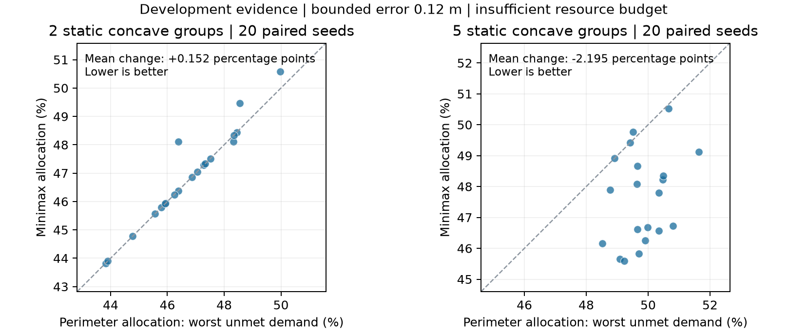

# 扩展版 Step 1：实现、冻结协议与开发评估

日期：2026-10-26。基线为 `Major-Research-Branches` 的 `dc94b827b2fd4c1ef45de962af6b0a0cfc6da355`。
本轮是新实现和开发检查，未改写历史原件、重建结果或旧协议哈希，未执行 5000–5029。
所有工作在项目独立 CPython 3.12.15 `.venv` 中完成，未更换依赖。

## 评估结论

三项优先事项已经形成可运行入口和可核查证据：真实状态/观测分离、静态多群有限资源分配、
以及在方法执行前封存的公平比较。扩展版 Step 1 因而可以作为**受限的静态多群研究基线成立**。
目前还不能宣称对所有形状/群数有真值覆盖优势、连续全局最优、传感器实测鲁棒性或 Step 2/3 稳定性。

尤其是分配算法对观察曲线的有限目录目标最优，不保证对真实参考边界同样最优。
20-seed 开发检查中，5 群凹形有平均收益，2 群凹形平均略有退化；不得删除后者来扩大主张。
期刊级的全矩阵确认尚未执行。新代码和工程检查通过，不能替代这项科学确认。

## 三项交付

| 事项 | 实现与验证 | 适用条件 |
|---|---|---|
| 分离真值与误差观测 | 独立只读数组与独立 NPZ；控制器只接收观测；同一真实场景的误差抽取后冻结；独立人体真值区间安全复核 | 全部人员被检测，位置误差有界，半径/需求/机器人定位精确 |
| 多群与不足资源目标 | 观察点连通分群；0/1/2 台机器人和闲置有定义；有限目录 minimax 分配；小规模穷举核对；部分服务不冒充完整覆盖 | 可分离静态群体，固定群体/需求，有限相位与积分精度 |
| 公平比较冻结 | 2 布局 × 3 分配；同布局内共用候选，全部方法共用输入/数量/相位机会；20 seeds/配置；输入、源码、环境和任务清单封存 | 明确失败分母，0 科学重试，程序/安全错误停止 |

代码位于 `src/udc/multigroup/`，编排位于 `src/udc/experiments/static_multigroup.py`，
统计位于 `src/udc/analysis/static_multigroup.py`。原 `run.py` 单群流程未替换。
完整数学目标、几何表示、命令和阶段边界见 [扩展契约](../../docs/STEP1_MULTIGROUP.zh.md)。

## 已完成的开发检查

| 批次 | 输入/行数 | 结果及含义 |
|---|---|---|
| v1 对称性较强的规划网格 | 单 seed，48 观测单元、864 行 | 仅规划；分群错配0、误差越界0、有限目录目标劣化0；主要分配差异为0，不是正收益证据 |
| v1 同批执行检查 | 16 个物理输入、96 行 | 50 FULL_SUCCESS、46 PARTIAL_SERVICE；96 安全部署完成；119,650 完整区间零安全违反 |
| v2 显式异质规划网格 | 单 seed，48 观测单元、864 行 | 仅规划；分群错配0、误差越界0、目录目标劣化0；16 条件等权真值参考主要差异 −0.01186685，单 seed 不给置信区间 |
| v2 凹形20-seed执行检查 | K=2/5 各20独立物理输入，80行 | 80 PARTIAL_SERVICE，完整成功0；80安全完成；65,023区间零安全违反；所有不足资源结论保留 |
| v2 中高资源补充执行 | K5、凹形/椭圆、seed1201，8行 | 中档4 PARTIAL_SERVICE、高档4 FULL_SUCCESS；8安全完成，22,365区间零违反；是同物理输入的资源比较，不另加独立seed |

v1 主要差异全部为零后，v2 在正式确认之前显式加入不同群体尺度和群内热点强度。
v1 namespace=2026102601，v2 namespace=2026102603，前者的源码、输入、结果和零差异原样保留。
这是开发中的设计修订，不是选择性替换正式确认样本；不能把 v1 和 v2 累加成同一实验的重复。

v2 的完整单-seed网格含 K=5 椭圆的真值参考劣化案例（+0.01216125），没有因其方向不利而移除。
目录上的零劣化与真值上的劣化同时出现，直接说明观察目标和公共参考指标不能混用。

### 20-seed的主要效应

限定条件：凹形模板族、误差上界 .12 m、低预算 5K 台、投影质量布局，minimax 对按周长分配。
正值表示最差群体未覆盖需求变多，负值表示改善；单位是比例差。

| 群体数 | 有效独立配对 | 平均差异 | 改善/相同/退化 |
|---|---:|---:|---:|
| 2 | 20/20 | +0.00151595（+0.152个百分点） | 1/16/3 |
| 5 | 20/20 | −0.02195247（−2.195个百分点） | 17/2/1 |
| 两条件等权 | 40/40 | −0.01021826（−1.022个百分点） | 分条件保留 |

两条件等权95%分层配对bootstrap区间为 `[-0.01338694, -0.00686805]`，即
约 `[-1.339, -0.687]` 个百分点；10,000次重采样，不可计算比例0。
它仅描述本轮两种配置的开发输入，不是完整16条件的前瞻确认。
80条记录是40个配对物理输入，不是80个独立场景。
seed1200与先前网格重叠，选择和扩展都发生在开发阶段；不能把这批数据称为未暴露输入的前瞻确认。
全部实际安全到达后，公共真值参考的计划/实际指标一致；规划收益没有依赖删除执行失败行。

公平性的代价也必须单列，不能将最差群体改善概括为总体覆盖改善：

| 群体数 | 按周长的加权未覆盖比例 | minimax的加权未覆盖比例 | 差异 |
|---|---:|---:|---:|
| 2 | 0.46006127 | 0.45137303 | −0.869个百分点 |
| 5 | 0.40956323 | 0.44874928 | +3.919个百分点 |

minimax先保护最差群体，才在同等最差水平下优化需求总缺口，因此不会同时保证这两个指标都优于基线。
K2表现为总需求改善而最差群体略退化，K5表现为最差群体改善而总需求退化。
若实际应用优先最小化总需求缺口，应另建主目标不同的新协议；当前冻结确认不能事后换目标。

### 工程检查与复判

- 全量测试：249 passed / 20.87 s；项目内 `--basetemp`，禁用cacheprovider，数值线程1。
- `pip check` 通过；`git diff --check` 通过（Git 的 CRLF 提示不是失败）。
- 当前 v2 规划网格864/864复判一致，v2的80条20-seed执行80/80、中高资源8/8复判一致。
- 旧 v1 执行使用其保存的源码快照复判，96/96一致；没有在新源码上改写旧锁。
- 单元测试覆盖中途碰撞而端点安全、误差/真值不共享、分群只读观测、完整人体圆盘保守包含、
  零资源、预算小于群体数、目录缺项、非单调服务、DP对穷举、观测篡改、预留种子拒绝、
  科学失败工件及程序异常停止。
- 最终逐文件核查1,912个任务工件receipt，1,912份轨迹NPZ禁用pickle读取通过，维度和任务映射一致。
  实测与复判凭据见[validation.json](validation.json)。

最小机器人间净配置裕量在部分开发执行中约 `9.78e-13 m`，人员定位误差已在模型中显式膨胀，
但机器人定位保持精确；不能因此声称对机器人定位误差、执行扰动或动态碰撞有鲁棒保证。
新执行是串行固定指派，统一1800 s截止，不与旧40 s控制器比较完成率或速度。
开发批次有时间重叠，每批最多2个episode进程、每worker数值线程1；本轮没有以这些墙钟时间比较算法效率。
当前只覆盖预定、远离墙面的群体布局，没有近墙/狭窄跨群通道压力测试。

## 已封存、未执行的完整确认

配置：[static_multigroup_v2.yaml](../../configs/step1/static_multigroup_v2.yaml)。
本机目录：`runs/static_multigroup_20261026/confirmation_v2_frozen/`。
冻结凭据：[freeze_receipt.json](freeze_receipt.json)。

- K=1/2/3/5；圆/椭圆/凹/不规则；误差0/.04/.12 m；低/中/高供给5K/11K/16K。
- 2布局 × 3分配 × 20 seeds（2000–2019），总计 **17,280行**。
- **320**个独立物理输入，**960**份冻结观测；所有方法共享同一观测、真实快照和嵌套初态。
- manifest SHA-256：`8c19566718cae9a9a05a3904f321f24b2ced4ea9f8c6d6d53c48597163e7ea8f`。
- 源码、输入、协议和环境锁验证通过，准备阶段未运行方法。确认结果数为0。
- 主估计量仍保留所有16个 K/shape 条件等权，包括 K=1 的零差异条件和可能不利的 K=2 条件。

本轮按要求完成协议冻结和开发评价，没有把17,280行预备清单写成已完成实验。
`runs/` 继续不随Git分发；报告内的摘要与冻结凭据可审查，本机完整工件及源码快照另外保存。
若源码发生变化，应创建新研究目录；禁止更新旧清单使其“通过验证”。

## Step 1成立到哪里

1. **问题定义成立。** 有明确的观测输入、误差假设、资源预算、缺口目标及独立评价。
2. **有限模型实现成立。** 分群、目录构造、整数分配和保存/复判闭合，有与穷举对照的分配性质。
3. **局部经验收益成立。** 本轮5群凹形的20配对显示收益；2群未显示平均收益。
4. **普遍鲁棒覆盖尚未成立。** 误差外包围支持条件性安全，不提供真实曲线弧距或覆盖缺口的统一上界；
   参考服务也是2048点采样，不是连续覆盖证明。
5. **独立论文尚不能仅凭本轮宣布完成。** 需要完整冻结确认、进一步的新颖性对照与误差—覆盖关系；
   不能将常规DP本身包装为已证明的科研首创。
6. **后续阶段仅逻辑可接。** 模块可作为静态子问题，但Step 2需时变真值、目标变化与切换分析，
   Step 3需通信/局部观测模型。当前结果不构成动态或分布式稳定性证明。

建议保留目前的冻结目标与失败分母，执行后按原主估计量解释结果；
若需要真正的最坏边界误差覆盖保证，应另立方法和新协议，而不是用当前真值结果反向调目标。
