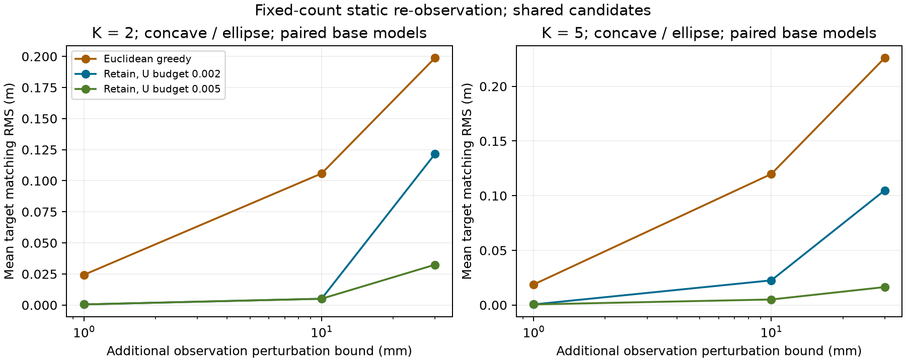

# 本轮科研评估：减少布局跳变，但真实服务保障仍有缺口

日期：2026-10-27（Asia/Tokyo）。

**结论：有服务代价预算的布局保留值得进入下一版Step 1候选方法；当前还没有建立对真实服务的统一保障。**
本轮同时获得了正向效果和一个经实际执行验证的反例，后者决定了方法的主张边界。

## 已完成的实验

新输入为K=2/5、凹形/椭圆，每配置20 seeds，共80个独立物理块。
在每个块中配对两种基线误差、四档附加扰动和五种选择器，完成3,200条规划记录。
数量在名义观测下分配一次后固定，所有选择器共用候选和安全约束。
80次共同名义部署、160次成对重部署均安全完成部分服务，完整覆盖成功0。
另外对一个事后选择的反例执行2个固定动作；它们不增加独立样本数。

全部3,440条主记录及2条见证记录的凭据和无pickle轨迹通过核验。
3,200条控制器选择逐位重构一致，240次主运动和2次见证运动的离线复判均一致。
实际运动合计69,490个完整区间，记录违反0；区间及重复动作不作为独立安全试验计数。
全量274项测试通过（23.56s），pip check及diff空白检查通过。

## 改善了什么

主比较为1mm附加重观测下，0.002保留策略与连续欧氏贪心的配对。
两策略有相同名义目标、相同资源数量与当前候选池。

| 指标 | 连续欧氏贪心 | 0.002保留策略 |
|---|---:|---:|
| 平均目标最小匹配RMS | 21.602mm | 0.538mm |
| 160观测视图的RMS中位数 | 1.121mm | 0.510mm |
| 160观测视图的RMS第95百分位 | 105.763mm | 0.687mm |
| 每次实际重部署的机器人总行驶距离均值 | 0.170035m | 0.007869m |

RMS主效应为−21.064mm，按完整物理种子块bootstrap的95%开发区间为
[−38.101, −7.933]mm。四个K/shape层均保留20个完整物理块，无缺失配对。
尾部分位数是描述性数据，不是置信区间。平均收益有减少少数大跳变的贡献，不能声称所有输入等幅改善。
80/80实际重部署配对均安全完成，初始机器人状态逐位相同。

连续弧距评分相对256点采样弧距评分，在本轮1mm同候选比较中，使真实参考最差群缺口
平均减少0.1536个百分点。再改成连续欧氏评分后，该缺口平均反而略增0.0028个百分点。
这说明消除采样误差有价值，但仅统一距离度量仍不能消除估计几何与真实参考之间的差别。

## 服务代价不能省略

保留规则在**当前观察模型、本群指派服务、有限候选池**中，逐群未覆盖比例损失至多0.002，
即0.2个百分点。该性质、共同候选一致性和安全准入均通过本轮检查。

真实参考服务的结果如下，均为保留减贪心；正值表示缺口变大：

| 附加扰动 | 最差群缺口平均变化 | 最大单对损失 | 真实损失超过观察预算的配对数 |
|---|---:|---:|---:|
| 1mm | +0.0028个百分点 | +0.1807个百分点 | 0/160 |
| 10mm | +0.0221个百分点 | +0.6952个百分点 | 7/160 |
| 30mm | +0.0362个百分点 | +1.1347个百分点 | 7/160 |

1mm的总加权缺口平均增加0.0124个百分点。10/30mm整批仅进行规划服务评价；
其中最大损失案例另作固定动作执行诊断。

具体反例是K5、凹形、seed2210、独立圆盘基线误差：实际人员位置误差最大0.101216m，
仍在声明0.12m以内；每群数量为[5,6,5,5,4]。
观察最差群损失只有0.1854个百分点，真实参考损失却为1.1347个百分点。
两种冻结目标各实际执行一次，都安全到达；该真实服务差异仍然存在，离线复判一致。
完整精度与来源凭据见[反例](true_service_witness.json)。

因此，可以支持“减少目标跳变并限制观察模型中的代价”；
不能把它扩展为“真实覆盖代价同样不超过0.2个百分点”。这不是阈值越界或超出误差假设造成的反例。

## 当前Step 1成立到哪里

1. 静态重观测下，固定数量的布局保留具备可执行性和可量化的运动收益。
2. 真实服务的统一误差界尚未建立，不能以观察模型的近优界替代。
3. 本轮固定数量，整数资源重分配的跳变仍未解决。
4. 仅验证一次重观测和一次重部署，尚无连续时序、动态人群或受限通信稳定性结论。

原v2确认仍在运行。12:44的记账快照为13,372/17,280条，含381条PATH_NOT_FOUND；
其中281条是执行时固定端点被保守障碍占据，100条是有限可见图未找到路径。
这些失败集中在中/高供给条件，不能由本轮低预算成功抵消，也不能直接称物理不可达。
该快照不是最终完成率或主效应，详情见[原确认过程记账](original_v2_interim.json)。

下一轮应优先建立可计算的真实服务误差界，并逐例解释原确认的端点/路径失败；
再研究资源数量变化时的稳定更新。布局保留可以作为其中一个模块，当前证据不足以宣布Step 1论文验证完成。

完整数表与协议见[实验报告](REPORT.zh.md)、[分析数据](analysis/analysis.json)和
[数学契约](../../docs/STEP1_PHASE_RETENTION.zh.md)。
