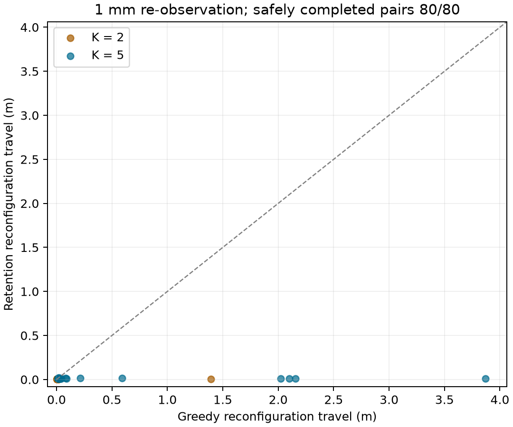

# 连续评分与布局保留：静态Step 1实验

日期：2026-10-27（Asia/Tokyo）。
本轮完成状态：**True**。证据类型：独立新输入上的开发方法实验，不是原v2正式确认。

## 主要结果

在预先指定的1mm重观测条件，.002保留策略减连续欧氏贪心的目标匹配RMS，
四层等权平均差为 **-0.021064m**；
按完整物理种子块重采样的95%开发区间为 **[-0.038100705049125466, -0.00793262869934875]m**。
完整分母敏感性范围为`[-0.021064072698413684, -0.021064072698413684]`m，该范围不是置信区间。

| K | 形状 | 有效/预定物理块 | 贪心RMS均值(m) | 保留RMS均值(m) | 差值(m) |
|---|---|---:|---:|---:|---:|
| 2 | concave | 20/20 | 0.001332 | 0.000486 | -0.000846 |
| 2 | ellipse | 20/20 | 0.047374 | 0.000542 | -0.046832 |
| 5 | concave | 20/20 | 0.004664 | 0.000620 | -0.004045 |
| 5 | ellipse | 20/20 | 0.033038 | 0.000504 | -0.032534 |

每层20个种子块，两种基线误差先在块内平均；80个独立物理块，160个基线观测。
四档附加扰动/五种方法不作为额外独立样本。所有条件和.005敏感性结果保存在CSV。
统计是开发结果；没有依据结果修改容差、补种子或筛除失败。
160个观测视图的描述性尾部：贪心目标RMS中位数/P95/最大值分别为
`{'views': 160, 'median_m': 0.0011207877484154932, 'p95_m': 0.10576336125277314, 'maximum_m': 1.0345071656201161}`，保留策略为`{'views': 160, 'median_m': 0.0005101463562794288, 'p95_m': 0.0006870531108846871, 'maximum_m': 0.002171015464081699}`。
视图不是160个独立物理输入，尾部分位数不是置信区间。

## 连续评分与真实参考服务

下表限定1mm，单位为未覆盖比例的百分点；负值表示改善。
这是在相同数量、同一候选池上的指标比较，不能解释为整个原控制器的比较。
次要指标按声明条件等权；缺失与配对数分别保留，完整详情见[contrasts.csv](analysis/contrasts.csv)。

| 比较 | 有效/预定观测配对 | 最差群缺口差异(pp) | 总加权缺口差异(pp) |
|---|---:|---:|---:|
| continuous_arc_greedy − sampled_arc_greedy | 160/160 | -0.1536 | -0.1576 |
| continuous_euclidean_greedy − continuous_arc_greedy | 160/160 | 0.0028 | -0.0160 |
| euclidean_retain_0.002 − continuous_euclidean_greedy | 160/160 | 0.0028 | 0.0124 |

保留策略的.002界只适用于当前观察曲线、本群指派服务与有限共享候选。
真实参考曲线、需求映射、跨群欧氏服务均可能使真实差异超过这个观察预算。
在1mm主比较中，真实最差缺口损失超过观察.002预算的配对数为
0/160；最大单对真实损失为
0.1807个百分点。
连续服务也是声明折线/线性密度的float64积分，不是真实人群影响模型或浮点认证。

较大扰动下，保留策略减贪心的规划目标在真实参考边界上的代价如下；
观察预算始终是0.2个百分点。10/30mm只评价规划目标，未执行对应重部署轨迹。

| 附加扰动(mm) | 有效配对 | 最差群缺口平均变化(pp) | 最大单对损失(pp) | 真实损失超过观察预算的配对数 |
|---|---:|---:|---:|---:|
| 1 | 160/160 | 0.0028 | 0.1807 | 0 |
| 10 | 160/160 | 0.0221 | 0.6952 | 7 |
| 30 | 160/160 | 0.0362 | 1.1347 | 7 |

这些超出观察预算的真实损失不违反本方法声明的观察模型界，但直接表明该界不足以
充当真实服务保证。保留策略不能独立解决边界误差到真实覆盖的联系。

另对事后选出的最大损失案例K5/凹形/seed2210进行固定动作执行诊断：
完整精度数据见[true_service_witness.json](true_service_witness.json)。
观察最差群损失为0.0018544135533689055，真实参考损失为0.011346670485246846，
实际最大人员定位误差0.10121614242567314m，小于声明0.12m。
两种固定动作从相同名义机器人终态各执行一次，结果：2/2次记录，安全完成标志True，121完整区间，违反0，实际真实最差缺口差值0.011346670485246846。
这2次动作不加入主试验的独立样本数或成功率；选择是描述性极值，未重新优化动作。
离线见证复判：2条，差异0，初态逐位相同标志True。

## 实际重部署

名义部署记录：`{'recorded': 80, 'statuses': {'PARTIAL_SERVICE': 80}, 'safely_completed': 80, 'executed_intervals': 64928, 'unsafe_intervals': 0}`。
重部署记录：`{'recorded': 160, 'statuses': {'PARTIAL_SERVICE': 160}, 'safely_completed': 160, 'executed_intervals': 4441, 'unsafe_intervals': 0}`。
完整任务成功数：0；
安全完成部分服务不能替代完整覆盖成功。
两策略初始机器人状态逐位不一致数：0。
实际行驶距离配对有效 **80/80**；安全完成配对子集的贪心均值
**0.170035m**、保留均值 **0.007869m**。
失败计入完整完成率分母，以上距离均值不代替失败惩罚后的全体效应。

这是真实静态人体快照下的一次重观测/一次重部署，未模拟人群运动、行为反馈、
连续观测漂移、分裂合并或通信延迟。人群物理真值在两阶段保持相同。
本轮固定资源数量，不能据此声称已解决资源分配的整数切换。

## 可核查性与边界

原计划3,200条规划、80次共同名义部署、160次实际重部署；记录3440条。
保留服务界违反0；共享候选/数量不一致0；
连续评分在其声明观察指标上的非劣性质违反0；
分群错配0；最大实际观测误差0.109954m。
核查3440个任务receipt与禁用pickle轨迹；
离线重构3200条规划、复判240次运动，
不一致0。

清单SHA-256：`ea5a37da07c57b83e9229387f1da0fa2ae5be2f7f80b86d2e137af9be1d7bb32`。全部输入、协议、源码和环境在运行前封存。
每个方法共用原安全阈值、相位机会及候选，真值不进入控制选择。
协议：[static_phase_retention_v1.yaml](../../configs/step1/static_phase_retention_v1.yaml)；
数学契约：[STEP1_PHASE_RETENTION.zh.md](../../docs/STEP1_PHASE_RETENTION.zh.md)。
数据和源码快照保存在`runs/static_phase_retention_20261027/main_v1`。

该结果用于判断连续评分与有服务预算的布局保留是否值得进入下一版本。
真实参考服务的统一误差界、任意扰动下的目标连续性和动态稳定性仍需单独建立。
原17,280行v2确认继续使用其封存源码，不混入本轮新方法或新数据。

## 原v2确认的过程记账

截至2026-10-27T12:44:48+09:00的记账快照：13372/17280条，状态{'PARTIAL_SERVICE': 7039, 'FULL_SUCCESS': 5952, 'PATH_NOT_FOUND': 381}。路径失败原因{'fixed_endpoint_occupied': 281, 'finite_visibility_graph': 100}。
详见[original_v2_interim.json](original_v2_interim.json)。K5未完成，任务顺序也不是随机抽样，
该快照不作为总体完成率或主效应结论。已经记录的路径失败不能解释成物理不可达证明；
它们说明原串行固定指派/有限图策略的适用限制，不能用本轮低预算成功覆盖掉。
