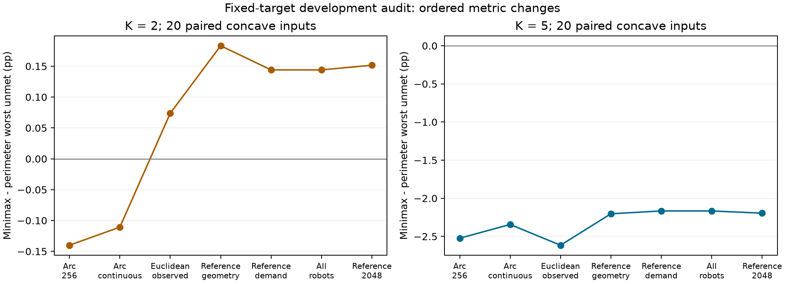
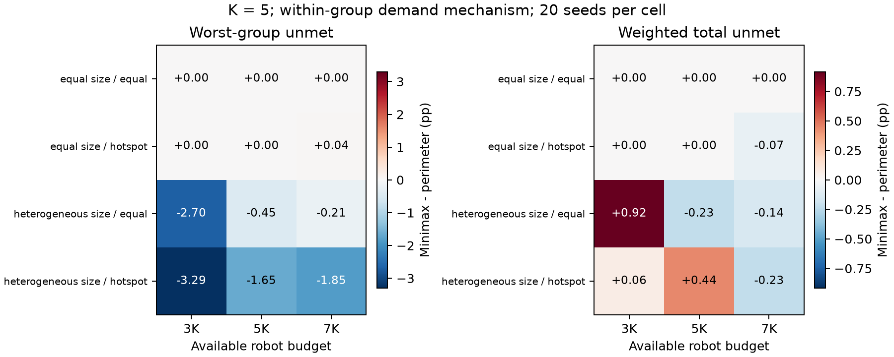
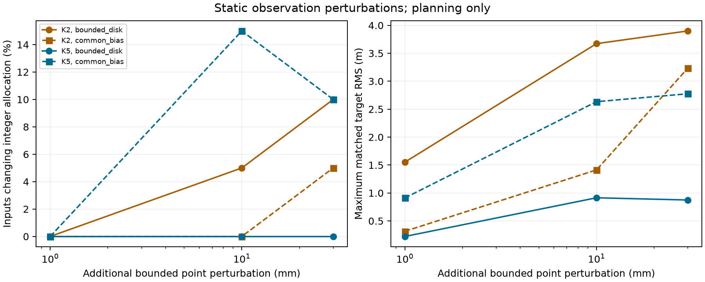

# Step 1 服务机制、误差与静态扰动实验

日期：2026-10-27；实验周期始于2026-10-26。
本报告为开发分析。原 v2 的17,280行独立确认使用另一目录、原冻结目标及源码快照。
本文件不将正在执行的确认当成已完成结果。

## 本轮已经回答的问题

1. 原规划优势为什么可能在真实参考评价上翻转？固定目标后，弧距/欧氏距与估计/参考几何
   的变化足以引起翻转。积分精度也可能显著影响观察目标的收益，跨群服务不是本批反例原因。
2. 多群分配收益是否只由群体数决定？新实验固定K后，群间尺度与群内需求形状改变收益；
   同尺寸、群内均匀的条件出现零差异。仅整体放大一个群的需求不会改变归一化群缺口。
3. 能否从静态直接进入反复重规划？微小观测扰动能引起米级目标重排；
   分群稳定不保证候选选择或整数分配稳定，需进一步设计切换机制。

## 实验和分母

| 研究 | 设计与结果 | 证据范围 |
|---|---|---|
| 固定动作分解 | 172条，86配对，原规划指标重算最大误差0 | 已有开发数据，不新增独立确认 |
| 机制v1 | 1,920条；K2/K5、大小2档、群需求倍率2档、预算3/5/7K、4分配器、20seeds | 40独立种子块，80位置配置，160加权输入；仅规划 |
| 机制v2 | 1,920条；独立新种子；群内均匀/热点，固定平均每人需求 | 同上；仅规划 |
| 静态微扰 | 320条，40物理输入、两种基线误差、4档附加扰动 | 240个非零扰动对比；仅规划 |
| 压力v1 | 原计划60条，记录2条后停止，58条未执行 | 近墙初始人体—机器人冲突；原证据完整保留 |
| 压力v2 | 60/60；41安全部署完成部分服务，19分离条件拒绝，完整成功0 | 20种子块、3场景；实际运动 |

机制v1/v2分群错配0、程序异常0；新增总需求DP和minimax各自在其声明观察目标上对
其他分配器的劣化数均为0。该性质不意味着公共真实参考目标也最优。
所有方法共享候选、相位机会与预算；`total`在相同目录中直接最小化总需求缺口。

## 固定动作分解

固定相同机器人目标，按预先声明的顺序逐项改变度量；下表是最差群体未覆盖比例的
minimax减按周长，单位为百分点，负值表示改善。每列为凹形20个配对均值。

| 评价阶段 | K2 | K5 |
|---|---:|---:|
| 原观察弧距、256点 | −0.1401 | −2.5237 |
| 观察弧距、连续积分 | −0.1107 | −2.3434 |
| 观察几何、欧氏距、本群 | +0.0738 | −2.6157 |
| 公共参考几何、观察需求映射 | +0.1831 | −2.2032 |
| 公共参考几何、精确需求映射 | +0.1440 | −2.1663 |
| 所有活跃机器人共同服务 | +0.1440 | −2.1663 |
| 原公共参考2048点评价 | +0.1516 | −2.1952 |

这是有顺序、存在交互的望远镜分解，不是唯一的因果归因。
参考几何变化同时包含位置扰动、保守误差膨胀及边界构造变化，不能全称为传感器误差。
K5椭圆seed1200的原观察优势−1.956个百分点，在连续观察弧距下为−0.442，
换成公共参考几何欧氏服务后变为+1.434，最终原评价为+1.216。

172条结果中公共参考2048点与连续模型的单方法最差缺口最大绝对差为
0.1676个百分点，配对方法差值的最大变化为0.1831个百分点；
未发现本批样本中“采样完整覆盖而连续模型有缺口”的情况。
连续计算对声明折线/线性密度解析积分，使用float64，不是浮点认证或真实人体行为保证。
全批未发现跨群服务贡献，但0.75m安全分离条件本身仍不能证明服务半径1m时不存在跨群耦合。

## 哪些异质性产生收益

整体将一群需求乘以c，归一化未覆盖比例满足U(cρ)=U(ρ)。因此机制v1的群间需求倍率
主要改变总需求权重，不能等同于群内热点形状。机制v2进一步改变群内上x四分位热点，
每群平均每人需求仍为1；位置和归一化误差抽取在两条件间一致。

机制v2、K5、预算5K、20配对的连续公共参考结果如下：

| 大小 | 群内需求 | 最差缺口变化 | 总加权缺口变化 |
|---|---|---:|---:|
| 相同 | 均匀 | 0 | 0 |
| 相同 | 热点 | 0 | 0 |
| 不同 | 均匀 | −0.454个百分点 | −0.226个百分点 |
| 不同 | 热点 | −1.653个百分点 | +0.443个百分点 |

结论限定在这组凹形模板和规划条件：大小差异提供资源重分配机会，群内热点可改变收益及代价；
不能概括为群数越多越好。所有预算、K2、零差异和退化条件保存在CSV，未按方向删除。
新`total`比较器是观察目录上的总体服务基线，不能当作真值最优oracle。

## 分群稳定与目标敏感性

320条中分群变化0，所有对应分群证书满足；240个非零扰动对比中，9个出现资源数量变化。
最大实际人员位置误差0.109809m，小于声明0.12m。
附加1mm扰动的一个资源数量不变案例，目标最小匹配RMS达到1.551975m：
K2/seed1515，资源仍为[5,5]，所选相位从[2,5]变为[1,1]。
重构目标与保存目标逐位相同，见[target_jump_diagnosis.json](target_jump_diagnosis.json)。
这是全批1mm、资源数量不变案例的描述性极值，不代表平均情况。
同一K2/独立误差条件的1mm目标RMS中位数仅0.001607m。
该案例两群曲线Hausdorff变化至多0.002688m、弧长起点位移至多0.003735m，
所以米级目标差不是边界整体米级移动的结果。逐相位重算确认原有限目录赢家发生切换，
详见[curve_origin_diagnosis.json](curve_origin_diagnosis.json)与
[phase_ranking_diagnosis.json](phase_ranking_diagnosis.json)。

该结果属于静态解映射的敏感性；动态振荡和稳定性仍需时序实验。
另保存1cm扰动使2群合成1群的显式阈值反例，该反例的充分稳定证书不成立。
理论条件、证明与边界见[服务契约](../../docs/STEP1_SERVICE_AUDIT.zh.md)。

## 压力测试及初始失败

压力v1的近墙场景，机器人7与人员18初始中心距0.31891083364136275m，
规定中心距0.75m，净裕量−0.43108916635863725m；执行区间数0。
执行器返回INITIALIZATION_INVALID，外层按既定初始安全规则记SAFETY_VIOLATION并停止。
原始文件和[精确诊断](pressure_v1_initial_state_diagnosis.json)保留，未调容差或删除失败。

压力v2另用新种子与所有场景相同的下侧墙均匀初态，只读取场地和预算。
基准20/20、近墙20/20均安全到达部分服务目标；近群19/20拒绝，1/20完成部分服务。
全批41次执行、31,694完整区间，记录安全违反0；完整任务成功0/60。
这说明当前分离准入条件会限制近群适用域，不证明被拒场景物理不可达。
20次零违反也不是安全概率认证；区间不能作为相互独立试验计数。

## 对Step 1的评价

静态多群基线、独立真值验收与可复核的部分服务实验已经成立。
本轮进一步给出了反例解释、连续模型评价、资源机制和静态敏感性证据。
真实参考服务的统一误差界、总服务代价受控的方法、目标切换机制仍需研究。
原v2确认继续回答其冻结的条件规划效应问题；补充完整分母的缺失识别界不替换原主统计量。
正式确认完成前，不宣称全矩阵优势或独立论文验证完成。
