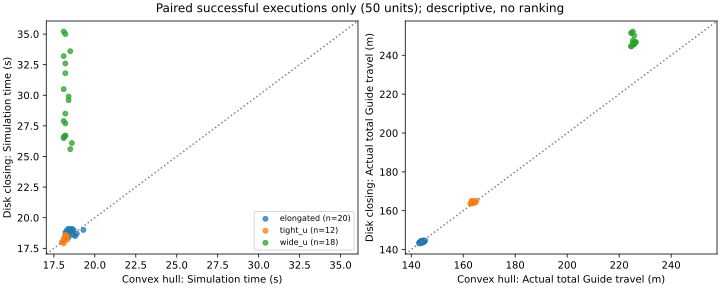

# Step 1 边界构造比较 v1：seed55–74 完整配对实验

2026-10-19，在 `Major-Research-Branches` 的干净提交 `3220233acf75dbd2a3a9cc28b8f91fab9f2e1255` 上完成。**60 个共享输入、120 行全部有终态；101 条实际部署全部成功并通过独立复判。** 共同人员／房间合法输入为 M=51：凸包 51/51，圆盘闭运算 50/51。另有 9 个共同输入拒绝（18 行）及 1 行圆盘边界拒绝；没有程序错误、中断、未执行行或安全违反。没有改变算法、阈值或配置，没有择优重跑。

这是预先固定 seed55–74 的完整比较，区别于上一轮 16 行协议开发检查，以及更早 seed35–54 的协议重建与开发回归。本批未用于边跑边调。51/51 是本批观察结果，不表示总体真实成功率为 100%。

## 版本、环境与事前冻结

科学执行提交为 `3220233`；YAML 的 `baseline_commit: 0ef6e1f` 指目标域一致性算法基线。`protocol.json` 的 provenance 是上一轮准备时的 `0ef6e1f + dirty`，其中源码哈希与最终交付完全一致；本轮没有改写它来伪装当前提交。实际开始时干净、逐执行任务 commit=3220233、源码一致的证据分别保存在 [execution_preflight.json](execution_preflight.json)、[execution_lock.json](execution_lock.json) 和原始逐任务 metrics 中。最终本地交付提交只新增分析与验证记录。

| 锁定项 | SHA-256 |
|---|---|
| `src/udc/**/*.py` 与 pyproject 的既有来源哈希 | `002fde3c5310dc6e32a67d16d760061a6f1919dde1a0de0e74894819532ce448` |
| 比较 YAML | `1c1650a80b2e653e560fc7b5f37301bd32918a9f1bb75a5b266fcec1a03d33b3` |
| v3 生成协议 YAML | `da5f865559db28095175ef6992cd1744319219251c7b21a2c6fdb7a60736c3f7` |
| 基础执行 YAML | `63c2b5392d3162b4984583fc4c1fa1136645f2ff9faa95509efc3924caffd89f` |
| 完整输入冻结记录 `future_inputs_frozen.json` | `dd6d122e2961527be91f9a218f4923f7886de58ee20773a0134eece3f0aa1910` |
| 120 行预留 manifest | `6ee50b8306f59ba6e3cb6ab4fc5ef3e0be4ee90a4ed8a4945f4fb1012fb8ac87` |
| 输入文件哈希映射的规范 JSON 摘要 | `c5c079066f56aa34048c3e7b1bde4a0985ddd0e4895d63f7c0d82fcf6bf4d02f` |

沿用 `E:\udc-wt\venv312\Scripts\python.exe`，Python 3.12.15；实际 `udc` 导入 `E:\Adaptive-Guide-Agent-Deployment-for-Unknown-Dynamic-Crowds\src\udc\__init__.py`。NumPy 2.5.4、SciPy 1.18.1、Shapely 2.2.0（GEOS 3.14.1）、JuPedSim 1.4.2、PedPy 1.5.1、PyYAML 6.0.3、pytest 9.1.1，未升级依赖；本轮 `pip check` 通过。源码、依赖及锁定配置未变，复用上一轮 **148 passed / 23.28 s** 的测试记录，没有重跑 16 行试运行或历史回归。

本轮实查 CPU 注册表名称为 i9-14900KF，psutil 检出 24 物理核／32 逻辑处理器、68,463,685,632 B（63.762 GiB）内存；预检可用约 49.0 GiB。6 worker、每 worker 数值线程 1。运行中直接读取父进程和六个 worker 的环境，`UDC_PRIORITY_STALL_COUNTERFACTUAL=0`，OMP／OpenBLAS／MKL／NumExpr 均为 1，见 [live_worker_environment.json](live_worker_environment.json)。101 条执行 metrics 中反事实亦全部关闭。完整线段与顶点交接开关使用原默认启用值。

生成前在限定的 configs／experiments、runs manifest／seed 路径、reports JSON 范围重新核查：没有协议外真实使用，本协议仅有上一轮预留清单，尚无 future 输入或执行目录。核查原件保存在预检和冻结记录中，报告引用见 [fresh_seed_audit_before_freeze.json](fresh_seed_audit_before_freeze.json)；旧 `seed_audit.json` 是上一轮准备时记录。随后仅调用一次 `--freeze-future`：先保存全部 60 个输入、SQLite、配置、随机流及冻结记录，逐个核验之后才启动估计器。每个场景—seed 只抽一次，无重抽或移动人员。随机流为 `SeedSequence([20261019, scene_index, seed]).spawn(3)`，人员、Guide 与未使用随机性的优化器流隔离。输入是本批前瞻冻结的新数据，不是旧原始确认数据的恢复或重建。现在 seed55–74 已被本批实际使用，后续不能再当作未用新 seed。

[input_map_60.json](input_map_60.json) 给出每单元的两条任务、N、原文件路径、文件／数组／配置／SQLite 哈希、各数组字节哈希与随机流记录；[input_references.json](input_references.json) 和 [pairing_checks.json](pairing_checks.json) 保存执行引用及两法配对核查。运行前完整核验记录为 `runs/step1_boundary_estimator_protocol/future_freeze_verified_before_results.json`，运行后所有冻结文件哈希仍一致。

原 `future_manifest_120.json` 的 `inputs_generated:false` 和 YAML 的 `run_in_this_round:false` 均保留，前者描述上一轮准备时点，后者描述上一轮工作范围。本轮用户明确授权完整执行，没有临时改科学配置；实际冻结与执行状态以 `future_inputs_frozen.json`、`future_freeze.json`、`future_summary.json` 为准。

## 比较契约与分母

研究问题是同一批合法精确全局观测、同样 Guide 资源及下游规则下，边界构造对整个部署流程的影响。两法输入均为人员中心、逐人半径、需求、Guide 初态和房间；N 固定 elongated=11、tight_u=13、wide_u=19，不按曲线长调整。

凸包对逐人半径圆盘求凸包。圆盘法先求圆盘并集，以 0.30 m 做膨胀—侵蚀闭运算，再与原圆盘并集合并。配置 `quad_segs=16`，源码实际为 `max(16,32)=32` 段／象限；凸包圆盘也是 32。完整占据集保留孔洞／分量用于描述；控制器取外环，可能填孔；多分量不会选最大分量或回退凸包。两法外偏移均为 1.3 m、round join、32 段／象限，约 0.10 m 等弧长采样，再按原折线弧长插值。原独立几何验收的人员圆盘使用 16 段／象限；该表示与完整 32 段占据参考分开保存。

部署固定 Equal Arc、常曲线密度、legacy phases `[0,.25,.5,.75]` 原顺序；仅当原目标静态入域失败时触发 `static_domain_phase_v1` 的 256 个整体相位，保持原曲线、数量、循环 gap、成对距离、静态入域和原需求评价。原目标与最终目标分别保存。导航、指派、安全过滤、联合进展恢复、优先模式监测及独立验收均未改。搜索未找到不是不可行证明，本批未发生该类失败。

冻结标准仍为中心距 0.75 m、墙距 0.55 m、数值容差 1e-7 m、额外导航裕度 0.11 m、规划 gap 1.94 m、执行 gap 2.0 m、速度上限 1 m/s、400 步／40 s、恢复预算 3，以及原到达保持和贴线条件。其他 Guide 的临时占据不参与永久静态目标入域判定。

主分母是人员／房间合法的 **51 个共同输入**；边界或下游失败仍在分母。全计划单元另报 60，双方成功的 50 个单元仅用于连续量配对分析，不替代主分母。估计器输出不进入共同物理安全真值；两法各自曲线与导航域不同，是此实验的流程效应。

## 120 行逐阶段结果

| 阶段终态 | 凸包（计划 60） | 圆盘闭运算（计划 60） |
|---|---:|---:|
| 共同人员输入拒绝 | 9 | 9 |
| 边界／曲线无效 | 0 | 1 |
| 数量必要条件违反 | 0 | 0 |
| 目标几何搜索失败 | 0 | 0 |
| 静态入域／相位搜索失败 | 0 | 0 |
| 初始指派／路径失败 | 0 | 0 |
| 执行恢复／协调／超时失败 | 0 | 0 |
| 最终到达／贴线／覆盖失败 | 0 | 0 |
| 安全违反 | 0 | 0 |
| 程序错误／外部中断／尚未执行 | 0／0／0 | 0／0／0 |
| 完整成功 | **51** | **50** |

全计划输入下分别为 51/60（85.00%）和 50/60（83.33%）；共同合法主分母下为 51/51（观察值 100%）和 50/51（98.04%）。全 120 行合计 101 SUCCESS、18 INITIALIZATION_INVALID、1 BOUNDARY_INVALID。所有通过前置检查的任务均执行，没有人为额度导致的 NOT_EXECUTED。阶段拒绝只有所需静态快照／状态工件，没有实际运动区间；其路程、部署时间和物理安全判定均为 null，不能解释为零成本或“安全通过”。

| 场景 | 计划共同输入 | 人员合法 M | 共同输入拒绝 | 凸包成功/M | 圆盘成功/M | 双方成功 | 仅凸包 | 仅圆盘 | 双方失败 | 未决 |
|---|---:|---:|---:|---:|---:|---:|---:|---:|---:|---:|
| elongated | 20 | 20 | 0 | 20/20 | 20/20 | 20 | 0 | 0 | 0 | 0 |
| tight_u | 20 | 12 | 8 | 12/12 | 12/12 | 12 | 0 | 0 | 0 | 0 |
| wide_u | 20 | 19 | 1 | 19/19 | 18/19 | 18 | 1 | 0 | 0 | 0 |
| 合计 | 60 | **51** | 9 | **51/51** | **50/51** | **50** | **1** | **0** | **0** | **0** |

Δ=(仅圆盘成功−仅凸包成功)/M = −1/51 = **−1.9608 个百分点**；wide_u 为 −1/19=−5.2632 个百分点，其余场景为 0。本批仅一个不一致配对，不作总体优劣或显著性结论，也不将 120 行当作独立人员样本。未给出 bootstrap／置信区间，不用全成功或退化区间宣称真实成功率为 100%。

完整行表为 [status_ledger_120.csv](status_ledger_120.csv)／[tasks_120.csv](tasks_120.csv)，含输入哈希、阶段、原因、是否执行、版本和缺失运动指标；60 单元联合表及分场景统计见 [analysis.json](analysis.json)、[paired_statistics.json](paired_statistics.json)。共同拒绝仅来自人员圆盘重叠：tight_u seed56、57、58、61、65、68、70、74，以及 wide_u seed69；均未重抽。

## 双方执行且成功的配对连续指标

以下差值均为 **圆盘闭运算−凸包**；实际路程是所有 Guide 的保存坐标逐区间位移范数之和。没有用最近安装路径长度替代。每个场景—seed 保持配对，统计子集为 50 对；排除了共同输入拒绝和圆盘 wide_u70 的边界拒绝，仅限这些连续量比较。

| 场景 | 配对数 | 仿真时间差：均值／中位数 s | 实际总路程差：均值／中位数 m | 恢复次数差：均值／中位数 |
|---|---:|---:|---:|---:|
| elongated | 20 | +0.265／+0.300 | −0.081558／−0.000501 | 0／0 |
| tight_u | 12 | +0.075／+0.050 | +0.698157／+0.830590 | 0／0 |
| wide_u | 18 | +11.405556／+10.750 | +21.771057／+20.626749 | +2.500／+3 |
| 合计 | 50 | +4.230／+0.400 | +7.972515／+0.765185 | +0.900／0 |

wide_u 的时间差范围 [7.1,17.1] s、路程差范围 [19.904542,26.910549] m。配对均值仿真时间为凸包 18.244444 s、圆盘 29.650 s；路程为 225.448588 m、247.219646 m。圆盘 18 例中 15 例触发既有协调并用满 3 次恢复，均最终成功；其余三例及所有凸包任务恢复为 0。该现象是较凹几何、目标、路径和协调一起变化的总影响，时间差不能单独归因于控制器。恢复事件与协调激活保存在 [execution_events.json](execution_events.json)，没有新增重放。

| 场景 | 配对数 | 总任务墙钟差均值 s | runner 墙钟差均值 s | 边界构造差均值 s |
|---|---:|---:|---:|---:|
| elongated | 20 | +0.211841 | +0.054801 | +0.030117 |
| tight_u | 12 | +0.459496 | +0.100507 | +0.067286 |
| wide_u | 18 | +3.829496 | +3.138315 | +0.080593 |
| 合计 | 50 | +1.573634 | +1.175836 | +0.057209 |

计算成本来自同机 6 worker 条件下既有事件计时，包含不同几何、预检、实际执行、独立复判和操作系统调度；不是纯求解器 benchmark。总任务差值也不等于控制器耗时。Equal Arc 没有增加迭代求解预算，未运行 pairwise 优化。完整运行墙钟 **49.776156 s**，各行 runner 墙钟相加约 202.768466 s（并行任务，不能当批次墙钟）。相位触发的单例政策成本约 0.230315 s。逐阶段可得成本及缺失值见 [timing.json](timing.json)，没有大量重放补齐计时或跨机器性能比较。



## 边界结构、资源及静态入域

所有 51 个合法输入的两法完整占据集均为单 Polygon；本批无 MultiPolygon，不等于系统已支持多分量。凸包全部无孔，圆盘 elongated 的 20 个占据集中 14 个有孔（孔数分布 0:6、1:6、2:5、3:2、4:1），tight_u／wide_u 无孔。控制器取外环，14 个有孔病例填孔，elongated 平均填孔面积 0.421890 m²、最大 1.255415 m²。完整占据集的周长包括孔边界，不能直接等同外环或部署曲线周长。

| 场景 | 完整占据描述配对数 | 额外包络面积均值：凸包／圆盘 m² | 部署曲线长度均值：凸包／圆盘 m | 原 N | 必要最小数量：凸包／圆盘 |
|---|---:|---:|---:|---:|---:|
| elongated | 20 | 4.098941／2.185812 | 20.628005／20.732853 | 11 | 11／11 |
| tight_u | 12 | 12.009439／1.012571 | 23.475467／24.091474 | 13 | 13／13 |
| wide_u | 19 | 22.683965／1.213458 | 28.074728 (n=19)／35.697301 (n=18) | 19 | 15 (n=19)／19 (n=18) |

额外面积均按同一合法输入的人员圆盘并集参考计算，包含 wide_u70 的完整占据描述；该参考不是唯一真实群体边界，额外面积只描述保守包络选择。周长、面积、凹形结构与孔洞的完整分布见 [analysis.json](analysis.json)。

曲线长度仅对成功构造的曲线定义，不能给拒绝曲线补值。双方曲线都有效的配对长度差均值为 elongated +0.104849 m（20 对）、tight_u +0.616007 m（12 对）、wide_u +7.624273 m（18 对）。wide_u 的凸包数量下界 15 而固定有 19，圆盘下界已达 19；这说明相同 N 下圆盘保留凹部增加了资源负担，与后续更长路径及协调开销相伴，但不是单因素因果分解。全部 101 条有效曲线的数量必要条件成立，独立的目标、路径和执行检查也实际通过；数量条件本身不是充分可行证明。

凸包全部曲线在静态保守域内。圆盘有三条原曲线存在正长度非法弧段，交运算遍历原折线全部边：

| elongated seed | 非法弧总长 m | 最大穿透下／上界 m | 原目标入域 | 相位触发 |
|---|---:|---:|---|---|
| 61 | 0.480417126 | 0.229162391／0.229167391 | 通过 | 否 |
| 63 | 0.775956664 | 0.141775567／0.141780567 | 通过 | 否 |
| 72 | 1.049363657 | 0.246628239／0.246633239 | 目标 4、7 拒绝 | 是 |

非法弧长来自几何差集，不用稀疏采样推断全曲线合法；只有最大穿透使用步长 ≤1e-5 m 的距离诊断及 1-Lipschitz 上界，最大未采样误差 ≤5e-6 m。完整原弧坐标区间、边号及交点均在逐行 `protocol_metrics.json`。没有删除非法弧、重新闭合或缩短曲线；61／63 原目标恰好避开禁区，仍沿原曲线定义覆盖。

72 的原目标 4、7 有符号距离分别为 −0.240314072、−0.136349925 m，前者连物理自由域都不覆盖，不能解释为微小浮点接触。既有 256 相位搜索选择 **+0.325805339 m**，保留原 L=20.851541698 m 与周期顺序，所有 gap≈1.895594700 m，目标几何、静态入域、初始路径与独立验收通过，18.6 s 成功、0 恢复。常数密度代价前后均为 0.299439867（仅该曲线内部指标）。两法采用完全相同的触发规则；凸包触发 0/51，圆盘触发 1/50 条有效曲线（或共同合法主分母 1/51），并非只为圆盘增加预算。

## 严格覆盖拒绝与本批失败层次

唯一估计器拒绝是 **wide_u seed70／disk_union_closed**，人员合法、占据集单分量且无孔，在 `estimate_disk_union` 的“占据外环严格覆盖每个 16 段人员圆盘”处失败。没有进入数量、目标、导航或执行阶段；不能把它称为执行失败或资源不足，也不能用搜索不可行解释。源代码中的原覆盖标准保持不变。

离线读取已保存 WKB 与全精度输入，未重新规划或执行，定位到人员索引 16（从 0 开始）：中心 `[15.931227462464868,15.838028154200485]`、半径 0.2 m。严格 `covers=False`、DE-9IM `212101212`；该 16 段圆盘与提取外环的差集面积为 **1.5777218104420236e-29 m²**、残片边长总和约 7.948233542814273e-14 m，未覆盖顶点距环约 7.240456129215212e-16 m。全精度残片 WKT 和顶点坐标保存在 [failure_evidence.json](failure_evidence.json) 与该任务 `confirmation_coverage_audit.json`。证据将失败定位到严格覆盖的表示／数值边界，而非人员大范围漏包；尚未建立新的稳健几何契约或修复证明。

还需区分更普遍的表示差异：完整 32 段占据参考下，凸包严格覆盖 51/51，圆盘严格覆盖 **0/51**，但双方全部差集面积为 0；这不把圆盘的严格谓词改判为真。成功安装的控制器外环按原 16 段逐圆盘标准为 101/101 真，拒绝的 wide_u70 为假。每个任务分别保存完整占据集、控制器外环表示／哈希、严格谓词、差集面积与未覆盖人员证据，见 [coverage_predicates.json](coverage_predicates.json)。浮点几何下“差集面积为零”不替代严格覆盖，成功率继续遵守预先冻结的验收定义，没有追认该拒绝成功。

人员输入的 9 个拒绝属于既有生成器的一次抽样约束限制。其他合法输入没有目标搜索、数量或路径失败。wide_u 圆盘的 15 次协调病例虽消耗 3 次恢复，均在预算内完成；没有新的系统性执行终止失败。保持全部原失败工件，不在这批确认输入上修复、调参、换 seed 或择优重跑。

## 全量独立复判与核验

每行在独立任务目录写 `reevaluated_metrics.json`，主进程收集汇总，没有并发覆盖共享复判文件。120 行 criteria 全一致，已保存的诊断量也全部一致；101 条真实轨迹均独立通过九类验收（几何、资源、规划、路径、安全、到达、贴线、gap、覆盖）。19 行前置拒绝的空运动验收只保留拒绝语义，不当作执行安全或成本。

分析脚本另按原始坐标直接实现区间解析最近距离：Guide—人取运动线段最近点，Guide—Guide 取同一时刻相对线段最近点，矩形墙距取区间两端最小值；未调用控制器安全过滤或用估计器几何充当物理真值。101 条共 **20,635 个区间**，与原共同物理指标的距离逐项误差小于 1e-12 m，轨迹初态／人员／半径／需求／房间与冻结输入逐坐标相同，路程及实际时钟相同。实际最大区间速度为 1.000000000000025 m/s，按原数值容差通过。

未经截断的最小安全残差：Guide—人 **+0.021587082282034986 m**，Guide—Guide **+9.90463766559202e-9 m**，墙 **+0.44999999999999996 m**；全部区间无违反。约 1e-8 m 的 Guide 裕量表示约束接近活跃，不能宣称有充分鲁棒余量。物理安全之外，原离线 evaluator 保留自身曲线上的到达保持、贴线与完整 gap／覆盖判定，未用其他估计器曲线替代。

在线 metrics、原离线复判均原样保留；追加的 `confirmation_interval_audit.json` 每任务独立保存直接坐标审计。汇总见 [independent_audit.json](independent_audit.json)、[verification.json](verification.json)。不存在需解释或覆盖的在线／离线不一致。全部文件校验见 [raw_checksums.json](raw_checksums.json)；原始输入／目标／WKB／路径／轨迹／事件的唯一存放位置为 `runs/step1_boundary_estimator_protocol/future_inputs` 与 `future`，报告未复制整个 runs 或原轨迹。通用汇总器附带的 `baseline_boundary_preservation.json` 在本批为空：旧 seed35–54 没有本批55–74的匹配曲线，不构成任何历史数组复现声明。

## 可复制操作与验证范围

以下是本轮实际入口。`freeze` 与 `run` 各只运行一次；**当前目录已经完成，不应再次执行这两条，也不能调用 prepare 覆盖。** 若只需重建报告，运行最后两条。既有入口拒绝覆盖已存在的部分／完成执行目录；本批无中断，未实施额外恢复或重跑机制。

```powershell
Set-Location 'E:\Adaptive-Guide-Agent-Deployment-for-Unknown-Dynamic-Crowds'
$py = 'E:\udc-wt\venv312\Scripts\python.exe'
$out = 'runs/step1_boundary_estimator_protocol'
$env:OMP_NUM_THREADS='1'
$env:OPENBLAS_NUM_THREADS='1'
$env:MKL_NUM_THREADS='1'
$env:NUMEXPR_NUM_THREADS='1'
$env:UDC_PRIORITY_STALL_COUNTERFACTUAL='0'
& $py -m pip check
# 本批已完成；以下两步仅记录首次运行命令，不可对当前目录重跑。
& $py -m udc.experiments.boundary_comparison --freeze-future --output $out
& $py -m udc.experiments.boundary_comparison --run-future --output $out --workers 6
# 从保存证据重建汇总，不生成输入、不执行部署、不替换在线结果。
& $py reports/step1_boundary_estimator_protocol/summarize.py --root $out --phase future --output reports/step1_boundary_estimator_comparison_v1
& $py reports/step1_boundary_estimator_comparison_v1/analyze.py --root $out --output reports/step1_boundary_estimator_comparison_v1
git diff --check
```

本轮分析脚本在全部原始记录上通过断言：120 个唯一任务、60 个唯一输入、冻结文件不变、执行源码／提交一致、反事实关闭、无重复或未执行任务、区间安全、实际速度、配对输入、实际时间和路程一致。新增报告代码不改科学源码，因此未用新增测试数量代替证据核查，也未重跑已有 148 项测试；报告脚本编译与 diff 检查通过。没有迁移环境、升级依赖、运行历史矩阵、validation5000–5029 或正式1620任务。原协议报告与试运行工件保持不变。

## 结论边界与下一轮唯一优先方向

固定资源下，凸包在本批合法输入上少一次严格边界拒绝；圆盘闭运算的额外包络面积较少，同时宽 U 曲线明显更长、必要数量更高、协调和实际执行成本更多。它们是可同时成立的描述，不压成单一排名。不同曲线原始规划代价不用于跨法排名；更凹不自动更有效，成功率更高也不自动更接近真实群体边界。没有真实边界标签，不增加 IoU／边界误差排名。精确全局观测、常曲线密度、静态 Step 1 的结论不能外推到噪声、风险降低、动态 containment 或一般收敛。

**下一轮只优先澄清并验证严格圆盘覆盖的几何表示契约**：以保存的 wide_u70 拒绝及 51 个圆盘的 32／16 段覆盖差异为证据，界定可复核的表示／数值处理，再决定是否需要最小修复。该重复出现的表示差异应先解释清楚；本轮确认表保持冻结，任何后续修复后重跑只能记开发回归。暂不启动需求加权交互、第三估计器、其他部署算法、场景／规模扩展或 Step 2/3。
