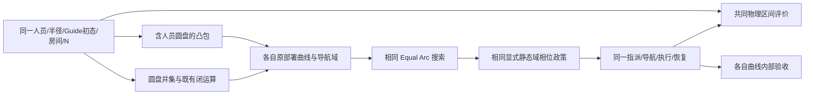

# Step 1 边界构造比较协议 v1

2026-10-19，Asia/Tokyo。协议已通过指定的 **8 个开发输入、16 行任务、4 条完整部署** 检查。没有生成 seed55–74 的输入，没有运行未来 120 行，也没有运行 pairwise、热点、第三种估计器或额外资源档位。

代码基线是 `Major-Research-Branches` 的 `0ef6e1f`，开始时工作树干净。既有 seed51 修复和重建开发回归仅作接口基线，不把它们改称原始独立确认复判。

## 1. 研究问题和比较口径

主问题：**同一批合法人员观测、相同 Guide 资源和下游规则下，边界构造如何影响可部署性、资源负担、执行成功和部署成本？**

当前提供全局、精确、静态人员位置与半径，比较的是边界表示／构造选择对整个部署流程的影响，不是感知噪声下的估计误差，也不是纯控制器比较。估计器输出改变占据环、部署曲线和导航几何；域哈希不同是需要观察的结果，不要求相同。实际安全始终由共同人员、半径和房间评价。没有真实群体边界标签，不做边界误差或 IoU 排名，不宣称未知几何、真实风险或 containment 已解决。



配置为 [boundary_estimator_comparison_v1.yaml](../../configs/step1/boundary_estimator_comparison_v1.yaml)，入口为 `python -m udc.experiments.boundary_comparison`。边界适配放在现有 `udc.boundary` 接口，未建立平行控制或评价框架。

## 2. 两种构造的准确契约

两种方法均读取相同的人员中心、逐人半径和已知房间。试运行人员半径均为 0.20 m；凸包实现没有忽略半径。

| 配置名称 | 当前实际函数 | 构造定义 |
|---|---|---|
| `convex_hull` | `estimate_boundary` / `occupied_hull` | 每人以自己的半径建立每象限 32 段圆盘，取全部圆盘顶点的凸包；全部半径为零时才走中心点凸包分支 |
| `disk_union_closed` | `estimate_disk_union` | 配置 `quad_segs=16`，实际使用 `max(quad_segs,32)=32`；先圆盘并集，再膨胀 +0.30 m、侵蚀 −0.30 m，最后与原圆盘取并恢复覆盖 |

两者均用 round 连接、每象限 32 段外偏移 1.3 m。沿原始偏移外环均匀弧长采样，点数 `max(32,ceil(raw_length/0.10))`。随后使用采样折线自身的累积弦长和分段线性插值，闭合缝回到首点。规划、相位搜索、覆盖评价都使用这条原规划折线，不能裁剪非法弧段再改变 L。

凸包为单个无孔 Polygon。圆盘闭运算保留全部构造几何以作描述：若占据区是 MultiPolygon，现有估计器在偏移前拒绝，不选最大分量，也不回退凸包。单个占据 Polygon 可以含孔洞；1.3 m 偏移结果若仍含孔洞或不支持的几何则拒绝。成功后 `Boundary.crowd` 保存占据区外环，控制器由该外环构造的 Polygon 填满原孔洞；因此报告分别记录完整构造区域和控制器外环包络，不把两者混为一谈。部署折线还需通过有效性、墙距、包围人员和人员距离检查；圆盘法沿用原 16 段圆盘覆盖谓词。

代码只抽取了原有圆盘／闭运算步骤供统一描述，未调整其几何计算。试运行中五个可生成圆盘边界的 `crowd/deployment/arc/length` 数组与上一轮保存的边界逐项相同，见 [基线保持检查](baseline_boundary_preservation.json)。凸包适配与直接调用原函数的数组一致，并有不同人员半径的测试。

严格覆盖谓词和差集面积分开保存。此次凸包完整覆盖 32 段参考圆盘；圆盘闭运算的 32 段 `covers` 严格谓词为 false，而参考差集面积为 0。不能用面积 0 替代严格覆盖结论。五个成功产生曲线的圆盘案例均通过原控制器外环对 16 段人员圆盘的覆盖检查；tight_u seed41 被该原检查拒绝。协议保留这些差异和拒绝，不增加容差使其通过。

## 3. 固定资源和共用下游规则

固定 N：elongated 11、tight_u 13、wide_u 19。同一场景—seed 两构造共用人员、半径、需求、Guide 初态、房间、N，以及同一份执行配置。新目录仅保存输入引用和统一 Equal Arc 配置；原 NPZ、SQLite 不复制。参考文件、统一配置及 SQLite 的哈希全部锁定，运行时核对。

部署只使用 **Equal Arc + 显式 static_domain_phase_v1**，常数曲线密度，不引入需求热点。保留原 Equal Arc 的 legacy phase 顺序 `[0,0.25,0.5,0.75]`，即 `s_i=(i+phase)L/N mod L`，这里 phase 以一个站点间隙为单位；后处理的整体相位另以米记录。先按原几何要求选择第一套可接受目标。数量必要条件单独记录，不能通过按估计器调整 N 使它成立；几何搜索耗尽不记为不可行证明。

只有原目标静态入域失败时，才调用原 `admissible_phase`：固定 256 个覆盖原周期的整体相位，保留数量、循环 gap pattern、原曲线和 L，重查闭合间隙、全部成对距及静态域。两构造政策相同，是否触发由其实际几何决定。有限搜索未找到配置只记为未找到见证。原目标、最终目标、各相位检查和时间分别保存；未触发时不声称改变了目标。

导航由各自占据外环构建：已知房间内缩 0.55 m，占据环 mitre 缓冲 0.55 m，simplify 0.10 m，再 mitre 缓冲 0.11 m。导航、指派、安全过滤、完整线段检查、联合进展恢复、优先模式进展监测和独立验收保持原实现；仅将已有 `estimated_convex_offset` 标签纳入给定曲线接口的合法来源名称。

固定人／Guide 中心距 0.75 m、墙距 0.55 m、数值容差 1e-7 m、额外裕度 0.11 m、偏移 1.3 m、规划间隙 1.94 m、执行间隙 2.0 m、最大速度 1 m/s、400 步／40 s、恢复 3 次。到达位置／速度阈值 0.03 m／0.03 m/s、保持 10 步、贴线容差 0.04 m 和原停滞窗口均锁定。代码准备和后续运行同时核查源文件、生成器与基础执行配置哈希。

## 4. 三类评价、失败和分母

**共同任务指标**：实际执行区间安全、最终到达、完整部署成功、全体 Guide 的实际轨迹路程、仿真时间、恢复及计算成本。`common_motion_metrics` 的接口不接收估计器占据环或边界真值，直接使用共同人员／半径／房间、实际保存位置和速度；路程是全部真实相邻帧位移的范数之和，不用最近安装路径长度代替。现有完整部署验收仍包括各自部署目标和原曲线要求，因此成功的含义是该构造产生的整条部署任务完成，不是固定同一目标的控制器性能。

**边界与资源描述**：32 段人员圆盘并集作为物理占据参考，记录覆盖谓词、差集面积、分量和孔洞、有效性、占据面积及含孔洞边界的周长、部署折线面积和长度、相对参考圆盘的额外包络面积、相对凸包的凹形面积、控制器外环填孔面积、数量上下界及严格非法弧段。额外包络面积描述建模保守程度，不叫估计错误。圆盘并集不是唯一真实群体边界。

**曲线内部指标**：原曲线弧坐标、弧间隙、常密度求积代价、相位变化，用于检查该曲线上的部署要求。两条不同曲线的原始规划代价不作直接排名。原 runner 还保留既有 Gaussian 需求诊断，但本协议采用的规划／相位密度是常数；单位人员需求不被解释为常曲线密度的推导或风险模型。没有综合评分。

主统计单位为场景—seed，主分母是人员圆盘不重叠、位于合法房间内的共同输入单元。人员输入无效时共同拒绝，且不调用估计器。估计器曲线／目标／路径失败留在共同合法分母里。程序错误另列并留在任务表中。每行保存 metrics、trajectory、state、config、planning 和独立复判；构造、目标和路径证据另存，不覆盖历史结果。

本轮 8 个计划输入中 7 个人员合法。由于只允许 4 条执行，其余已通过规划的行是 **未执行、部署结果未知**；运动指标为 null，不能当作零路程、零违反或失败。两构造完整部署成功率因此都为 null：凸包为 2 个已知成功、5 个未知；圆盘闭运算为 2 个已知成功、2 个阶段失败、3 个未知。不能写成 2/7 的完整部署成功率，更不能用执行子集的 2/2 替代主要成功率。

后续完整 120 行全部执行或阶段终止后，按共同合法分母报告各构造成功分数，以及配对联合表：双方成功、仅凸包成功、仅圆盘成功、双方失败。配对成功分数差为 `(仅圆盘成功数−仅凸包成功数)/共同合法单元数`，有未执行单元时保持缺失。时间与路程差只在双方都实际执行且成功的配对子集计算，按场景分别描述并明确子集大小；不把两估计器当作独立人员样本，不用该子集替换主要成功率。试运行联合表为 2 个双方成功、5 个未决，不作推断或排名，见 [配对统计](paired_statistics.json)。

## 5. 16 行实际协议检查

所有输入均引用上一轮 `reconstructed_v3` 已保存的冻结快照，来源是协议重建，不是缺失原始确认数据的恢复。本轮没有重新抽样。

| 输入单元（固定 N） | 凸包 | 圆盘闭运算 |
|---|---|---|
| elongated 36（11） | 规划、目标、路径通过，未执行 | 同左，未执行 |
| tight_u 36（13） | 规划、目标、路径通过，未执行 | 同左，未执行 |
| wide_u 36（19） | 规划、目标、路径通过，未执行 | 同左，未执行 |
| elongated 51（11） | 执行成功，未触发后处理 | 原目标入域失败，后处理 −0.080997074 m 后执行成功 |
| wide_u 35（19） | 执行成功 | 执行成功 |
| elongated 35（11） | 规划、目标、路径通过，未执行 | 占据区为两分量 MultiPolygon，BOUNDARY_INVALID |
| tight_u 35（13） | 共同人员输入无效 | 共同人员输入无效；两侧均未调用构造 |
| tight_u 41（13） | 规划、目标、路径通过，未执行 | 原占据外环圆盘覆盖检查拒绝，BOUNDARY_INVALID |

汇总：4 SUCCESS、8 NOT_EXECUTED、2 BOUNDARY_INVALID、2 INITIALIZATION_INVALID；16 行均有工件并独立复判一致。共同合法单元中，凸包 7/7、圆盘闭运算 5/7 通过初始路径检查。这是本组开发案例的阶段可执行性，不是部署成功率或总体接受范围估计。

| 共同输入 | 凸包 L / 必要 N下界 | 圆盘闭运算 L / 必要 N下界 | 实际 N |
|---|---|---|---|
| elongated 36 | 20.367737 m / 11 | 20.487885 m / 11 | 11 |
| tight_u 36 | 23.469398 m / 13 | 24.173036 m / 13 | 13 |
| wide_u 36 | 28.078417 m / 15 | 35.723812 m / 19 | 19 |
| elongated 51 | 20.621299 m / 11 | 20.735251 m / 11 | 11 |
| wide_u 35 | 28.034650 m / 15 | 35.616713 m / 19 | 19 |

圆盘构造的资源负担与凸包不同，本身是结果；没有为凸包减少或为圆盘增加 Guide。所有成功构造曲线均满足数量必要条件，仍需目标和路径检查。圆盘 elongated51 保留原约 0.053147610 m 非法弧段；两方法其他成功构造曲线的严格非法长度为 0。相位只在这一个圆盘单元触发，几何并未裁剪。

面积同样体现构造选择：wide_u35 相对人员圆盘参考的额外占据面积，凸包约 22.470768 m²、圆盘闭运算约 1.224100 m²；不能将前者直接叫边界错误。elongated36 圆盘占据区域有两个孔洞，控制器外环另外填入约 0.670202 m²，完整占据区额外面积约 2.211798 m²、控制器外环额外面积约 2.882000 m²。完整描述和缺失值见 [16 行 CSV](tasks_16.csv)。

## 6. 最多四条实际部署

| 输入／构造 | 仿真时间 s | 实际总路程 m | 恢复 | 到达／区间安全 |
|---|---|---|---|---|
| elongated51 凸包 | 18.5 | 143.362603 | 0 | 通过／无违反 |
| elongated51 圆盘闭运算 | 18.9 | 144.391115 | 0 | 通过／无违反 |
| wide_u35 凸包 | 18.3 | 226.998578 | 0 | 通过／无违反 |
| wide_u35 圆盘闭运算 | 27.7 | 245.798212 | 3 | 通过／无违反 |

四条均通过既有独立验收及共同物理区间复核，实际输入和目标逐坐标配对一致。最小 Guide 净裕量出现在 wide_u35 圆盘法，约 1e-8 m，表示约束接近活跃，不能称为充分鲁棒裕量。两对的“圆盘减凸包”时间差为 0.4 s、9.4 s，路程差为 1.028512 m、18.799634 m；只描述这两对，不作正式估计器或控制器排名。

全部 16 行串行、一个 worker、数值线程为 1，墙钟 17.58 s。本轮没有运行任何 pairwise 优化。原 Equal Arc 无迭代求解，256 相位后处理本例约 0.115 s；另存构造、描述、整曲线诊断、Equal Arc、相位、预检导航、runner 和离线复判时间。预检和独立验收会重复必要的路径检查，故 runner 墙钟不是单纯控制算法耗时。早期拒绝之后的计时缺失，不填零。见 [timing.json](timing.json)，不作跨机器性能比较。

## 7. 未来 120 行清单与冻结操作

已准备 [future_manifest_120.json](future_manifest_120.json)：3 场景 × seed55–74 × 2 构造，60 个共享输入、120 行，N 仍为 11／13／19。只含标识、资源和估计器，不包含新人员、Guide、目标或轨迹。seed55–74 在限定的配置、实验、runs manifest／seed 路径、报告 seed 元数据核查中没有发现既有使用；本协议自己的预留清单不作为历史使用，详见 [seed_audit.json](seed_audit.json)。未来冻结时必须再次核查，发现占用立即停止，不能根据本轮结果换 seed。

未来输入复用既有生成协议：`SeedSequence([20261019, scene_index, seed]).spawn(3)`，场景顺序 elongated、tight_u、wide_u；人员扰动标准差 0.04 m，Guide 在原内缩周界上 ±0.35 m 弧长扰动和 0.012 相位。每单元只抽一次，人员／Guide 流隔离，不按构造结果重抽。单位人员需求保持原值，但规划密度显式为常数。

后续显式 `--freeze-future` 才会抽取并先保存全部 60 输入，写入文件／数组／SQLite／配置哈希及流记录；在此之前不会运行任何估计器。`--run-future` 必须已存在完整冻结记录，并逐行核对源代码、配置、输入及数据库。人员拒绝仍有两行，构造拒绝不改变 N、不删除配对单元。当前源码和配置锁变化会拒绝执行，需建立新协议版本或新 attempt，不能覆盖旧证据。未来完整运行最多 6 worker、每 worker 数值线程 1。

## 8. 测试、版本和复现命令

沿用 i9 的 uv Python 3.12.15，实际导入本仓库；NumPy 2.5.4、SciPy 1.18.1、Shapely 2.2.0、JuPedSim 1.4.2、PedPy 1.5.1，没有升级依赖。实查逻辑处理器 32、物理核 24、可见内存约 63.762 GiB。

试运行源码哈希：`002fde3c5310dc6e32a67d16d760061a6f1919dde1a0de0e74894819532ce448`；比较配置哈希：`1c1650a80b2e653e560fc7b5f37301bd32918a9f1bb75a5b266fcec1a03d33b3`。生成器和基础执行配置哈希、环境、逐输入引用及原始工件校验见 [environment.json](environment.json)、[input_references.json](input_references.json)、[raw_checksums.json](raw_checksums.json)。

完整测试 **148 passed / 23.28 s**，pip check、compileall、git diff 检查通过。新增测试覆盖不同人员半径、直接原函数输出保持、双方输入映射、共同拒绝、多分量拒绝、静态域／相位政策、跨估计器不同域、失败分母及未执行缺失、真实运动区间物理安全、未来固定清单。没有以测试数量代替试运行。

本轮执行过的 PowerShell 命令（仓库根目录；prepare 要求全新目录，禁止覆盖）：

```powershell
$py = 'E:\udc-wt\venv312\Scripts\python.exe'
$out = 'runs/step1_boundary_estimator_protocol'
$env:OMP_NUM_THREADS='1'
$env:OPENBLAS_NUM_THREADS='1'
$env:MKL_NUM_THREADS='1'
$env:NUMEXPR_NUM_THREADS='1'
$env:UDC_PRIORITY_STALL_COUNTERFACTUAL='0'
& $py -m pytest -q
& $py -m pip check
& $py -m udc.experiments.boundary_comparison --prepare --output $out
& $py -m udc.experiments.boundary_comparison --run-smoke --output $out --workers 1
& $py reports/step1_boundary_estimator_protocol/summarize.py --root $out --phase smoke
& $py -m compileall -q src tests
git diff --check
```

以下仅为后续完整实验的操作说明，**本轮没有运行**：

```powershell
# 获得下一轮完整比较授权后，保持候选源码及配置锁不变。
& $py -m udc.experiments.boundary_comparison --freeze-future --output $out
& $py -m udc.experiments.boundary_comparison --run-future --output $out --workers 6
& $py reports/step1_boundary_estimator_protocol/summarize.py --root $out --phase future --output reports/step1_boundary_estimator_comparison_v1
```

当前运行目录保留唯一输入引用和本轮派生工件，Git 保存源码、配置、测试和汇总。未创建 backups、未复制整个 runs、未迁移虚拟环境、未覆盖历史结果；完成后只做本地提交，不推送或合并 main。

## 9. 是否具备完整比较条件

**已具备按冻结协议准备和执行完整比较的条件。** 两估计器接入相同下游、资源和物理评价，16 行记账与四条执行均验证通过；未来 120 行清单和冻结／执行入口已准备，但新输入尚未生成。后续实际开始前须复核 seed 占用和版本锁。

适用限制保留：当前系统只支持单条有效闭曲线，圆盘构造的多分量／圆盘覆盖失败会成为结果；构造外环可能填孔；部分部署曲线可能与保守导航域不兼容；固定相位网格未命中不是不可行证明。没有共同真实群体边界，额外面积不等于估计误差。试运行只有两对成功执行，不能支持正式排名。下一步只按这份协议运行已预留的 120 行，不同时加入其他估计器、部署法、场景或资源档位。
