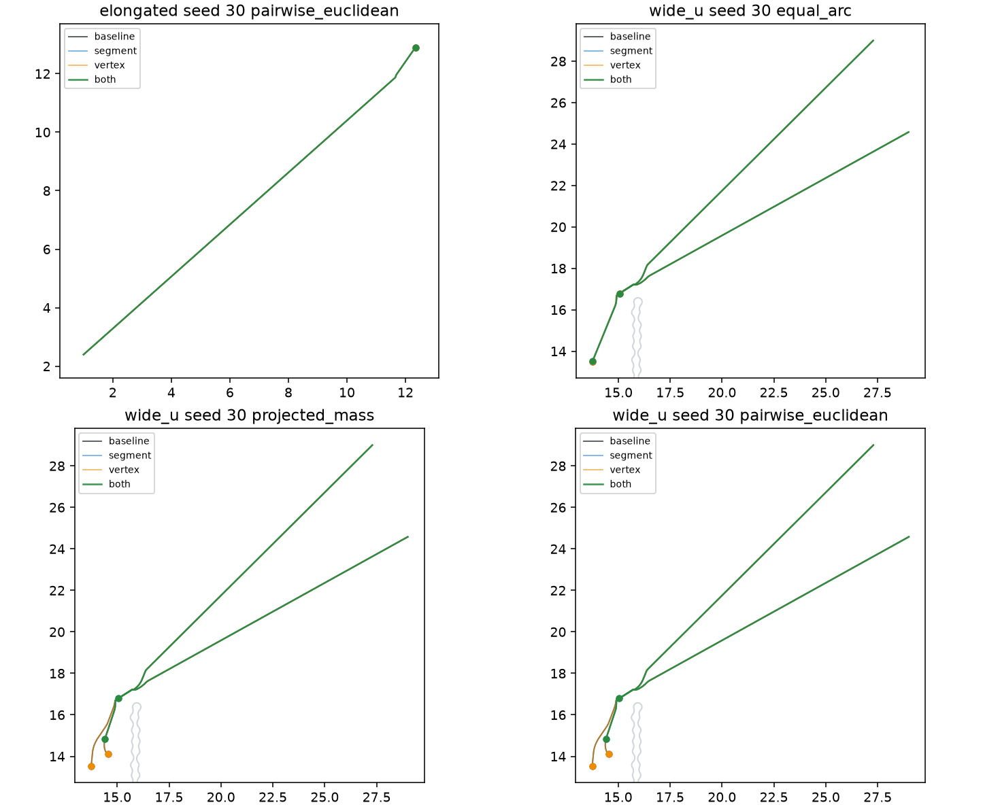

# 转角交接：完整线段判定与顶点到达

冻结执行版 `b6c9e0df`。上一批 `execution_progress` 轨迹只读：90 行里 60 成功、27 输入失败、3 次恢复耗尽。细长 seed30 成对方法是 19.1 s 成功、0 次恢复。本轮没有回退这些结果，没有新 seed，没有重做目标优化。

未进入候选的让行逻辑不在 `src/udc/` 的控制路径里。现有 `priority_yield` 仍是第三次恢复，名义速度只给优先 Guide。

## 完整连接判定

旧判定在 `free.covers` 失败、但线段仍在物理自由空间时，只看 0、0.25、0.5、0.75、1 五个点是否深过 1e-7 m。

宽 U seed30 组合运行里有一条实际被拒绝的弦：长 13.95 m，五个采样点的穿透都是 0，与保守障碍相交 0.69 m。沿弦以有符号距离复查，最深点穿透 0.081 m。这是稀疏采样漏检，不是更宽的自由空间。

新判定三步：

1. `free.covers` 为真则整段在自由空间内，含边界。
2. 线段离开物理自由空间则拒绝。
3. 否则计算线段在保守障碍内的部分，要求每一点到障碍边界的距离不超过原 `ENDPOINT_TOLERANCE_M` = 1e-7 m。同一条边同时盖住两端点时，由到凸集的距离在端点取最大；否则用 1-Lipschitz 上界或对分。不把 0.11 m 规划裕度当成安全距离，也不改人、Guide、墙的实际运动区间检查。

测试覆盖：窄凹陷和孔洞上采样点都合法的长弦、贴着边界的安装边、闭合边上的一段、1e-9 m 接触接受、1e-6 m 穿透拒绝。普通静态域的障碍边在第一次查询后复用，不每步重建可见图。

新旧判定不一致时写入 `segment_disagreements`，只追加记录。细长 seed30 成对方法记录了 138 次不一致，三种新版本的位置轨迹与基线逐坐标相同。记录没有改变这条已经成功的控制结果。

## 顶点到达

名义速度

\[
v_{\mathrm{nom}}=\min(v_{\max},\, d/\Delta t)\, u
\]

只在下面同时成立时计算：当前点到该路径顶点的整段连接合法，距离不超过原航点半径 0.05 m，下一条安装边从顶点合法、从当前点不合法。\(d=0\) 时沿安装边交接。速度随后仍受原最大速度、安全过滤和执行段检查约束。过滤后的剩余距离写进事件，下一步用真实位置重判。连接不合法时保持原比例命令，并继续用原有的 3 次恢复；本轮没有新的路径查询，也没有重置停滞计时。

贴近规划边界不再单独排除这条命令。边界是否可走仍由 1e-7 m 几何容差和原安全半平面决定。

仅顶点、仍用五点采样时，宽 U seed30 Equal Arc 的 Guide 4 在 14.7 s 首次改用该命令：名义速度 0.477 m/s，过滤后 0.394 m/s，规划边界约束的松弛约 \(10^{-9}\) m/s，并与 Guide 5 的间距约束同时接近活跃。24.0–24.7 s 过滤速度为 0，名义速度回到约 0.061 m/s 的比例命令。优先模式在 24.8 s 打开后，25.3 s 距顶点 \(8.2\times 10^{-8}\) m 并交接，随后沿下一条边以比例速度前进。26.8 s 预算仍耗尽：三次恢复在交接前已经用完。projected_mass 与成对方法仍在 30.4 s 耗尽。这只说明该命令在过滤允许时能走到这个顶点，不是有限时间到达的一般证明。

## 四例消融

两个场景—seed 输入，四个版本。基线轨迹复用 `execution_progress`，没有重跑。新版本各 4 条，共 12 次新执行。

| 版本 | 细长成对 | 宽 U Equal Arc | 宽 U projected_mass | 宽 U 成对 |
|---|---|---|---|---|
| 基线 `b6c9e0df` | 19.1 s 成功，0 次恢复 | 26.8 s 耗尽 | 30.3 s 耗尽 | 30.3 s 耗尽 |
| 仅完整连接 | 19.1 s 成功，逐坐标相同 | 26.9 s 仍耗尽 | 21.4 s 匹配失败 | 21.4 s 匹配失败 |
| 仅顶点到达 | 19.1 s 成功，逐坐标相同 | 26.8 s 仍耗尽，25.3 s 已交接该顶点 | 30.4 s 仍耗尽 | 30.4 s 仍耗尽 |
| 两项组合 | 19.1 s 成功，逐坐标相同 | 22.8 s 匹配失败 | 21.3 s 匹配失败 | 21.3 s 匹配失败 |

组合版本与仅顶点版本的首次坐标差都在 14.7 s、Guide 4。仅完整连接的首次差在 17.9 s、Guide 7：名义速度与基线相同，过滤速度从约 0.45 m/s 降到约 0.23 m/s。目标坐标差为 0。匹配失败的共同记录是：当前目标被其他 Guide 占据，接着原 `reachable_reassignment` 报找不到匹配。搜索失败仍不是不可行证明。



## 固定输入回归

候选是两项同时打开的源码。63 个有效执行任务全部重跑，复用 v2 的人员和全精度目标。另加重放原九案例和 v1 宽 U seed22 Equal Arc。27 个 `INITIALIZATION_INVALID` 没有重跑，也没有从 90 里删掉。

| 口径 | 成功 | 其他 | 分母 |
|---|---:|---|---:|
| 全部 90 行 | 48 | 27 输入失败，6 匹配失败，9 恢复耗尽 | 90 |
| 有效输入 | 48 | 15 个执行失败 | 63 |

全任务成功率 48/90，有效输入成功率 48/63。上一批对应数字是 60/90 和 60/63。63 条新轨迹独立复判与在线判据一致，包括 15 条失败。失败轨迹的 `safety_ok` 仍为真，未通过的是到达、曲线或覆盖。

原 60 个成功里 12 个变失败，全部是宽 U：

| 任务 | 原先 | 现在 |
|---|---|---|
| seed26 Equal Arc | 25.4 s 成功，0 次恢复 | 23.7 s 匹配失败 |
| seed26 projected_mass / 成对 | 25.5 s 成功 | 29.3 s 耗尽 |
| seed28 三方法 | 28.0 s 成功，2 次恢复 | 32.5–32.6 s 耗尽，指派与基线不同 |
| seed31 Equal Arc / projected_mass | 22.5 s / 24.9 s 成功 | 21.1 s / 20.7 s 匹配失败 |
| seed31 成对 | 25.9 s 成功 | 30.1 s 耗尽 |
| seed34 Equal Arc / projected_mass | 22.5 s 成功 | 27.5 s 耗尽 |
| seed34 成对 | 29.1 s 成功，2 次恢复 | 29.7 s 耗尽 |

39 个成功与基线逐坐标相同。另外 9 个成功仍成功：seed27 三方法时间不变，路程减少约 0.007–0.023 m；seed29 三方法时间不变，路程减少约 0.029 m，Guide 净裕量从约 \(2\times 10^{-5}\) m 降到约 \(3\times 10^{-6}\) m；seed33 三方法从 35.8 s 到 36.0 s，路程增加约 0.004 m，恢复仍是 1 次。这 9 个的目标坐标和指派未变。

原 3 个 seed30 失败都变成更早的匹配失败：Equal Arc 22.8 s，另两方法 21.3 s，各用 2 次恢复。没有一个变成成功。

原九案例：细长和窄 U 六条仍成功，时间与位置逐坐标相同。宽 U 三条从 36.2 s 成功、1 次恢复变为 31.1 s 耗尽、3 次恢复。seed22 Equal Arc 从 33.7 s 成功、2 次恢复变为 29.0 s 耗尽、3 次恢复；输入和目标坐标差为 0，人/Guide/墙净裕量 0.0458 / \(9.9\times 10^{-9}\) / 0.450 m。名义执行数 63+9+1=73，实际都跑了。

Guide—人、Guide—Guide 中心距 0.75 m，Guide—墙 0.55 m，数值容差 1e-7 m，规划间隙 1.94 m，执行间隙 2.0 m，400 步 / 40 s，恢复预算 3 次，最大速度 1 m/s。这些都没有改。约 \(10^{-8}\) m 的 Guide 净裕量只说明约束接近活跃。

## 测试与复现

新增测试：采样漏检的凹陷弦和孔洞弦、边界安装边、纳米级接触与微米级穿透、内部及边界上的顶点命令、非法连接不用限速直达、过滤后未到达不提前交接、最大速度和恢复预算保持、直线自由段仍用比例命令。原“边界上必须用比例命令”的断言已改成：边界上可以走向合法顶点，不能走非法弦。

`python -m pytest -q`：115 passed（26.39 s）。`python -m pip check`：No broken requirements found。消融 12 次新执行墙钟 15.1 s。回归 2 个进程、每进程 1 条数值线程，墙钟 84.7 s。

```powershell
.\.venv\Scripts\python.exe -m pytest -q
.\.venv\Scripts\python.exe -m pip check
.\.venv\Scripts\python.exe -m udc.experiments.corner_handoff --ablation --workers 2 --output runs/step1_corner_handoff_repair --report reports/step1_corner_handoff_repair
.\.venv\Scripts\python.exe -m udc.experiments.corner_handoff --regress --workers 2 --output runs/step1_corner_handoff_repair --report reports/step1_corner_handoff_repair
```

## 判断

剩余的 seed30 停滞不是单一原因。非法长弦来自五点采样。比例命令在最后几厘米过慢。安全过滤会把合法的顶点方向速度压到接近 0，规划边界半平面和 Guide 间距约束可以同时活跃。组合之后，原重指派在部分宽 U 上找不到匹配，失败比原先的耗尽更早。

完整线段判定应当保留，五点采样不能再当作控制判定。顶点限速命令可以保留为“连接已经合法时的名义速度”，它在 Equal Arc 的仅顶点运行里把该顶点走到了 \(10^{-7}\) m 量级，但没有让三个任务成功，也没有扩大预算。两项一起打开会让原来靠错误长弦和边界滑动完成的成功案例退化。这个退化要留在记录里。

门槛和预算保持原值。执行层现在没有进入边界估计方法比较的条件：固定输入上的成功率下降，三个目标停滞没有解除，也没有一般收敛结论。估计器比较、新 seed、RA-ABDC 和 Step 2/3 都不开始。
