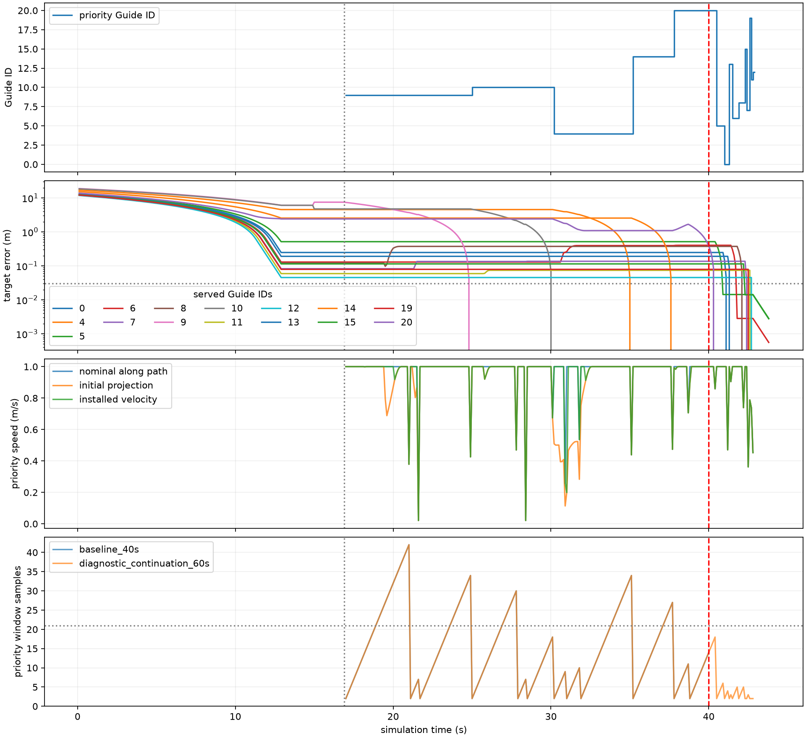

# Step 1固定超时：优先协调与40秒截止诊断 v1

**本案属于A类：当前冻结策略和嵌套初始化下的时间预算边界。未发现需要修复的实现、监测或路径一致性错误，也没有持续两秒的优先对象停滞。** 原40秒TIMEOUT被逐位复现；唯一一次自然延续诊断在43.8秒通过全部原物理验收，超过生产截止3.8秒。原确认275成功、84拒绝、1 TIMEOUT和I₂完全保留，没有改为276成功。

40秒时最大目标误差0.5142976515m来自**尚未服务的Guide5**；当时优先对象是Guide20，误差0.3858664999m。已交接的9、10、4、14均已在各自目标，误差0。主要时间花在原固定队列依次推进长路径，再服务尚未轮到的短路径，随后完成原保持条件；不是当前优先对象静止，也不是队列完成被错误当作任务成功。

## 1. 基线与冻结现场

分支Major-Research-Branches，起点efc9694e，工作区干净；原确认执行0433bb19、科学实现继承865e6a48。读取AGENTS、架构、确认报告、研究说明、失败索引，以及runner、恢复、优先队列、路径跟踪、窗口和联合速度求解源码。实际Python为本仓库`.venv/Scripts/python.exe`，udc来自本仓库`src/udc`，Python3.12.15及现有依赖不升级，无fetch、merge、push或main修改。

原确认包源码聚合SHA为`dcac16daf240271dd34e5694f4f127bbefbe2a9ffe687ab2384dff7327111169`。原68份执行Python文件逐文件匹配0433bb19规范化Git内容，并以当前原始字节hash继续保护。本轮仅新增观测／隔离诊断和分析模块；生产runner、控制器、进展监测、导航、安全和评价文件零修改。

运行前协议／配置／源码／测试提交为 **820a9c5f16d4843a049981cb66810554f5ae3a83**，干净后冻结20,414项历史文件引用。随后仅一次baseline_40s、一次diagnostic_continuation_60s，均从t=0开始，无检查点恢复、重试、新seed或目标优化。两次实际运行均记录同一clean提交、数值线程1及生产反事实0。

人员、半径、需求、房间、N21初态／ID、曲线、静态域、目标和初始指派／完整路径直接读取原唯一NPZ／YAML／计划，不从CSV或报告舍入值重建。Equal Arc身份按原manifest与冻结final plan核验；继承配置内默认method字段保持原值，原supplied-plan入口安装Equal目标，不重新调用布局。合法14.9秒重指派仍允许发生，原目标集合不变。

|冻结对象|SHA-256／值|
|---|---|
|原人员输入NPZ|5b92ec7c3b59b5b89df591a4500c41149e716dcac55ba69d0f1feab734e0850c|
|原N21 Guide NPZ|e2e84f530cb6eb58708e1c5f53e95f02f1da903119c660e934f68804c8154adb|
|原目标NPZ|5081c51df55e427c26516527f483b52ab305ebeff5364b59da38b84cad7b19a6|
|原初始指派NPZ|20d039137a18629753656bcf2fcb59cb9a8a74d14a4dcdb612ac8cc4a7979f07|
|原执行配置|bf9652994bc19514213eca21873557948dc32a4f14ff004a0da55dc50f7c8a47|
|原静态域几何hash|6cd7748c4626817e04bcff2ebdb754cadabc00918458d44d8866a17723b4827f|
|原TIMEOUT metrics|2f34d971bc3724c922093bee08bff00020ca3a30fbe171b7c20a1205e35f18ce|
|原轨迹NPZ|788c2651f442df09c416a3b1e5312c69d0cab5f39cd05198b72c30cead24d1f0|

[固定引用全集](fixed_scene_references.json)、[冻结摘要](freeze_summary.json)和原新目录protocol.json保留曲线、域WKB、需求和初始路径等其余hash。旧确认报告、统计及在线metrics均通过原hash保护。

## 2. 40秒确定性复现

baseline_40s使用原runner函数和原配置，仅观察super调用的原样返回；新观测没有修改名义／过滤速度、队列、窗口、路径或恢复选择。401个位置帧、400个名义速度、过滤速度和航点样本逐位相同，零首次差异。初始指派与每条完整路径精确相同；恢复事件、优先决策和参考变化在排除墙钟字段后完全相同。终止仍为40.0秒TIMEOUT、3次恢复、相同末态和物理验收失败。

|时刻s|既有动作|实际结果|预算已用／剩余|
|---|---|---|---|
|14.9|path_recompute|Guide5的target19被当前其他Guide占据，正确拒绝、无部分安装|1／2|
|14.9|reachable_reassignment|静态完整候选验证并原子安装，连续身份hash链通过|2／1|
|16.9|priority_yield|原队列／优先模式启用，不替换已安装路径|3／0|
|40.0|时间循环截止|仍安全跟踪，但未到达／贴线／覆盖|3／0|

14.9秒的合法身份变化仅交换Guide9与10的target14／15，观察日志中frame150表示[14.9,15.0]的第一条重指派后命令；不是额外15.0秒重指派。优先阶段未再重装路径或改变目标。原第二策略失败短路边界保持，本案第二策略已成功，所以它不是本案超时出口。

复现的真实总路程270.655936106m、每Guide12.888377910m。独立物理区间全部安全，但arrival、curve、gap和coverage为false；失败过程的40秒与路程不作为成功成本。[A复现摘要](baseline_40s_summary.json)、[A独立验收](baseline_40s_independent_rejudge.json)可核对。

## 3. 优先队列的逐对象进展与40秒身份

原策略在16.9秒按剩余路径降序冻结队列`[9,10,4,14,20,5,0,13,6,8,15,7,19,11,12,18,1,16,17,3,2]`。当前优先对象沿已安装合法线段请求进展，其余Guide名义速度为0，共同安全过滤可按需让行。观察到的顺序未循环、倒退或重排。

|Guide|优先服务区间s（延时段单列）|服务时间s|开始剩余折线m|结束剩余m|
|---|---|---|---|---|
|9|16.9–24.9|8.0|7.766702013|0|
|10|24.9–30.1|5.2|5.000957487|0|
|4|30.1–35.1|5.0|4.726936104|0|
|14|35.1–37.7|2.6|2.547401669|0|
|20|37.7–40.0（原截止）|2.3|2.642733564|0.385866500|
|20|40.0–40.4（诊断延续）|0.4|0.385866500|0|
|5|40.4–40.9（诊断）|0.5|0.514297651|0.014297651|
|0／13／6／8|40.9–42.2（诊断）|1.3|逐人见CSV|均≤0.03|
|15／7／19／11／12|42.2–42.8（诊断）|0.6|逐人见CSV|均≤0.03|

40秒时队列索引为4：已服务4人9/10/4/14均误差0，当前20误差0.385866500m；尚未服务的16人为`[5,0,13,6,8,15,7,19,11,12,18,1,16,17,3,2]`，其中10人尚在容差外。最大误差属于排在当前对象之后的Guide5，不属于已交接对象。完整21人误差与角色在[analysis.json](analysis.json)的at_40s中。

所有交接均以真实位置检查原0.03m容差，完整位置／误差在queue_handoffs中。诊断43.8秒范围内，未发现已交接Guide被再次推离容差；进一步按每帧相同目标身份核查，也未发生任何“已到达后又出容差”。14.9秒身份交换单列，不误算物理推离。让行运动确实存在，但本案不能归因为已完成对象被反复推开。

完整队列在42.8秒退出，原exit_reason为priority_order_within_tolerance、exit_outside_tolerance为空；18/1/16/17/3/2这六人当时已在容差内，被正确直接跳过。退出后恢复普通跟踪，小于容差的误差按原比例律继续收敛，同时累计保持；并没有把队列结束当成成功。

[逐帧时间线](diagnostic_continuation_60s_timeline.csv)、[全部对象服务表](diagnostic_continuation_60s_service.csv)及新runs中的frames.json、navigation_sets.json、events.json保留全精度位置、路径hash、航点与每Guide状态。首次实际轨迹差异仅来自原40秒后继续，0–40秒无控制差异。



红虚线为原40秒截止，灰线为16.9秒优先模式开始。误差按每帧真实指派计算；14.9秒身份交换可产生误差定义跳变，不是位置跳跃。图中后续服务没有改变原确认TIMEOUT。

## 4. 原20步监测没有错误刷新或隐藏停滞

原优先监测使用`(Guide ID, 航点索引, 单Guide路径hash)`作为参考；真实剩余折线从真实位置到当前航点，加其后路径段。每帧已从保存的真实坐标与完整路径独立重算，前后值与原参考一致，目标误差也逐帧精确相符。

40秒前共有12次参考初始化／变化；延续后共22次：1次初始、7次同对象航点变化、14次对象交接。7次同对象变化均为真实航点推进，没有同对象路径重装、无原因窗口清空或错误连续性刷新。对象切换时单Guide路径hash随身份改变，不代表又安装了整套路径。跨对象的剩余值跳变没有计作运动进展；同对象航点变化的路程差仅浮点舍入级。

原窗口成熟阈值为21个样本（20步／2秒），本案有67个成熟优先窗口，最小两秒下降1.922085163m，远大于原0.03m停滞门槛。不是窗口一直无法成熟。再跨同对象的航点变化累加每个真实区间的同参考减少量，显式排除表示跳变，最小两秒实际减少仍为1.783032679m；低于0.03m的同对象两秒窗口为0。最后若干短任务在两秒内已交接，其窗口不成熟是正常短服务，不能据此认定监测遗漏停滞。

原priority_path_stall返回值逐帧复算一致，priority_stalled帧为0；普通模式的均值／均速公式仅作为上下文另存，没有代替优先对象指标。全体均值受让行影响，不能用其抵消断言当前对象停止。生产priority_stall反事实开关始终0，抑制事件为空；本案没有绕过真实停滞终止。

[原窗口审核CSV](baseline_40s_window_audit.csv)、[延续窗口审核CSV](diagnostic_continuation_60s_window_audit.csv)及两个supplementary_checks.json提供无重置／无身份混算证据。

## 5. 投影、联合进展求解与活跃约束

原联合进展接口共调用30次，28次接纳、2次拒绝；预算仍MAXITER=80，没有新增求解器或额外试验速度。返回速度与实际安装速度逐位相同；拒绝时实际安装的仍是原基础安全投影，也逐位核对。

|区间s|当前Guide|原请求m/s|基础投影／实际安装m/s|拒绝候选的进展短缺m/s|线性行残差m/s|
|---|---|---|---|---|---|
|30.9–31.0|4|1.0|0.198929686|0.404300696|3.33e−16|
|38.7–38.8|20|1.0|0.891303804|0.055911125|0|

这两次原SLSQP均status8、6轮，候选按原速度球裁剪后没有满足请求进展的原1e−4m/s接纳条件，因此正确不安装；不能因线性行残差小就声称完整候选合格。它们也没有把当前对象变成零速度。30.9秒附近活跃规划边界和Guide4–20约束，联合链中还有20–6；38.7秒当前对象主要受规划边界限制。短暂限制不等于持续停滞，更不证明动态无解。

整个优先阶段，涉及当前对象的活跃记录为Guide–Guide47条、规划边界19条，人和墙0条（按原binding_constraints的1e−5m/s速度约束slack诊断门槛）。同帧可有多条，这些是记录次数，不可换算成可相加的时间损失。完整联合活跃约束、名义／基础投影／最终速度和原求解请求、残差、接纳保存在新runs；[查询表](diagnostic_continuation_60s_joint_queries.csv)和[活跃约束表](diagnostic_continuation_60s_active_constraints.csv)便于检查。

每个当前优先对象的真实起点到当前航点完整线段均通过原segment_in_free，全部实际命令线段检查也通过；静态域hash不变，未见失效路径索引或数值端点接纳失配。物理安全另对所有完整运动区间独立评价，未用静态路径检查替代。

## 6. 时间分解：顺序服务与最后保持

|互斥分类|原0–40s|延续0–43.8s|
|---|---|---|
|普通跟踪（优先模式前）|16.9s|16.9s|
|优先有效推进（按本报告分类）|22.1s|24.6s|
|优先短航点／末步|0.8s|1.1s|
|优先明显过滤限速|0.2s|0.2s|
|退出后普通跟踪，同时最终保持|0|1.0s|
|合计|40.0s|43.8s|

分类先取settled保持，再分普通／优先，优先中先取实际沿程速度低于原请求90%的区间，再取距aim≤原0.05m航点容差的短步，余为有效推进。转角与限速可以重叠，单独flag不额外相加。初始16.9秒包含0–14.9普通跟踪，以及14.9重指派后到16.9的原20步进展窗口；14.9／16.9的恢复在仿真时刻瞬间执行，其求解墙钟不是额外仿真秒。

优先阶段当前aim均合法，未进入非法aim的比例回退；沿合法线段请求的是原有限步长进展，主要耗时不是比例渐近。退出后普通增益1.5继续收敛残余误差，与最终保持重叠；初始普通阶段的比例趋近也已包含在16.9秒中，不再另加。

最初五个优先对象的开始剩余折线分别约7.767、5.001、4.727、2.547、2.643m，在原顺序下逐个处理，当前对象持续推进。40秒时还需约0.4秒结束20，后续短任务实际再用2.4秒，42.8秒退出队列。42.8–43.8普通跟踪与10步低速／到达保持重叠，共1.0秒，不是各算1秒。因而本次额外3.8秒可具体归为2.8秒剩余队列服务＋1.0秒原保持要求。

原基线runner墙钟4.5163s、观测与复判汇总5.0260s；延续runner4.0741s、汇总4.6007s。联合求解墙钟分别0.4170／0.4115s；三次恢复墙钟分别约0.2804/0.2029/0.0004s与0.2332/0.1670/0.0004s。它们受机器和观测开销影响，不能解释为仿真中对象花了这些秒推进，也不作为两次算法速度比较。

## 7. 唯一60秒上限诊断及独立验收

诊断机制在实验入口读取原runner.experiment源码，仅将原唯一step循环上界400改为600；恢复这个AST节点后与原完整AST相同。生产文件和config.yaml仍是400步／dt0.1／3恢复，其他安全、路径、停滞、预算和成功break完全保留。编译副本只用于本指定诊断，原函数仍为40秒。入口拒绝resume／planning-only，从t=0连续使用同一控制器对象；没有在40秒恢复位置、重置窗口或额外重排。

|核查|结果|
|---|---|
|0–40秒位置／名义／过滤速度／航点|逐位相同|
|400步完整相关控制与runner状态|队列、索引、路径、指派、预算、参考、样本、pending、hold与普通进展一致|
|恢复事件及身份链|仍3次，原同一合法重指派；没有第四次|
|原配置／输入／目标／曲线|精确相同|
|诊断截止上界|600步／60秒，未因结果再延长|
|实际诊断停止|438步／43.8秒，原成功分支触发|
|original_protocol_success|false|
|原确认状态／成功数|TIMEOUT／275，保持不变|

原评价器evaluate对40.0至43.8秒全部39个保存前缀独立重算，未新增运动执行；首次gap保持42.8s、curve及coverage保持43.7s、arrival／速度保持及全部标准43.8s。截止前每帧仍有Guide不满足到达容差，故没有更早的完整完成被忽略。队列退出比完整验收早1.0秒，是正确的保持语义。[39前缀核查](original_evaluator_prefix_checks_39.json)、[400步状态](cutoff_40s_state.json)和[自然延续审计](continuation_audit.json)保存证据。

诊断43.8秒末态最大目标误差0.002814842m、最大贴线距离0.002481858m、最大gap1.689689521m，九项原验收全部通过。全438个区间（含40秒后的38个）独立安全通过；最小人员／Guide／墙净裕量分别0.043109189m、9.9972163e−9m、0.45m。真实总路程273.225055886m、每Guide13.010716947m。基线400＋诊断438＝838个新评价区间存在重叠，不是838个独立样本，更不是新的确认任务。

## 8. 分类、未采用修改与条件性回归

|类别|本案证据与判定|
|---|---|
|A：安全推进但晚于40秒|成立。对象持续推进，43.8秒自然完成，主要解释为冻结顺序和原保持下的截止边界|
|B：队列／监测实现不一致|未发现。交接容差、参考变化、样本与原逻辑逐帧一致，窗口有成熟且不隐藏两秒停滞|
|C：路径／几何表示失配|未发现于本条轨迹。真实起点到当前aim及实际完整线段均合格，域与索引一致|
|D：真实停滞或循环|未观察到。队列单向退出，最小同对象两秒实际减少1.783m；两次短求解拒绝只是局部限速|
|E：60秒仍未完成／其他终止|未发生。未再延长，也未绕过任何其他出口|

本轮没有生产科学修复候选，不改速度、优先顺序、监测定义、接纳、安全或预算。按条件纪律，未启动十条小回归或276次固定目标执行回归；全量单元测试和这两次固定现场诊断不冒充开发回归。未发现错误不等于一般性证明没有错误，本结论只解释这一条冻结控制过程。

43.8秒晚到不证明40秒内不存在其他控制或队列，也不建议将全部生产任务统一放宽到60秒。更改排序或并行协调属于新的政策研究，不能包装成bug修复。本案允许以时间边界收拢，不为追求100%成功继续修补。

## 9. 测试、来源与命令

基线212 passed/26.17s；首五项诊断测试后完整217 passed/26.58s；补入口守卫后冻结前218 passed/30.21s；最终218 passed/25.21s。pip check无冲突、compileall和diff检查通过。一次新增测试插入位置错误导致NameError，发生在任何实验前，修正测试结构后上述全套通过；科学执行／诊断编排错误0。测试覆盖AST单节点差异、400前缀／原配置／队列窗口不重置、原非时间break、硬上限、拒绝resume、事件时间字段与身份／预算区分；继承的真实停滞、侧向运动不算进展、预算耗尽、安全拒绝／原子安装和非法身份审计仍通过。

本案未实际遇到延时阶段的真实停滞。保留此出口的证据来自原源码AST等价与既有停滞／预算测试，不能把本案的无停滞扩展成普遍收敛保证。人／Guide0.75m、墙0.55m、容差1e−7m、规划裕度0.11m、偏移1.3m、gap1.94/2m、速度1m/s、生产40s与恢复3，以及原到达／速度／保持／严格覆盖均不变。

|记录|值|
|---|---|
|诊断运行提交|820a9c5f16d4843a049981cb66810554f5ae3a83|
|含新增观测模块的UDC源码SHA|bb135b98b2121c90515352ddda0970e02a88bdf9221119ddc2d0116baf10ad88|
|新配置SHA|a25a063e3ae5e41dad1a16e55502022a0beddf312232af897a7ba084311f52ec|
|新protocol SHA|c9fa148cfd044d73d0d9baff3ec946e00ae10b188af6e814833e6ad3f178e22c|
|原runner.py文件字节SHA|99bb92ceecebd7d1651675de16a9ceca96b3f84d25e79b10cda84ef38b8db91a|
|原experiment函数文本SHA|72d1775d7fcbb98544bfc52bb2188c654fd14337d5ae5620994c36f613f85526|
|原AST／诊断AST SHA|见freeze_summary.json（仅上界一个节点）|
|历史保护／原源码文件|20,414／68，全部核验|

唯一新原始工件在`runs/step1_execution_deadline_diagnostics_v1/`。Git保存协议、配置、观测／分析／测试和报告，完整原始逐帧状态在新runs按hash引用，不复制整个历史runs或创建backups。环境见[environment.json](environment.json)，完整新工件hash见[raw_checksums.json](raw_checksums.json)，最终核查见[final_checks.json](final_checks.json)。

实际PowerShell流程如下，现有目录的两次运动均已完成，不应重试或覆盖；只读分析／导出与运动执行分开。

```powershell
$py = '.\.venv\Scripts\python.exe'
$out = 'runs/step1_execution_deadline_diagnostics_v1'
$env:PYTHONUTF8 = '1'
$env:UDC_PRIORITY_STALL_COUNTERFACTUAL = '0'
$env:OMP_NUM_THREADS = '1'
$env:OPENBLAS_NUM_THREADS = '1'
$env:MKL_NUM_THREADS = '1'
$env:NUMEXPR_NUM_THREADS = '1'
# 先提交820a9c5f并确认工作区干净
& $py -m udc.experiments.deadline_diagnostics --stage freeze
& $py -m udc.experiments.deadline_diagnostics --stage baseline_40s
# 从保存A工件先做逐帧只读分析，见baseline_readonly_analysis/
& $py -c "from pathlib import Path; from udc.analysis.deadline_diagnostics import analyze_attempt; p=Path('$out').resolve(); q=p/'baseline_readonly_analysis'; q.mkdir(); analyze_attempt(p,'baseline_40s',q)"
& $py -m udc.experiments.deadline_diagnostics --stage diagnostic_continuation_60s
& $py -m udc.analysis.deadline_diagnostics
& $py reports/step1_execution_deadline_diagnostics_v1/audit_export.py
& $py -m pytest -q --basetemp=.tmp/pytest-deadline-final
& $py -m pip check
& $py -m compileall -q src
git diff --check
```

## 10. Step 1收拢

本轮完成原TIMEOUT的可复现机制解释，不更改新输入确认：同N需求布局收益与主要资源交互得到相应批次支持，热点／背景和执行成本分开；当前策略仍有40秒时间边界。系统导航一致性修复与方法能力证据分开记账，晚到诊断不增成功率。

已整理[Step 1一页证据图谱](../../docs/STEP1_EVIDENCE_MAP.zh.md)。下一步可进入论文方法、结果与限制的证据整合，本轮不再启动控制补丁、新seed、大型矩阵或几何／规模／噪声／Step2/3。适用范围仍是三个固定模板、冻结需求、嵌套周界初态、静态单人群与精确全局观测；不宣称一般收敛、噪声鲁棒、真实风险／containment改善或完整RA-ABDC。
