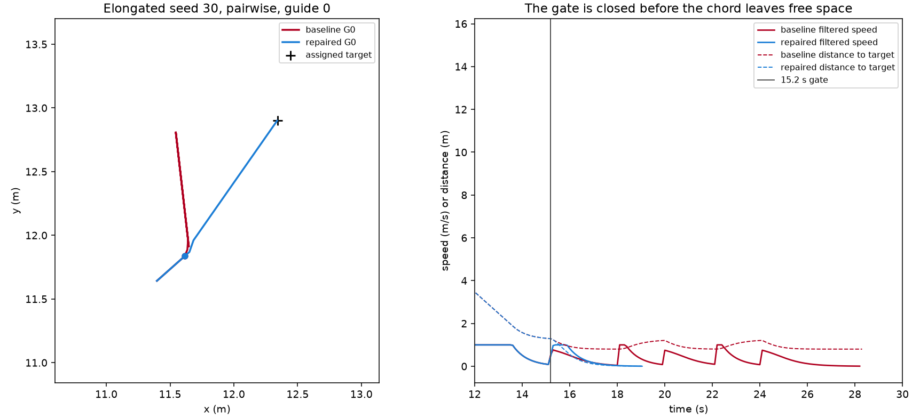

# 执行跟随修复：四例停滞与回归

冻结执行版 `a0781c56`，上一交付 `1e84283e`。本轮在其后继续，没有回退。原始 `runs/step1_nonconvex_confirmation_v2/baseline/` 只读。诊断重放与冻结轨迹的位置差为 0，源码哈希在诊断时未变。

## 四例首次失配

四个任务只有两个场景—seed 输入。诊断重放没有改变控制器决策。

细长 seed30 成对欧氏，Guide 0：

- 15.2 s 距路径顶点 1 为 0.0486 m，落在 0.05 m 航点半径内。到最终目标的长弦被 5 点采样判为合法，但下一步 0.1 m 样本离开保守自由空间。
- 安全过滤把速度从 1 m/s 压到约 0.54 m/s，引导贴着规划边界滑动。15.7 s 起当前位置到已选目标的连接不再合法。到 18.1 s 名义速度仍约 1 m/s，过滤速度降到约 0.045 m/s。
- 之后三次恢复都安装或进入优先模式，但跟随器继续追踪失效直连。28.3 s 预算耗尽。顶点 1 在失配时仍可合法连接，距离约 0.30 m。

宽 U seed30 三方法不是同一种失配：

- 16.9 s Guide 9 的长弦不合法，但即时步仍在自由空间内且过滤速度为 1 m/s，运动没有停。
- 随后多个 Guide 的名义速度被安全过滤抵消。Equal Arc 在 22.8 s 因当前占据失败后再安装静态路径；24.8 s 进入 priority_yield，优先 Guide 4 停在边界顶点外 0.041 m。
- 下一段从顶点本身合法，从任何偏离位置都不合法。比例增益使最后几厘米的速度低于停滞窗能承认的进展，2 s 后预算耗尽。projected_mass 与成对方法的优先对象是 Guide 9，同样在边界转角耗尽预算。
- 优先期间非优先 Guide 的名义速度为 0，过滤仍可给相邻 Guide 约 0.02 m/s。这不是静止保证，但也不是 Equal Arc 停住的主因：优先 Guide 的过滤速度已接近其名义速度。

## 修复与消融

候选修复只改自由空间内的航点切换。引导中心到规划障碍的有符号距离大于原数值容差 1e-7 m 时，航点前进必须同时通过原 `segment_in_free` 和即时步检查。若下一段只从顶点合法，而引导已在 0.05 m 半径内，则用一个不超过最大速度的执行步走到该顶点，不吸附位置，不扩大半径，不新装路径，不计入 3 次恢复预算。已经贴在规划边界上的引导仍用原规则。

让行改动做过，没有进入候选。把距优先 Guide 一个安全间距内的引导以最大速度推开，细长案例与基线逐坐标相同，宽 U 三例仍预算耗尽；和过宽的跟随规则一起用时，projected_mass 与成对方法变成更早的 `PATH_UNREACHABLE`。优先模式里把名义速度清零不能打开这个转角。因此不增加让行功能。

| 版本 | 细长成对 | 宽 U Equal Arc | 宽 U projected_mass | 宽 U 成对 |
|---|---|---|---|---|
| 冻结基线 | 28.3 s 耗尽 | 26.8 s 耗尽 | 30.3 s 耗尽 | 30.3 s 耗尽 |
| 仅跟随（候选） | 19.1 s 成功，0 次恢复 | 与基线逐坐标相同 | 与基线逐坐标相同 | 与基线逐坐标相同 |
| 仅让行（未采用） | 与基线逐坐标相同 | 仍耗尽，末态差 0.080 m | 29.6 s 仍耗尽 | 29.6 s 仍耗尽 |
| 过宽跟随加让行（未采用） | 19.1 s 成功 | 31.0 s 仍耗尽 | 21.4 s 路径失败 | 21.4 s 路径失败 |

细长成功的跟踪误差 0.00358 m，人/Guide/墙净裕量 0.749 / 0.821 / 0.450 m，实际路程 144.414 m，目标与指派未变。关闭跟随开关后四例与冻结轨迹的位置差为 0。



## 回归

v2 的 90 行用新标签 `execution_progress` 重跑，2 个进程、每进程 1 条数值线程，墙钟 61.9 s。输入、目标和部署算法没有重抽。结果 60 成功、27 输入失败、3 次恢复耗尽。27 行输入失败仍是 `INITIALIZATION_INVALID`，留在 90 的分母里。

63 条执行轨迹全部独立复判一致，包括 3 条失败。原 59 个成功没有变成失败。41 条执行轨迹与冻结基线逐坐标相同，其中包括 3 条未解决的宽 U 失败。21 条原成功轨迹改变，全部是宽 U：多数更早结束，恢复次数有的从 1 降到 0，seed28 三方法从 1 次路径重算变为占据失败后再做原有的可达重指派，Guide 9 与 Guide 10 的目标身份对调，目标坐标未变，九类判据仍通过。这是原恢复策略的结果，不是新的指派器。

另外 10 条保存轨迹：原九案例中细长和窄 U 六条逐坐标不变；宽 U 三条仍成功，时间 36.2 s 变为 28.1 s，恢复从 1 次路径重算变为同帧的占据失败加重指派。宽 U seed22 Equal Arc 仍成功，时间 33.7 s 变为 26.3 s，恢复从 2 次变为 0 次，目标坐标未变。合计 63+9+1=73 条执行，输入互不重复。

安全门槛、400 步、3 次恢复预算和覆盖阈值没有改。约 1e-8 m 的 Guide 净裕量仍只表示约束接近活跃。

## 测试与复现

新增 5 项：自由空间内拒绝非法即时步并在一步内走到顶点；边界上保持原比例命令；顶点上的合法安装边可以切换；优先模式不给其他 Guide 名义速度；预算耗尽仍记账且不另装路径。不安全安装和失败事件的原有测试保留。`python -m pytest -q`：107 passed（23.53 s）。`python -m pip check`：No broken requirements found。

```powershell
.\.venv\Scripts\python.exe -m pytest -q
.\.venv\Scripts\python.exe -m pip check
.\.venv\Scripts\python.exe -m udc.experiments.nonconvex_rebuild --spec configs/step1/nonconvex_confirmation_v2.yaml --output runs/step1_nonconvex_confirmation_v2 --run --tag execution_progress --workers 2
.\.venv\Scripts\python.exe -m udc.experiments.execution_progress --output runs/step1_execution_progress_repair/saved_replay_repeat
```

最后一条写到新目录，避免覆盖已经生成的 `saved_replay`。

## 未解决

宽 U seed30 的三种方法仍在边界转角耗尽 3 次恢复。完整静态路径已经安装，下一段只在顶点上可见，优先让行没有把引导在停滞窗内送上该顶点。本组不证明该转角不可达，也不把这 3 例记成成功。估计器比较和 Step 2/3 仍不开始。
