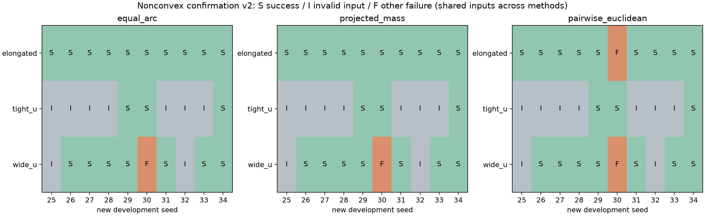
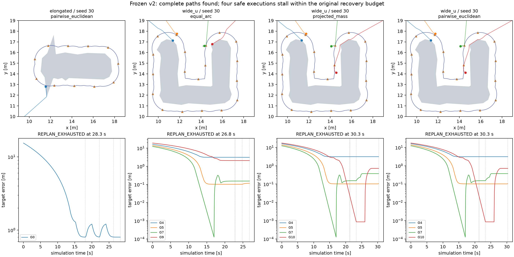

# Step 1 恢复语义验收与非凸新seed确认 v2

2026-10-19，Asia/Tokyo。新90行已全部完成：**59 SUCCESS、27 INITIALIZATION_INVALID、4 REPLAN_EXHAUSTED**。全任务成功率59/90=65.56%；30个共享输入单元中21个有效，有效输入下59/63=93.65%。63条执行轨迹全量独立复判一致，实际运动区间安全全部通过；4次执行失败仍未解决。程序错误、外部中断均0。

这批结果说明恢复判别和失败记账能够工作，同时暴露有限恢复的执行停滞边界。它不支持普遍收敛、安全鲁棒性或完整RA-ABDC贡献。丢失的历史45任务及原11次失败仍未恢复，不能追认已解决。

## 基线、修改与冻结

研究分支 `Major-Research-Branches` 从干净的 `ccb817a2` 接续，保留 `5562d11b` 等本地成果。远程地址仍为用户指定GitHub仓库；本轮未推送、未修改main。先核对重建v1的923份工件，全部匹配既有校验记录；没有重复生成或重跑该45任务。原九案例上一轮实际9/9成功证据保留，本轮没有把它们重复算作新样本。

必要修改保存在 **`a0781c56fdbc5eadddd9f7f84df721b6272f763b`**。冻结时工作区干净，90行均在这个提交运行，源码SHA-256为 **`222c501c170877429f77276c72c1bdbded1e4fa625743237522e71ca4f559a3d`**，没有批中改代码、调目标或择优重跑。最终交付仅增加文档、Notebook和只读报告，不改变该版本的源码、配置或测试。

沿用现有导航与三个恢复策略，补充以下必要语义：

| 条件 | 证据与处理 |
|---|---|
| 静态端点无效 | `static_endpoint_invalid`；在加入其他Guide临时障碍之前检查 |
| 静态域分量不同 | `static_components_disconnected`；结论限当前保守规划域 |
| 当前被Guide占据 | `current_guide_occupation`；记录占据者、端点距离、0.75m门槛；不保证未来释放 |
| 其他Guide造成临时分量阻隔 | `current_guide_barrier`；与静态分量分开 |
| 仅搜索失败 | `search_not_found`，`infeasibility_proven=false` |
| 实际状态不安全 | 查询前拒绝，`unsafe_actual_state`；不进入恢复运动 |
| 预算耗尽 | `budget_exhausted`事件；3次预算不增加，失败查询也消耗预算 |
| 完整候选集通过 | 全目标排列、全活动Guide路径、真实起点/目标端点、每条人/墙路径段先验证，再原子安装 |

每次恢复写入触发原因、实际位置、目标/指派、查询域、当前占据情况、查询/验证/安装三阶段结果、预算、前后全精度目标/身份/路径哈希、帧与时间。失败查询不会因提前异常漏记或部分安装。`priority_yield`复用已安装路径，不冒称新的查询/验证/安装。多Guide同时运动继续通过原速度过滤和独立区间安全检查；单Guide路径验证不等于多Guide联合执行保证。

有限验收复用已有测试，补齐静态端点/分量、未知搜索失败、持续失败有限终止、实际不安全、候选不完整/不安全拒绝原子安装等缺口。完整测试 **102 passed，15.93s**；uv检查71包兼容，`pip check`通过。新增8个实际测试用例，不为凑数量改测试。

另外只执行两个保存案例作语义验收，输出 `runs/step1_recovery_semantics_v2/`：宽U seed22 Equal Arc仍33.7s成功，先记录当前占据失败，再完整路径安装，消耗2次预算；细长seed20 Equal Arc无恢复、18.4s成功。两者位置、输入、目标和指派数组与先前修复逐坐标相同，独立复判一致。这两次发生在冻结前开发源码哈希`cacbd0f291d95816c1a1802789623536c82ce8f116cbdf2b30a65e0c39576dc6`，与90行冻结版本分开记录，不计为新输入单元。

## 协议和环境

配置：[nonconvex_confirmation_v2.yaml](../../configs/step1/nonconvex_confirmation_v2.yaml)。完整运行协议及环境见 `runs/step1_nonconvex_confirmation_v2/protocol.json`，30份输入和90行manifest在执行前冻结。冻结前本地3132个metrics记录未发现seed25–34；扫描范围是本地保存记录，不声称这些seed在所有主机从未使用。

每个场景—seed只生成一次。场景细长/窄U/宽U，人员16/22/26，Guide11/13/19，房间30m、人员半径0.20m、demand=1。人员坐标加入独立标准差0.04m高斯扰动；`SeedSequence([20261019, scene_index, seed]).spawn(3)`分别划分人员、Guide、优化器流，现有优化器确定性。Guide在已知房间的1m内缩周界 `(1,1)→(1,29)→(29,29)→(29,1)` 上按0.012周长相位和±0.35m独立弧长扰动生成。人员中心距不足0.40m直接记录三行输入失败，绝不重抽。

从本次人员观测生成1.3m圆盘并集曲线，闭运算0.30m、quad_segs16、采样0.10m，沿用常数曲线密度。三方法共享全精度输入及曲线，各自规划新目标；成对方法仍为7起点、每起点40迭代/20秒。没有复用旧seed目标。Guide/人0.75m中心距、墙0.55m、1e-7m数值容差、1.94m规划间隙、2.0m执行验收、贴线条件、400步/40秒、3次恢复预算均不变。

笔记本实查Intel Core Ultra7 258V、8核/8逻辑处理器、31.52GiB可见内存、Windows11；使用现有uv0.13.0与`.venv` Python3.12.15，editable导入本仓库。NumPy2.5.4、SciPy1.18.1、Shapely2.2.0、JuPedSim1.4.2；未升级依赖。先串行seed25九行（3成功、6输入失败），工件/配对核对后以2个worker完成81行，每worker数值线程1。一次运行中进程采样约270MiB常驻总量，只是采样，非整批峰值测量。

## 完整结果与独立评价

完整90行、结果、输入/目标哈希、时间、路程和裕量见 [tasks_90.csv](tasks_90.csv)；30个配对单元全SHA-256见 [paired_units_30.json](paired_units_30.json)；原始机器汇总 [summary.json](summary.json)，紧凑统计 [statistics.json](statistics.json)。原始输入、目标、轨迹和失败帧仍在runs，不复制到reports。

| 方法 | 全任务 | 成功 | 输入失败 | 执行预算耗尽 | 全任务成功率 | 有效输入下成功率 |
|---|---:|---:|---:|---:|---:|---:|
| Equal Arc | 30 | 20 | 9 | 1 | 66.67% | 20/21=95.24% |
| projected_mass | 30 | 20 | 9 | 1 | 66.67% | 20/21=95.24% |
| pairwise_euclidean | 30 | 19 | 9 | 2 | 63.33% | 19/21=90.48% |
| 合计 | 90 | 59 | 27 | 4 | 65.56% | 59/63=93.65% |

27行输入失败来自9个人员单元：窄U seed25/26/27/28/31/32/33，以及宽U seed25/32。其原始人员/Guide/配置快照和三行方法状态保留。沿用已有失败工件格式，这27份`trajectory.npz`仅保存t=0真实初态，`steps=0`、`executed=false`，目标为空、指派为-1、速度序列为空；它们是拒绝快照，不是执行轨迹，不计入63或伪造运动。其余21个输入单元对应63个任务；边界、数量、目标规划和初始完整路径全部通过。边界失败0、数量失败0、规划失败0、初始路径失败0、执行恢复失败4、仅最终验收失败0、程序错误0、外部中断0。

所有63条已执行轨迹均有独立`reevaluated_metrics.json`，成功与失败判定、准则一致数63/63，安全通过63/63。独立评价对每个恒速执行区间求Guide—人及Guide—Guide的解析最近距，并检查墙距，**不是只检保存帧**。规划域沿线检查与物理安全检查含义不同，不混为严格运动可行性证明。



三方法共享人员输入，独立人群样本单元为30而非90，条件有效单元21。常数密度下方法接近或某些目标/轨迹重合正常；不把上述描述性差异解释为方法优劣，更不作为需求加权优势证据。重建v1修复后36/45与本批59/90分别报告，不合并成独立正式验证。

## 四次失败的分层证据

全部失败集中于seed30，完整状态、目标、路径、域参数/哈希、恢复前后哈希及首次失配见 [failure_classification.json](failure_classification.json)。没有目标或身份映射变化；没有超出1e-7m端点数值容差的保存状态/执行线段离开保守域。后者由整条执行线段对容差扩张域的几何包含核对获得，不只检查最终异常。

| 场景/方法 | 时间 | 观察证据 | 结论与未解决部分 |
|---|---:|---|---|
| 细长 / pairwise_euclidean | 28.3s | 18.1s重算、22.2s静态完整匹配均查询/验证/安装成功；26.3s进入priority_yield；28.3s预算耗尽；末态无目标占据 | G0仍距目标0.80228m，导航与安全过滤后的执行路径不一致、停滞；不是搜索失败或静态不可达证明 |
| 宽U / Equal Arc | 26.8s | 22.8s当前Guide占据查询失败消耗1次；同帧静态完整路径验证安装消耗第2次；24.8s priority_yield；26.8s预算耗尽 | G4距边界航点0.002411m，下一段快捷连接不合法，安全速度约0.00370m/s；其他Guide占据仍持续，未证明能及时释放 |
| 宽U / projected_mass | 30.3s | 21.3s当前占据失败后静态完整路径安装；23.3s priority_yield；30.3s预算耗尽 | G4距同一边界航点0.03083m，下一快捷连接不合法；优先模式中其他Guide名义速度为0，过滤仍可施加安全修正 |
| 宽U / pairwise_euclidean | 30.3s | 与projected_mass相同的末态轨迹和恢复时刻，目标文件哈希分别保留 | 同类边界转角与安全协调停滞；不能算另一个独立人群单元 |

细长G0在24.1s从航点2切至最终目标时，直连检查通过；**24.4s开始**当前位置到已选航点不再满足保守域直连检查，安全过滤后的运动随后贴边停滞。末帧名义速度约1m/s，实际约0.00670m/s，安全投影残差3.53e-17。此处定位到执行路径跟随与安全层一致性，不表示原路径不存在；本轮没有凭这些观察直接改控制器。

宽U三例的目标当前位置被占据与静态完整路径存在可以同时成立。静态恢复没有改变身份映射，完整路径安装也未保证联合执行在预算内完成。当前有4次`current_guide_occupation`查询事件：其中1次对应最终成功的新任务，3次对应上述宽U失败。其余成功任务中的恢复不能据此解释为对照因果收益。

63个任务中18个触发恢复，其中14个最终成功、4个失败；27个独立触发帧，31条尝试/终止事件：19次完整路径安装、4次占据查询失败、4次priority_yield、4次预算耗尽。23个触发帧接受了某策略，其中priority_yield的接受不等于安装新路径。没有无限循环或超过3次预算。



## 安全、覆盖与成本

| 指标 | 所有63个执行任务（最小 / 中位 / 最大） |
|---|---|
| 仿真部署/终止时间 | 18.0 / 19.0 / 38.3s |
| 实际轨迹总路程，所有Guide步间位移之和 | 143.5894 / 163.8078 / 253.9805m |
| 初始导航墙钟 | 0.01461 / 0.07113 / 0.52010s |
| 单episode运行墙钟（metrics.wall_time） | 0.5862 / 0.9479 / 2.8032s |
| 末态实际覆盖最大间隙 | 1.83943 / 1.88387 / 3.75095m |
| 末态最大曲线距离 | 0.000987 / 0.002598 / 0.642668m |

成功59条的实际最大间隙为1.83943–1.90967m，末态最大曲线距离0.000987–0.003498m；失败四条间隙2.68042–3.75095m、曲线距离0.10000–0.64267m，按原标准失败。所有区间最小净安全裕量：人0.0215871m、Guide **9.92246e-9m**、墙0.45m，分别是中心距减0.75m、中心距减0.75m、墙距减0.55m。Guide约1e-8m意味着约束接近活跃，不能解释为充分噪声鲁棒性。

| 方法 | 目标规划墙钟（21次：最小 / 中位 / 最大） |
|---|---|
| Equal Arc | 0.003889 / 0.006808 / 0.010674s |
| projected_mass | 0.003912 / 0.005582 / 0.010769s |
| pairwise_euclidean | 1.96197 / 4.91921 / 21.42460s |

成对方法额外计算成本显著，原求解预算未变。23次恢复查询0.01525/0.29094/0.51661s，19次完整候选验证0.000651/0.001277/0.002373s；全部恢复事件墙钟合计6.69247s。上述恢复与导航成本包含在episode运行墙钟内，不能再相加当纯执行耗时；目标规划另计。现有`execution_wall_s`报告字段来自`metrics.wall_time`，包含初始化、导航、循环与独立评价，不是精确分离出的纯控制循环墙钟，本批未补造不存在的计时。

CSV同时保存`installed_navigation_length_m`与从真实轨迹计算的`actual_trajectory_length_m`；前者是现有metrics路径长度，不能替代实际路程。采样运行于同一笔记本、串行/最多2worker，墙钟仅为本机测量，不能据此作跨版本严格性能结论。未发现诊断造成明显批运行障碍，但没有设计额外性能基准来证明零开销。

## 可复制PowerShell命令

以下读取/检查命令可在当前目录运行；不会重建已冻结输入或重跑科学失败。

```powershell
Set-Location C:\Users\kai\Adaptive-Guide-Agent-Deployment-for-Unknown-Dynamic-Crowds
$py = Join-Path $PWD '.venv\Scripts\python.exe'
$uv = 'C:\Users\kai\AppData\Local\Microsoft\WinGet\Packages\astral-sh.uv_Microsoft.Winget.Source_8wekyb3d8bbwe\uv.exe'
git status --short
git branch --show-current
git show --stat a0781c56
& $py -c "import udc; print(udc.__file__)"
& $uv pip check --python $py
& $py -m pip check
& $py -m pytest -q tests/test_replan_domain.py tests/test_nonconvex_rebuild.py
& $py -m pytest -q
& $py -m udc.experiments.nonconvex_diagnostics --output runs/step1_nonconvex_confirmation_v2 --report-dir reports/step1_nonconvex_confirmation_v2
Import-Csv reports/step1_nonconvex_confirmation_v2/tasks_90.csv | Group-Object status | Select-Object Name,Count
```

本批实际执行命令顺序如下，**仅作记录，不要在已有输出上再次freeze**。重新研究时应使用空的新实验目录及对应协议，并保留其版本；最终文档提交不等于当时冻结commit。

```powershell
& $py -m udc.experiments.nonconvex_rebuild --spec configs/step1/nonconvex_confirmation_v2.yaml --output runs/step1_nonconvex_confirmation_v2 --freeze
& $py -m udc.experiments.nonconvex_rebuild --output runs/step1_nonconvex_confirmation_v2 --run --seeds 25 --workers 1
& $py -m udc.experiments.nonconvex_rebuild --output runs/step1_nonconvex_confirmation_v2 --run --seeds 26 27 28 29 30 31 32 33 34 --workers 2
```

全63条执行轨迹已逐任务调用既有独立评价；报告命令核对保存判定及输入/目标/源码哈希，不重新仿真。外部中断专用`--resume-interrupted`仅适用尚无最终metrics、且版本/配置/输入相同的中断任务；本批无中断，无需使用。已完成科学失败不得通过此参数择优重跑。

## 下一轮唯一优先方向

**固定这四例的人员、目标、导航域与安全标准，研究边界转角的路径跟随/安全过滤一致性及有限优先恢复的执行停滞。** 先复用保存帧与名义/安全速度定位，必要反事实单列开发标签；保持估计器和部署规划不变。当前没有证据要求更换估计器或放宽目标约束，也不保证另一个指派必然解决联合执行问题。

待执行层稳定后才考虑固定部署与执行层比较既有凸包与圆盘并集边界；本轮不展开。没有重跑1620正式任务、300曲线诊断、旧45重建或进入Step2/3，没有创建backups或全量打包。
