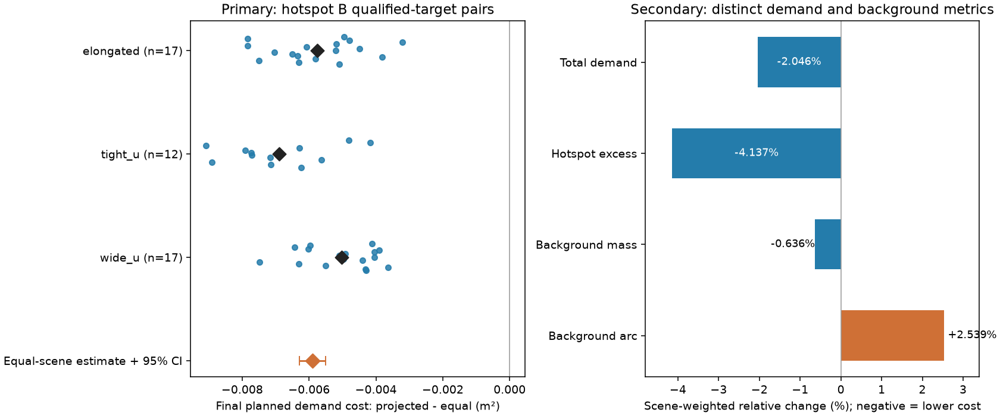
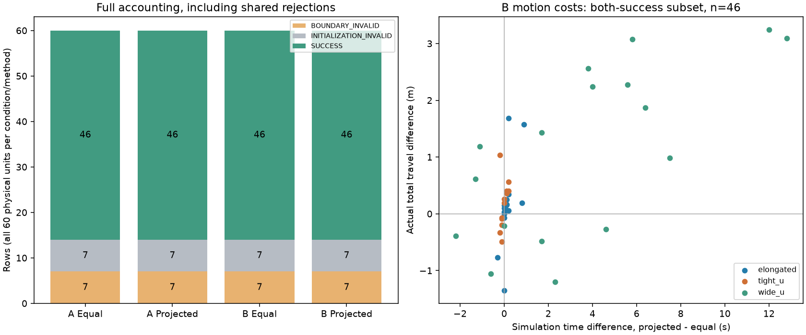

# 非凸需求部署：新seed配对确认 v1

本轮完成60个新物理输入、120份需求和240行任务，未补抽、换seed、重试或批内修算法。184行完整部署成功，56行因共同人员输入或边界检查拒绝。两方法成功状态完全相同。

预先指定的热点B主要指标为最终规划需求代价差ΔJ=J_projected−J_equal。双方目标合格的46个物理配对全部为负；三个固定场景等权均值为 **−0.00589590 m²**，物理单元分层配对bootstrap的95%区间为 **[−0.00628377, −0.00550997] m²**。场景等权平均相对变化为−2.0463%。这是通过共同输入和目标检查后的条件性需求分配收益。背景弧段代价增加，部分wide_u执行成本增加；没有成功率优势，也不解释为真实风险或containment改善。

## 1. 基线、版本及冻结顺序

当前工作分支为`Major-Research-Branches`。从干净的`e7abbc12`继续，`4b2b199f`和`e7abbc12`均在本地历史中；本轮没有fetch、merge、push或修改main。旧36行试点、相位归因及其报告保持原结论。

阅读了AGENTS、架构、两份开发报告及配置。仅新增确认编排、预定统计和必要测试，复用`demand_pilot`、`phase_attribution`、原生成器、部署、导航、安全过滤、恢复、当前优先对象路径进展监测和独立评价模块。没有复制第二套规划器、相位搜索器或控制器。

运行前源码、配置、统计和协议先提交为 **`e9fe1bbbf04cc6d026684ac2f8adceff09026d57`**，工作区干净后才生成输入。全部240行metrics记录相同提交、`dirty=false`及科学源码SHA-256：

`cf925d3e1fa9b137e2782cb7409a29fc13b9dc86e17303078cd9e94e5d4e5d14`

冻结顺序为：本地seed审计与区间锁定→60份人员/Guide快照及边界→120份需求和目标无关窗口→完整240行manifest→首seed串行12行→其余228行→全量独立复判→预定统计。生成只抽一次；60次draw、0次replacement。冻结700份输入文件，结果后核验全部匹配。4711份本批原始文件和1385份历史/科学基线保护文件最终哈希均匹配。[源码及依赖追溯](execution_source.json)、[最终检查](final_checks.json)、[原始文件哈希](raw_checksums.json)可核对。

## 2. 方法与需求的准确口径

仅比较：

- `equal_arc+all_phase_256`
- `projected_mass+all_phase_256`

后者是Lloyd迭代与弧间隙约束共同产生布局，再进行共用的有限整体相位搜索。不能将收益全部归因于单次gap投影，也不声称全局最优或一般收敛。本批未运行新的Mass CVT矩阵或P0/P1/P2消融。

原布局复用legacy起点顺序[0,.25,.5,.75]、300轮上限及原停止规则。projected浓度固定1，无浓度减半、Equal Arc回退或额外起点。每方法从自己的原始布局开始，始终检查256相位，含零；相位单位为弧长m，网格相对于原布局弧坐标原点。i≤128时φ=iL/256，否则φ=(i−256)L/256；不先用P2移位。保存循环排序、原索引和周期对应关系，循环换位不算运动。

每候选独立检查原数量、曲线、循环gap及闭合gap、全部成对欧氏距离、贴线和静态入域。合格者按原始rho的总需求J、|φ|、带符号φ升序选择。原始rho用于规划、候选评分和独立评价；不使用规划器变换密度自评。选中后才做正常指派/初始路径，不能因路径失败换第二个相位。184份有效布局各检查256个候选，共47104次候选检查，每份合格数121–256。共享缓存包含输入、曲线、布局、需求和域哈希；紧凑相位/弧坐标/索引保存在runs，无完整候选距离矩阵复制。

边界固定`disk_union_closed`。N固定elongated=11、tight_u=13、wide_u=19。人员、房间、半径、扰动、Guide初态和随机流沿用v3：namespace=20261019，场景顺序elongated/tight_u/wide_u，各单元`SeedSequence([namespace, scene_index, seed]).spawn(3)`。

A为逐人需求全1，经既有Gaussian映射得到曲线密度，不能称常数曲线密度。B背景1、固定圆盘内5，圆盘半径1.2 m，以人员中心距离≤半径判定。圆心分别为elongated [12,14.75]、tight_u [12,16.4]、wide_u [11,16.4]。全部从旧配置读取，未按新人员调整。60单元热点成员为40单元3人、20单元4人，无空盘。

Gaussian带宽1.2 m、全曲线共同尺度、周期线性插值、归一化和2048中点积分保持原实现。热点超额窗口在Guide目标出现前由冻结人员/需求生成；背景质量代价与背景弧段代价分别评分。A/B共享同一物理输入，同需求的两方法共享完整边界、曲线、rho、窗口和评价规则。60份需求向量对均保存；共同预检失败的28个需求条件没有伪造rho/窗口，余92条件有完整密度和窗口。

## 3. 新seed审计及完整分母

预先规则从75开始，寻找三个场景均未暴露的首个连续20-seed区间。审计本仓库configs、experiments、reports及现存runs输入记录/manifest/protocol共397份元数据，包括估计器开发记录，区分显式不同namespace，同家族不能归属者保守排除。最终为 **75–94**，在生成前锁定。审计范围限本机可见记录，不能声称查遍其他电脑或缺失记录；相同整数seed不自动代表相同人员输入。未使用保留seed5000–5029。[审计](seed_audit.json)、[60输入及哈希](input_map_60.json)、[120需求及哈希](demand_map_120.json)、[240行manifest](manifest_240.json)均保存。

|固定场景|物理单元|人员/场地合法|人员拒绝|合法人员后的边界拒绝|完整曲线及两方法成功单元|
|---|---:|---:|---:|---:|---:|
|elongated|20|20|0|3|17|
|tight_u|20|13|7|1|12|
|wide_u|20|20|0|3|17|
|合计|60|53|7|7|46|

人员拒绝为tight_u seeds77、81、86、87、88、92、94，保留原合法性判定。边界拒绝为elongated75/77/82、tight_u90、wide_u82/84/86；其中elongated77为MultiPolygon，其他6个为默认严格覆盖检查不通过。本轮不增加覆盖残差诊断、不把这些拒绝统一宣称为已证明的数值残差，不加epsilon、不修几何、不改判32段。

|阶段状态|全部任务行|
|---|---:|
|共同人员/场地无效 INITIALIZATION_INVALID|28|
|边界/曲线无效 BOUNDARY_INVALID|28|
|数量必要条件违反|0|
|原始布局未找到|0|
|256相位未找到合格目标|0|
|初始路径/指派失败|0|
|恢复耗尽/超时|0|
|到达/贴线/覆盖终验失败|0|
|实际安全违反|0|
|程序错误/中断/未开始|0|
|完整成功 SUCCESS|184|
|总计|240|

每方法120行：92成功、14边界拒绝、14人员拒绝。未执行56行的仿真时间、真实路程、恢复和区间安全为null，未填写0或安全通过。全部状态、阶段计时、缺失原因和逐行哈希见[240行台账](tasks_240.csv)。

|需求|物理单元|双方成功|仅Equal成功|仅projected成功|双方失败|双方目标合格的代价配对|双方成功的运动配对|
|---|---:|---:|---:|---:|---:|---:|---:|
|A 全1|60|46|0|0|14|46|46|
|B 热点|60|46|0|0|14|46|46|

两需求各场景双方成功数17/12/17，双方失败3/8/3。本批每方法完整流程92/120=76.67%；共同人员/场地合法物理分母上46/53=86.79%。这些分母同时保留；不把条件性需求配对替代完整流程。有效样本是60个物理单元，240任务不是240个独立人员样本，A/B及派生指标也不独立。

## 4. 预定主要指标与配对统计

唯一主要需求指标为B条件双方最终目标合格的ΔJ，单位m²；即使执行失败，其合格规划目标也应保留在此指标。本批没有此类执行失败。先在各场景求配对均值，再等权平均三个场景，不按17/12/17数量混合权重。

|B 场景|有效配对/全部单元|平均ΔJ m²|平均配对相对变化|ΔJ<0比例|
|---|---:|---:|---:|---:|
|elongated|17/20|−0.00576257|−1.9634%|17/17|
|tight_u|12/20|−0.00689918|−2.4535%|12/12|
|wide_u|17/20|−0.00502593|−1.7222%|17/17|
|三个场景等权|46/60|**−0.00589590**|**−2.0463%**|46/46|

预定percentile bootstrap固定10000次，RNG seed2026102001。每层从全部20个物理单元有放回抽20个，A/B、两方法和阶段状态使用同一单元索引；共同失败仍作为缺失配对参与重采样。每次重新求条件性场景均值和三层等权值。10000次全部可计算，无无法计算的重复；95%区间[−0.00628377,−0.00550997] m²。此区间反映三固定模板内的人员输入变异，不覆盖所有非凸形状，也没有消除目标有效子集的条件性。

最不利有效B案例（最大ΔJ）为elongated seed80：Equal J=0.2967917789，projected J=0.2935751377，Δ=−0.0032166412 m²（−1.083804%）。全部有效B配对相对变化范围−3.212728%至−1.083804%。逐对原值见[主要配对表](primary_hotspot_pairs.csv)，失败单元仍在完整台账中，未用删除失败证明总体优势。

|场景内最不利有效B案例|Equal J m²|projected J m²|ΔJ m²|相对变化|
|---|---:|---:|---:|---:|
|elongated seed80|0.2967917789|0.2935751377|−0.0032166412|−1.083804%|
|tight_u seed76|0.2812561947|0.2770786836|−0.0041775111|−1.485305%|
|wide_u seed92|0.2918917742|0.2882567997|−0.0036349745|−1.245316%|



## 5. 需求收益与背景代价

以下次要指标均为三个场景等权平均；相对变化先逐对计算再分层汇总，不是总和的比值。各指标使用自己的冻结密度/质量和归一化，不能把这些已归一化指标直接相加成总需求代价。

|条件及规划指标|平均Δ m²|平均相对变化|有效配对方向|
|---|---:|---:|---|
|A 总需求|−0.00475716|−1.6486%|46降低、0增加|
|B 总需求（主要）|−0.00589590|−2.0463%|46降低、0增加|
|B 热点超额|−0.01189240|−4.1368%|46降低、0增加|
|B 背景质量|−0.00184368|−0.6360%|42降低、4增加|
|B 背景弧段|+0.00742534|+2.5388%|0降低、46增加|

A各场景平均Δ依次−0.00514273、−0.00466614、−0.00446261 m²，保持与B分开报告。B热点超额平均相对变化依次−2.8124%、−5.6183%、−3.9795%；背景弧段依次+3.4627%、+2.4142%、+1.7395%。背景质量反映人员映射的背景需求质量，背景弧段反映固定热点窗口之外的曲线空间，两者方向可以不同。不能用前者平均下降掩盖后者全部增加。

实际终态Guide坐标也按同一冻结曲线rho/窗口独立评分。终态全部通过贴线/到达检查；A总需求等权Δ=−0.00476998 m²（−1.6528%）；B总需求−0.00590405（−2.0491%）、热点超额−0.01190565（−4.1410%）、背景质量−0.00184811（−0.6375%）、背景弧段+0.00741405（+2.5349%）。终态需求差与规划方向一致，不将未执行目标与实际部署性能混列。

## 6. 执行、真实路程与恢复

首seed75的12行串行，8成功、4边界拒绝；门控核对通过后继续其余228行（176成功、24边界拒绝、28人员拒绝）。首组计入240，没有重复执行。184次实际部署均为本批新执行，无旧轨迹复用。

以下为双方成功子集的projected−Equal均值；路程是各Guide实际保存轨迹相邻位置位移之和，不是初始路径估计。

|条件|场景|配对n|仿真时间差 s|实际总路程差 m|恢复次数差|
|---|---|---:|---:|---:|---:|
|A|elongated|17|+0.0647|+0.2134|0|
|A|tight_u|12|−0.0167|+0.2181|0|
|A|wide_u|17|+1.7294|+0.9061|+0.8235|
|B|elongated|17|+0.1412|+0.1536|0|
|B|tight_u|12|−0.0167|+0.1704|0|
|B|wide_u|17|+3.7059|+1.1143|+0.4706|

全部实际部署仿真时间17.9–37.7 s，未超40 s。B配对时间差范围−2.2至+12.8 s，路程差−1.3489至+3.2405 m，恢复差−3至+3。A时间差−6.5至+8.0 s，路程差−2.7364至+2.7858 m。总体恢复0次132行、1次5行、3次47行；3次为预算内使用，不是恢复耗尽失败。

wide_u B seed83：Equal 24.5 s、246.6738 m、0恢复；projected 36.5 s、249.9144 m、1恢复。seed85：Equal 24.9 s、247.8662 m、0恢复；projected 37.7 s、250.9581 m、1恢复。两者仍安全成功，但说明需求布局/相位改变路径与联合协调成本，不能只报告需求百分比。这是新增执行成本证据，没有出现需要在本批修复的新控制失败。



## 7. 独立复判、数值检查及安全边界

所有240行独立复判，包括56拒绝行；184条实际轨迹均做完整运动区间检查，未只检查保存帧。[独立核查表](independent_checks_240.json)中在线/离线criteria、diagnostics、success不一致均为0，无安全违反、程序错误或外部中断。在线metrics原样保留，另存独立结果。

维持0.75 m人/Guide中心距、0.55 m墙距、1e-7 m原容差、0.11 m规划裕度、1.3 m偏移、1.94/2.0 m规划/执行gap、1 m/s、400步/40 s、3恢复及原到达/速度/保持/贴线标准。完整线段、边界端点连接、原子路径安装、联合过滤及进展约束均未修改。默认16段严格覆盖保持，32段构造不替代默认验收。

全轨迹最小净裕量：人员0.0215870822820 m，Guide **9.90771531484e−9 m**，墙0.45 m。Guide约1e−8 m仅说明约束接近活跃，不能称为充分鲁棒。选定目标最小全成对距离1.1054196059 m；最小静态域signed clearance **8.64228010986e−5 m**，同样是小裕量而非鲁棒性保证。

主选择和主统计固定2048点。所有184个合格选定目标用原冻结rho和窗口做8192点独立积分；不重选相位。92个A/B配对的收益符号变化0，单配置最大J变化1.39056e−5 m²，最大配对Δ变化1.13340e−5 m²。8192点B等权Δ=−0.0058956999 m²，A=−0.0047568411 m²。[逐对积分敏感性](fine_integration_pairs.csv)保留全部原值。相较主要效应，积分变化小；本轮没有新增网格搜索，有限256候选最优不能称连续相位全局最优，网格敏感性开发证据仍见原相位报告。

## 8. 计算成本、环境和验证

本机Core Ultra 7 258V、8核/8逻辑线程、RAM 33847832576 B；初查可用17678737408 B。沿用`.venv` Python3.12.15、uv0.13.0，udc实际导入本仓库`src/udc/__init__.py`。numpy2.5.4、scipy1.18.1、shapely2.2.0、PyYAML6.0.3、jupedsim1.4.2、pedpy1.5.1、pytest9.1.1、threadpoolctl3.7.0。未升级或复制其他机器环境。[环境记录](environment.json)包含解释器绝对路径。

首组1 worker，后续最多2 worker且仅2任务在途，每worker数值线程1；主进程和全部worker显式`UDC_PRIORITY_STALL_COUNTERFACTUAL=0`，记录值均为0，数值线程观测均为1。保留原完整线段和顶点到达开关。

|方法|原布局平均/最大 s|256相位平均/最大 s|执行runner平均/最大 s|有效执行n|
|---|---:|---:|---:|---:|
|equal_arc+all_phase_256|0.001861 / 0.003783|0.422523 / 0.912306|1.471260 / 3.942989|92|
|projected_mass+all_phase_256|0.023965 / 0.178520|0.428100 / 0.997849|1.631369 / 4.128454|92|

全部行也保存路径、细积分、独立复判和行总计时。共享输入冻结环节14.0523 s；首12行21.5559 s；余228行252.9384 s。后两段合计274.4943 s，不包含最后全量复判、分析和测试。单行wall时长处于并行执行环境，不能直接相加当批总耗时，也不与其他机器墙钟作算法速度结论。

基线测试185 passed/22.75 s；预提交194 passed/27.64 s；批后完整测试 **194 passed/24.63 s**。`pip check`无依赖冲突，`compileall src tests`与`git diff --check`通过。九项新增测试覆盖seed审计/不同协议、首连续区间、需求共享隔离、失败与缺失分母、整单元分层重采样、有效样本不足时不出区间、执行失败仍保留规划配对、拒绝独立工件及安全/程序停止。并验证冻结文件、各行运行源码和未执行运动null；不是以测试数替代实验。

下面是本批使用的PowerShell顺序。prepare要求干净源码，且输出目录必须不存在；原目录已冻结，禁止对其重复freeze或first/remaining。精确重建应使用运行前提交及其历史输入依赖，在独立工作目录操作；审计只能复现该次可见记录范围。`rejudge`是本批实际全量复判命令，会另写独立结果，保留在线metrics；只读再分析可用新的report路径。

```powershell
$env:UDC_PRIORITY_STALL_COUNTERFACTUAL = '0'
$env:OMP_NUM_THREADS = '1'
$env:OPENBLAS_NUM_THREADS = '1'
$env:MKL_NUM_THREADS = '1'
$env:NUMEXPR_NUM_THREADS = '1'
$py = '.\.venv\Scripts\python.exe'
$out = 'runs/step1_nonconvex_demand_confirmation_v1'
& $py -m udc.experiments.demand_confirmation --stage audit --output $out
& $py -m udc.experiments.demand_confirmation --stage prepare --output $out
& $py -m udc.experiments.demand_confirmation --stage freeze --output $out
& $py -m udc.experiments.demand_confirmation --stage first --workers 1 --output $out
& $py -m udc.experiments.demand_confirmation --stage remaining --workers 2 --output $out
& $py -m udc.experiments.demand_confirmation --stage rejudge --output $out
& $py -m udc.analysis.demand_confirmation --output $out --report reports/step1_nonconvex_demand_confirmation_v1
& $py reports/step1_nonconvex_demand_confirmation_v1/plot_results.py --report reports/step1_nonconvex_demand_confirmation_v1
& $py -m pytest -q
& $py -m pip check
& $py -m compileall -q src tests
git diff --check
```

## 9. 证据解释与下一步

新输入确认与开发证据一致：在同等有限相位机会下，合格配对的projected布局需求总成本和热点超额成本均较低，细积分不改变方向；184次合格部署均在原安全/时间/恢复预算内完成。A也有收益，提示该布局针对人员映射的非均匀密度起作用，不能把全部效果解释成热点机制或单次gap投影。

新增限制同样明确：14/60共同输入/边界拒绝使结论条件化；tight_u有效12/20少于其他层；背景弧段全部变差，背景质量4例变差；wide_u运动时间、路程和恢复代价更大，最慢已到37.7/40 s；Guide安全约束接近活跃。只有三个固定模板、固定N和固定需求模型，审计范围是本机记录，不作一般形状、真实风险、containment或成功率优势声明。

据此冻结当前 **Lloyd+gap布局与共用all_phase_256需求部署候选** 的实现和适用范围，保留所有拒绝，不调热点、seed或预算追求更好结果。下一轮唯一优先变量建议为 **Guide资源档位N**，重点核查wide_u需求收益与执行余量的权衡；人员/几何、热点、密度和控制器保持不变，具体新协议另行决定。本轮没有启动新资源档位、扩展seed、几何矩阵或Step 2/3，也不采用完整RA-ABDC命名或一般理论结论。

原始输入、布局、相位候选、指派、路径、轨迹、事件及在线/独立工件唯一保存在`runs/step1_nonconvex_demand_confirmation_v1/`；Git保存源码、配置、测试、协议和派生报告/索引，没有backups、全runs复制或历史覆盖。
