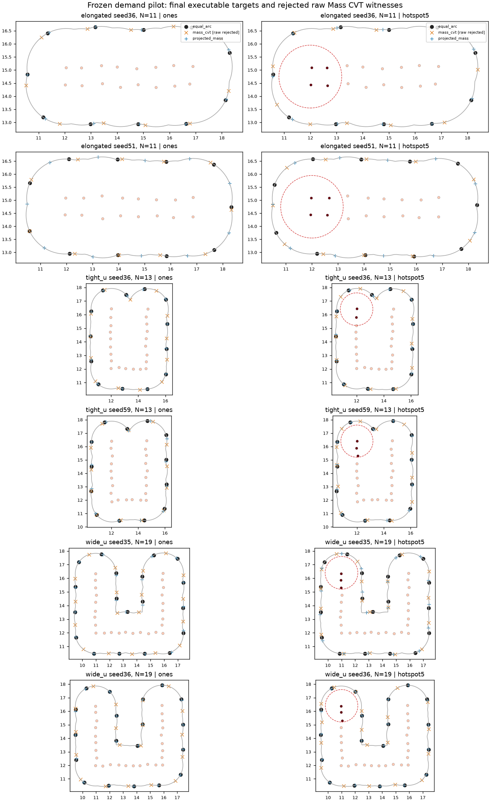

# Step 1：固定非凸曲线上的需求加权部署机制试验

2026-10-20，Asia/Tokyo。六个既有开发物理输入、十二份需求、36行全部完成。**Equal Arc和projected_mass各12行完整部署成功；Mass CVT的12行全部因弧间隙超限而拒绝，未执行。** 36行均独立复判，24条真实执行轨迹全部通过原验收，没有安全违反、程序错误或配对错误。

在六个热点条件内，projected_mass相对共用相位处理后的Equal Arc，将原始需求代价降低 **0.907%–3.766%**，热点超额代价降低 **1.404%–6.123%**；背景弧段代价增加 **0.982%–11.989%**。热点条件的仿真时间差为−0.1至+1.3 s，实际总路程差为−0.676至+0.269 m，恢复次数不增加。收益有限且伴随覆盖分配代价，不能据此声称一般方法排名、真实风险下降或containment改善。

本批属于开发机制试验，六个物理输入才是配对单位；十二需求单元和36行不是36个独立人员样本。没有使用5000–5029，没有增加seed、热点乘数、算法、搜索预算或Step 2/3条件。

## 同步关系、环境与执行版本

仓库为 `C:\Users\kai\Adaptive-Guide-Agent-Deployment-for-Unknown-Dynamic-Crowds`，origin为 `https://github.com/Wu-kaixin/Adaptive-Guide-Agent-Deployment-for-Unknown-Dynamic-Crowds.git`，分支为 `Major-Research-Branches`。开始时工作区干净。完成 `git fetch origin` 后，本地和远程研究分支均为 `c37a023a79159ece268b7862ddffba17c69308f3`，左右提交数0/0，无需合并。没有修改或合并main。

`f9743ab`之后的`c37a023a`只增加Step 1整合审阅与数据可用性等文档，未修改`src/udc`算法。没有回退到旧编号，也没有把远程尚未提供的其他机器提交视为已获得。交付在研究分支上新增本地提交：**本地包含远程且超前**，不再声称交付HEAD与远程SHA一致；没有推送、reset、clean或删除已有提交。

实测Intel Core Ultra 7 258V，8物理核／8逻辑处理器，33,847,832,576 B（约31.52 GiB）内存；探测时可用12,065,693,696 B，非峰值测量。沿用仓库`.venv\Scripts\python.exe`，Python **3.12.15**，uv **0.13.0**；`udc`实际导入本仓库`src\udc\__init__.py`。NumPy 2.5.4、SciPy 1.18.1、Shapely 2.2.0、JuPedSim 1.4.2、PedPy 1.5.1、PyYAML 6.0.3、pytest 9.1.1、threadpoolctl 3.7.0。项目没有单独的uv锁文件，依赖依据是现有`requirements.txt`固定版本、`pyproject.toml`和实际环境；没有复制虚拟环境、安装或升级科学依赖。完整记录见[environment.json](environment.json)。

实际执行是`c37a023a + 工作区改动`，不是干净的旧提交。冻结并逐行核查的源码总哈希为 **`94d5013b85ee917c7feb71a52d5593136074bbe084d7860cea5bba07cdc8ce9e`**，逐文件字节哈希、配置和协议文件哈希见[execution_source.json](execution_source.json)。冻结后没有修改`src/udc`或本批配置；报告汇总脚本的后续修改仅用于读取保存工件。provenance中的dirty和原始commit如实保留。

主进程阶段冻结记录与三个实际运行PID（首组串行主进程、其余两个worker）的环境均记录 `UDC_PRIORITY_STALL_COUNTERFACTUAL=0`。每个worker的threadpoolctl实测数值线程为1，OMP/OpenBLAS/MKL/NumExpr环境也均为1。完整线段与顶点交接保留默认启用。首组六行串行，8.021 s墙钟；其余30行2 worker，40.658 s墙钟。墙钟是本机编排条件下的观测，不与i9历史秒数作算法性能比较。

## 边界、协议与需求接口核查

已核对[120行边界比较](../step1_boundary_estimator_comparison_v1/REPORT.zh.md)、[目标域一致性](../step1_target_domain_consistency/REPORT.zh.md)、[联合进展恢复](../step1_joint_progress_diagnostics/REPORT.zh.md)、[优先进展监测](../step1_priority_progress_monitor/REPORT.zh.md)及[覆盖表示契约](../step1_coverage_geometry_contract/REPORT.zh.md)。这些历史结果只提供协议背景，不作为本批代码的成功率证据。未重跑历史整表、覆盖审计或精确有理数证明。

边界固定为原`disk_union_closed`：观测圆盘并集、0.30 m闭运算、恢复原圆盘、单外环控制几何、1.3 m外偏移、0.10 m采样。构造实际32段／象限；默认验收仍为原16段严格covers。32段元数据来自已有construct_boundary描述，不改变接纳，不设epsilon，不追认seed70成功。没有凸包对照、边界估计器开发、pairwise大批优化或完整RA-ABDC。

保持人员／Guide中心距0.75 m、墙距0.55 m、原数值容差1e-7 m、导航规划裕度0.11 m、规划／执行gap 1.94／2.0 m、速度1 m/s、400步／40 s、3次恢复，以及原到达保持、贴线和覆盖判据。人员初始化后冻结，无crowd–guide动力学交互。

接口审计结果：

| 环节 | 实际密度与行为 |
|---|---|
| 原始需求映射 | `demand_profile(..., mode='mass_cvt')`，同一Gaussian核、h=1.2 m、全曲线统一最大值尺度 |
| Equal Arc规划 | 接收同一原始输入；保持等弧算法，内部常密度和内部cost不用于需求收益评分 |
| Mass CVT | 直接读取冻结的原始Gaussian rho |
| projected_mass | 同一rho，浓度固定1；原有Lloyd＋gap投影，无浓度退火、回退或新增修复 |
| 相位候选 | `admissible_phase`直接读取该条件保存的原始rho，而非常密度或规划器变换后的rho |
| 独立评价 | 从保存人员、需求、曲线重新构造Gaussian总量／超额／背景质量，使用原`excess_coverage`及独立验收 |

旧`nonconvex_rebuild.plan_target`、`target_domain`和边界比较入口硬编码常曲线密度，属于各自已经冻结的旧协议，不能用作本批非均匀需求入口。本批新编排模块`src/udc/experiments/demand_pilot.py`复用既有规划器、相位函数、experiment、导航和reevaluate_result；没有建立另一套控制框架。密度接口本身已足够，无须修改规划、相位、导航、安全或验收算法。唯一公共工件接口适配是让`rejected_result`可接收冻结需求快照及配置，避免规划拒绝写回原全1需求；默认调用行为保持。

rho(s)=Σd_j exp(−‖x(s)−p_j‖²/(2h²))，先在曲线采样点用logsumexp求和，再除以同一曲线的最大值。包括周期接缝的线性插值生成2048个中点求积节点，节点质量为rho·L/2048。代价J=Σmass·d_L²/Σmass，单位m²。共同比例会在归一化中消去；不同需求条件的缩放积分不能用来比较总需求量。A的人员需求全1，但曲线rho最低值仅0.1767–0.3957，明显不是常曲线密度。

新增五项测试覆盖：常密度相位行为保留；非均匀密度代价变化及全部候选的原始密度排序；Gaussian直接计算、共同尺度、归一化和周期接缝；36行冻结配对与篡改检测；带需求的拒绝工件且无虚构运动指标。测试不执行新的确认矩阵。

三方法沿用legacy phases `[0,.25,.5,.75]`，每起点最多300轮；选择第一个通过弧间隙与全成对几何检查的输出。全部失败时，只保留四次尝试中原始需求代价最低的**拒绝见证**，不执行，不宣称不可行证明。共享`static_domain_phase_v1`只在原几何通过且静态目标域不合法时触发，预算固定256个全周期相位，排序为原始需求代价、最小相位绝对值、带符号相位。最终方法标签均明确为`方法名+shared_static_domain_phase_v1`；触发与否另记。处理后的Equal Arc可能受需求影响，不能称其完全不依赖需求。

## 六个输入、十二份需求和36行冻结

五个输入复用本机原v3冻结NPZ／SQLite；检查原input_record的输入文件与数组哈希。重新调用当前同一构造后，crowd、deployment、arc和length均与已有冻结曲线逐数组完全一致。旧文件不改写。tight_u seed59原始工件不在本机，只按可靠的v3生成代码与scene_index=1在新目录重建该例；历史比较已经消费seed59，本轮不称其新seed确认。

重建seed59的原始数组组合哈希为`1a529660c54850e3d07bb7e3c4d5657b3427dba49ad67bc7c9b92be4bdb0a004`；people、radii、demand、guides、room、guide_arcs、guide_arc_jitter、base_people的逐数组字节哈希全部匹配历史input_map_60记录。仍标为`protocol_reconstruction_not_original_recovery`，没有声称恢复原SQLite文件、旧轨迹或原文件字节。

原20 m圆形场景热点参数不适配这些30 m非凸输入。运行前依据基础人员坐标固定空间圆盘：elongated `(12,14.75)`，tight_u `(12,16.4)`，wide_u `(11,16.4)`，半径均1.2 m，背景1、盘内5，成员规则为人员中心距离≤半径，不裁切权重。坐标对应细长左端／U形左上臂，未看Guide目标，不随方法或seed结果移动。所有盘均有人员，没有补抽。

| 物理输入 | 人数 | N | 原曲线长 m | 热点人员索引（从0开始） | 冻结超额窗口节点／2048 | 来源 |
|---|---:|---:|---:|---|---:|---|
| elongated36 | 16 | 11 | 20.487885 | 0,1,8,9 | 878 | 原v3快照 |
| elongated51 | 16 | 11 | 20.735251 | 0,1,8,9 | 874 | 原v3快照 |
| tight_u36 | 22 | 13 | 24.173036 | 7,8 | 512 | 原v3快照 |
| tight_u59 | 22 | 13 | 24.255262 | 6,7,8 | 575 | 协议重建，历史数组哈希匹配 |
| wide_u35 | 26 | 19 | 35.616713 | 6,7,8 | 495 | 原v3快照 |
| wide_u36 | 26 | 19 | 35.723812 | 6,7,8 | 497 | 原v3快照 |

冻结顺序是六个物理输入→十二需求向量／曲线密度／热点窗口→完整36行manifest→首组六行→其余30行。六个输入均通过原初始化、边界和数量必要条件，没有换案例。A/B共享人员、半径、房间、Guide初态、曲线和N；同条件三方法共享同一demand.npz及配置。SQLite路径按本机实际位置生成新配置，未改历史配置。首组六行属于elongated36的两需求×三方法，核查通过后计入36，不重复执行。

冻结时文件锁覆盖原input.npz、人员SQLite、新曲线、十二份需求与配置、manifest、生成协议、基础配置、requirements和科学源码哈希。详见[六输入来源](inputs_6.json)、[十二需求及密度规则](demands_12.json)、[36行manifest](manifest_36.json)、[几何／Guide哈希](geometry_guide_hashes.json)和[原始工件校验表](raw_checksums.json)。Guide逐数组哈希是汇总时从未改变的冻结NPZ派生，输入文件锁在规划前已存在。

唯一原始工件在`runs/step1_nonconvex_demand_pilot_v1/`：physical保存本批曲线与来源引用，conditions保存十二份需求／密度／配置，plans保存原目标、最终目标、候选、几何和初始路径，results保存轨迹／事件／metrics／state。五个原输入和SQLite直接引用已有runs；仅缺失的seed59生成新物理快照。未复制整个runs、创建backups或覆盖历史结果。Git中的JSON／CSV是清单、来源和分析，不是完整原始轨迹的数据分发。

## 全阶段结果与独立复判

| 终态／检查 | Equal Arc＋共用相位 | Mass CVT＋共用相位 | projected_mass＋共用相位 |
|---|---:|---:|---:|
| 计划行数 | 12 | 12 | 12 |
| 输入／边界／数量拒绝 | 0 | 0 | 0 |
| 目标几何规划拒绝 | 0 | 12 | 0 |
| 共用相位触发 | 2 | 0 | 0 |
| 相位预算耗尽／最终入域拒绝 | 0 | 0 | 0 |
| 初始指派与路径通过 | 12 | 不适用 | 12 |
| 实际执行 | 12 | 0 | 12 |
| 执行／到达／覆盖／安全失败 | 0 | 不适用 | 0 |
| 完整成功 | 12 | 0 | 12 |
| 程序错误／未决行 | 0 | 0 | 0 |

Mass CVT共48个legacy起点全部违反max gap≤1.94 m，最大gap范围2.116110–2.858948 m；48个起点的全部成对欧氏距检查均通过。拒绝不是Guide数下界违反，也不是执行死锁。所选拒绝见证和所有起点的间隙、闭合缝、距离、原始代价保留；最大gap的冲突目标对与全精度坐标见[failure_evidence.json](failure_evidence.json)。例如elongated36热点原见证目标5→6，弧坐标10.52000908294→13.32060532442 m，gap=2.80059624148 m；没有临时修复它。

所有24套最终目标独立重投影到原曲线，复核数量、循环gap pattern、闭合gap、全成对欧氏距和静态域；初始指派、可达矩阵及路径另存。projected_mass最小成对距为1.107697464 m，最小静态域有符号余量0.026855513 m。**本批投影后没有新增成对距离或静态入域拒绝**；所有projected_mass的max gap达到1.94 m，约束确实活跃。这不证明任意非凸曲线均可行。

36行均通过保存工件离线复判；总／超额／背景原始需求评分重新从保存人员与需求构造，与冻结rho评分一致。24条执行的人员、半径、需求、热点mask、房间、初态、曲线、目标及初始指派逐数组核验一致。拒绝行仍有metrics、trajectory、state、planning和config，只有初始状态，没有实际区间；部署时间、路程、恢复及运动安全指标均为null，未填零。[offline_checks.json](offline_checks.json)、[36行完整台账](tasks_36.csv)保存检查结果。

实际执行仿真时间17.9–32.2 s。八条wide_u执行均使用3次既有恢复，其余16条为0。所有真实运动区间安全；最小净裕量为人员0.021587082 m、Guide约9.925e-9 m、墙0.45 m。Guide极小余量表示约束接近活跃，不是鲁棒裕度证据。实际max gap最大1.940485339 m，最终平均贴线距离最大0.000688838 m；完整九类验收全部通过，未放宽门槛。

## 同曲线需求收益与拒绝代价

下表J均为原始需求归一化m²。Equal Arc与projected_mass列为**通过检查的最终目标**；Mass CVT列仅为**拒绝的原始目标见证**，12行全部未执行，其低J不是可部署优势。每一行仅在同物理输入、同需求、同曲线内比较，不能跨曲线按J排名。

| 输入／需求 | Equal Arc最终J | Mass CVT拒绝原J | projected最终J | projected最终J下降% | 投影保留原始J收益% |
|---|---:|---:|---:|---:|---:|
| elongated36 A | .286513 | .276894 | .280620 | 2.057 | 61.26 |
| elongated36 B | .287182 | .253469 | .279038 | 2.836 | 24.16 |
| elongated51 A | .293881 | .282249 | .294071 | **−0.065** | 27.17 |
| elongated51 B | .294321 | .259753 | .291653 | .907 | 16.63 |
| tight_u36 A | .286436 | .271582 | .282702 | 1.304 | 25.14 |
| tight_u36 B | .286507 | .264650 | .282519 | 1.392 | 18.25 |
| tight_u59 A | .288851 | .275611 | .282136 | 2.325 | 50.71 |
| tight_u59 B | .287880 | .259579 | .281216 | 2.315 | 23.55 |
| wide_u35 A | .297725 | .273903 | .287318 | 3.495 | 43.69 |
| wide_u35 B | .296322 | .261825 | .285161 | 3.766 | 32.35 |
| wide_u36 A | .293431 | .274127 | .288517 | 1.675 | 25.45 |
| wide_u36 B | .294150 | .262437 | .290794 | 1.141 | 10.58 |

最后一列固定使用**相位前**三个原目标：`(J_equal_raw−J_projected_raw)/(J_equal_raw−J_mass_rejected_raw)`。它衡量相对这些有限预算原见证的规划收益保留，不是相对全局最优的效率，也不是未执行Mass CVT的运动收益。B条件保留总需求收益10.58%–32.35%、热点超额收益4.19%–19.39%；A条件保留总需求收益25.14%–61.26%。seed51的最终Equal Arc另有相位收益，因此不能把最后一列当最终部署收益百分比。

超额需求沿用原定义：盘内d−d/5=4，盘外0；总量、超额及背景Gaussian使用同一尺度。背景质量为总量减超额质量。热点弧窗口在目标出现前固定为“局部超额质量≥局部总量一半”，不使用会空掉的最近人员窗口。背景弧段代价是该窗口补集上的均方弧距离；它与背景**质量**加权代价是不同指标。A无超额需求，两项热点指标及相应背景分解均不适用。

下表差值均为projected_mass减Equal Arc，共用相位处理后比较。收益%为成本下降，背景代价%为成本上升；背景质量为负值表示成本下降。全部六对均实际成功。

| B热点输入 | 超额代价下降% | 背景质量代价变化% | 背景弧代价上升% | 仿真时间差 s | 实际路程差 m | 恢复差 |
|---|---:|---:|---:|---:|---:|---:|
| elongated36 | 4.151 | −1.328 | 2.199 | .0 | +.070 | 0 |
| elongated51 | 2.408 | +.794 | 11.989 | +.6 | −.061 | 0 |
| tight_u36 | 2.773 | −.743 | 2.579 | .0 | +.269 | 0 |
| tight_u59 | 4.031 | −1.227 | 3.154 | .0 | +.021 | 0 |
| wide_u35 | 6.123 | −2.478 | 5.030 | +1.3 | +.039 | 0 |
| wide_u36 | 1.404 | −.994 | .982 | −.1 | −.676 | 0 |

重点区域收益在全部六例都伴随背景弧代价增加，但背景质量代价只在seed51增加，说明“背景覆盖”必须说明用哪个权重衡量。没有把背景质量小幅改善解释为所有背景弧段改善。规划目标需求收益也不等于真实风险降低。

需求确实改变目标：从A到B，Mass CVT原目标集合的对称周期弧Hausdorff变化为0.971–1.268 m；projected_mass为0.072–0.607 m。原Equal Arc六例均不变，seed51的后处理Equal Arc才随需求变化。测量是同一物理曲线的目标集合距离，不把循环排序换位当移动。见[analysis.json](analysis.json)中的demand_target_changes。



## 执行成本与相位归因

每对Equal Arc／projected_mass均通过相同路径与实际区间安全验收。Mass CVT没有部署时间、运动安全或实际路程，不能与本表混合。

| 输入／需求 | 仿真时间 E／P s | 实际总路程 E／P m | 恢复 E／P |
|---|---|---|---|
| elongated36 A | 18.8 / 18.8 | 144.888 / 145.098 | 0 / 0 |
| elongated36 B | 18.8 / 18.8 | 144.888 / 144.958 | 0 / 0 |
| elongated51 A | 18.3 / 18.9 | 144.274 / 144.392 | 0 / 0 |
| elongated51 B | 18.3 / 18.9 | 144.397 / 144.335 | 0 / 0 |
| tight_u36 A | 17.9 / 17.9 | 165.157 / 165.482 | 0 / 0 |
| tight_u36 B | 17.9 / 17.9 | 165.157 / 165.426 | 0 / 0 |
| tight_u59 A | 18.6 / 18.4 | 165.060 / 165.010 | 0 / 0 |
| tight_u59 B | 18.6 / 18.6 | 165.060 / 165.081 | 0 / 0 |
| wide_u35 A | 27.7 / 30.6 | 245.798 / 247.649 | 3 / 3 |
| wide_u35 B | 27.7 / 29.0 | 245.798 / 245.837 | 3 / 3 |
| wide_u36 A | 32.2 / 29.5 | 252.766 / 249.786 | 3 / 3 |
| wide_u36 B | 32.2 / 32.1 | 252.766 / 252.090 | 3 / 3 |

A条件下执行成本也不是一致上升：wide_u35增加2.9 s、1.851 m，而wide_u36减少2.7 s、2.980 m。不能用单一均值描述执行机制或宣称总体更快。恢复次数没有变化，但wide_u原执行仍用满3次预算。

Equal Arc规划墙钟1.453–4.884 ms；projected_mass为11.285–178.803 ms；Mass CVT四个拒绝起点合计40.156–170.347 ms。实际Mass CVT单起点最多100轮，projected_mass最多116轮，均未增加300轮上限。相位未触发时仅检查原入域与需求代价；两个触发行固定256候选分别约138.071、176.450 ms。计时含Python、几何描述和系统调度，不是跨机器求解器benchmark；逐行字段见CSV及analysis。

仅elongated51的Equal Arc两行触发相位：

| 需求 | 相位 m | 处理前J | 处理后J | 仅相位下降% |
|---|---:|---:|---:|---:|
| A：人员全1 Gaussian | −2.753900517425382 | .298481992581 | .293881389342 | 1.5413 |
| B：热点5 | +4.859824442515380 | .298014860842 | .294321393328 | 1.2394 |

这不是常密度下的−L/256最小相位结论；原始Gaussian非均匀，整体相位会改变J。两行保持循环gap pattern、N和曲线，没有剪弧或吸附位置。原始相位和候选全部保存，评分由原始rho重新核实。

projected_mass十二行均未触发相位，所以其目标加权变化及本批可行性不能归因于后处理。seed51 A在相位前projected_mass比原Equal Arc低1.478%，但Equal Arc相位收益更大，最终projected_mass反而高0.065%；B的总需求优势则从2.135%缩小到0.907%。因此共用处理的触发条件本身会影响方法比较。Mass CVT全部48次是gap失败，发生在相位之前；整体平移也不能修复循环gap超限。

## 可复现检查、限制与下一轮方向

实测基线175 passed／23.98 s；适配后完整 **180 passed／25.70 s**，包含五个新测试。`pip check`、`compileall src tests`、`git diff --check`通过；五项接口测试单独运行5 passed／3.83 s。没有把旧验证百分比作为本轮证据。原默认边界、覆盖、导航、安全、联合协调及进展监测没有算法改动，检查所及仍限于这些固定开发输入。

以下PowerShell命令在仓库根目录执行。现有输出不可覆盖；完整复现使用**新的空目录**。输入来源仍依赖本机五份原v3快照，其他机器缺失时不能仅复制命令声称恢复原输入。汇总脚本会对指定输出重新离线复判，不能指向历史研究目录。

```powershell
$py = '.\.venv\Scripts\python.exe'
$env:UDC_PRIORITY_STALL_COUNTERFACTUAL = '0'
$env:OMP_NUM_THREADS = '1'
$env:OPENBLAS_NUM_THREADS = '1'
$env:MKL_NUM_THREADS = '1'
$env:NUMEXPR_NUM_THREADS = '1'
git status --short
git branch -vv
git remote -v
git fetch origin
git rev-list --left-right --count HEAD...origin/Major-Research-Branches
& $py -c "import sys, udc; print(sys.version); print(sys.executable); print(udc.__file__)"
& $py -m pytest -q --basetemp .tmp/demand_pilot_check_new
& $py -m pip check
& $py -m compileall -q src tests
git diff --check
# 读取本轮证据并复判：派生报告使用新目录，保留本轮Git报告。
& $py reports/step1_nonconvex_demand_pilot_v1/summarize.py `
    --output runs/step1_nonconvex_demand_pilot_v1 `
    --report reports/step1_nonconvex_demand_pilot_v1_rejudge_new
# 完整复现只运行固定36行；首次执行应先确认下面目录尚不存在。
$out = 'runs/step1_nonconvex_demand_pilot_v1_reproduction_new'
& $py -m udc.experiments.demand_pilot --output $out --stage freeze
& $py -m udc.experiments.demand_pilot --output $out --stage first --workers 1
& $py -m udc.experiments.demand_pilot --output $out --stage remaining --workers 2
& $py reports/step1_nonconvex_demand_pilot_v1/summarize.py --output $out `
    --report reports/step1_nonconvex_demand_pilot_v1_reproduction_new
```

本批回答是：**需求加权可以改变这些固定曲线的目标并改善重点区域规划覆盖；gap投影保住可执行性，但只保留部分无约束需求收益，且背景弧覆盖会付出代价。** 未投影Mass CVT的低成本伴随全部规划拒绝，不能当作部署优势。投影后本批尚未出现新成对距离／静态域失败；现有合法性不能推广到未知新曲线。共用相位在seed51已足以改变相对结论，成为新增的归因问题。

下一轮唯一优先方向是：**先预注册并隔离同一有限相位预算下“共用相位选择”与“gap投影”的需求收益归因，再决定是否开展新seed确认。** 特别要区分原目标已合法因而不触发相位的行，与入域失败后获得需求相位优化的行。本轮不运行这一新对照、不扩展矩阵、不调整热点，也不自动进入Step 2/3。
