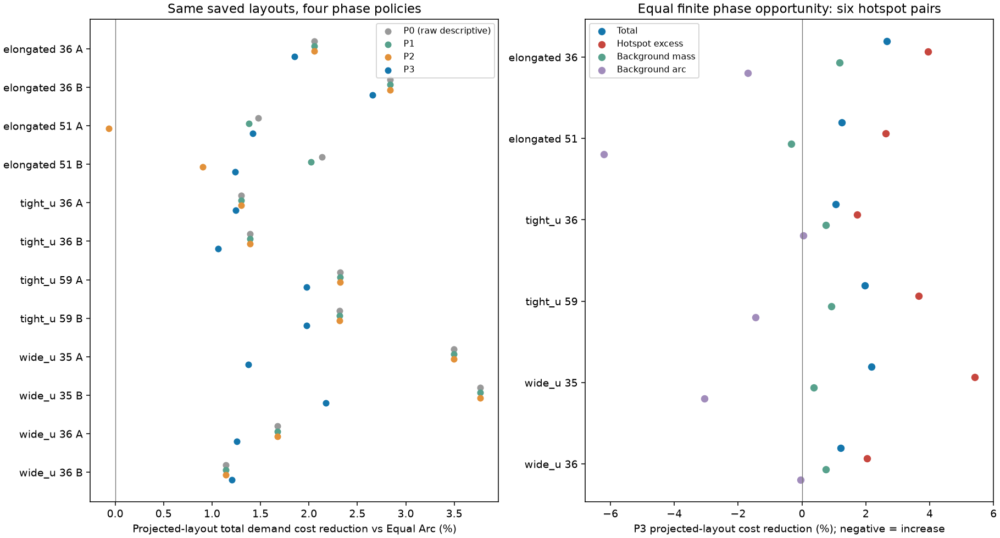

# Step 1：整体相位机会与目标间隙布局的配对归因

2026-10-20，Asia/Tokyo。本轮只读取上一轮六个物理输入、十二份需求和保存的原目标。完成**主网格96行政策分析、半格网格24行P3敏感性分析、240项细积分独立核查，以及24行P3执行验收**。其中21条为新增执行、3条严格复用原轨迹，全部SUCCESS；没有重新执行P2、Mass CVT或不合格P0。

**相位机会一致后，projected_mass保存布局仍有需求收益。** P3主网格下，十二条件总需求代价相对Equal Arc下降1.061%–2.658%；六热点条件的超额代价下降1.735%–5.419%。seed51全1条件在原P2下的反转消失。两种预定网格及2048／4096／8192点评价均未改变这些需求收益的方向。本轮剩余差异称为**目标间隙布局差异**；projected_mass原布局来自Lloyd迭代与gap投影的组合，没有证据将差异全部归给某一次投影。

**Mass CVT原拒绝见证的gap超限不能靠整体相位修复。** 这是保存布局的平移不变量结论，不是其他目标布局不存在的证明。没有为这些已知gap不合格见证枚举256相位或执行它们。

值得进入**新seed确认协议的准备阶段**，但本轮没有分配新seed、冻结新seed manifest、扩大矩阵或启动新执行。原36行仍是有效的整条流程比较，未被改写或宣布错误。

## 基线、保护与实际源码

开始时分支为`Major-Research-Branches`，HEAD为`4b2b199f64dd75d8c14c228f00e6cd347e5a4ef9`，工作区干净。阅读了AGENTS、架构、原需求试验报告与配置、manifest、原／最终目标以及相位记录。**本轮未fetch、pull或merge**，未混入远程新代码、修改main或推送。相对本机上次保存的origin研究分支引用，本轮开始超前1条；交付新增一条本地提交，不将这个缓存引用当作本轮远程实时状态。

原36行的629份runs工件及其外部冻结引用先全部校验，无缺失、无哈希变化。原报告目录、配置和上一轮已有`src/udc`文件也纳入保护。本轮冻结记录共有718个受保护引用，包含原工件、外部人员快照／SQLite、原报告、既有源码和本轮配置；运行与最终独立复判之后全部匹配。没有复制整个runs、创建backups、改写旧锁或修改旧reevaluated_metrics。对复用轨迹直接调用独立evaluator，结果写入新目录。

沿用仓库`.venv\Scripts\python.exe`，Python3.12.15，uv0.13.0；udc导入本仓库`src\udc`。NumPy2.5.4、SciPy1.18.1、Shapely2.2.0、JuPedSim1.4.2、PedPy1.5.1、pytest9.1.1、threadpoolctl3.7.0，未安装或升级依赖。笔记本仍为8物理核／8逻辑处理器、33,847,832,576 B内存；开始探测可用16,724,725,760 B，非峰值测量。

本轮只新增`src/udc/experiments/phase_attribution.py`实验编排，不改旧规划器、admissible_phase、边界、导航、安全过滤、协调恢复、进展监测或验收。没有调用Lloyd规划、人员生成或热点生成。实际执行为`4b2b199f + 本轮工作区`，冻结源码SHA-256为 **`f35d6f0744fdf416cbcf1d3eb60a534a293ea69ed6d0895e551d81bbd036c5ea`**；旧源码文件逐字节保持，源码、配置、协议和P3目标锁见[source_environment.json](source_environment.json)。不是拿旧commit冒充新实验源码。

标准保持：人员／Guide中心距0.75 m，墙距0.55 m，数值容差1e-7 m，导航规划裕度0.11 m，部署偏移1.3 m，规划／执行gap1.94／2.0 m，速度1 m/s，400步／40 s，3次恢复，默认16段严格覆盖及原到达保持、贴线标准。没有覆盖数值诊断扩展、pairwise求解器、浓度调节、回退、资源变化或Step 2/3。

## 输入、布局和循环索引

每个条件直接引用原input.npz、boundary.npz、demand.npz、SQLite、配置和三个方法的original/targets.npz。没有从CSV的舍入坐标重建。每种布局保留原坐标和弧坐标顺序，循环排序另保存`origin_indices`，以原目标索引跟踪新候选。P0直接保留原数组，不做重插值。目标集合的循环换位不算目标移动，Guide路程仅来自真实运动轨迹。

| 物理输入 | 人数 | N | 原曲线长 m | 冻结需求 |
|---|---:|---:|---:|---|
| elongated36 | 16 | 11 | 20.487884791937 | A全1；B原热点5 |
| elongated51 | 16 | 11 | 20.735250954732 | 同上 |
| tight_u36 | 22 | 13 | 24.173036127180 | 同上 |
| tight_u59 | 22 | 13 | 24.255261798716 | 同上，沿用上一轮已经冻结的协议重建输入 |
| wide_u35 | 26 | 19 | 35.616713420307 | 同上 |
| wide_u36 | 26 | 19 | 35.723811939842 | 同上 |

十二条件的人员／需求组合、物理输入、Guide初态、曲线、原始rho、热点窗口、静态域及三布局文件哈希见[input_layout_hashes_12.json](input_layout_hashes_12.json)。没有重抽seed59或将其称为新确认输入。A是人员需求全1的Gaussian场，不是常曲线密度；B完全沿用原圆盘成员、背景1／盘内5、h=1.2 m、全曲线共同尺度和归一化规则。

六个物理输入是开发配对单位；十二需求、96政策行、24敏感性行以及12,288个候选检查均不构成新增独立人员样本。不作显著性或总体方法排名推断。

## 四政策、有限网格与缓存

| 政策 | 原目标合法时 | 原目标入域不合法时 | 需求是否参与相位选择 |
|---|---|---|---|
| P0 | 保存原目标 | 保留不合格，J只作描述 | 否 |
| P1 | 保持原目标 | 合格候选中选最小绝对相位，再按带符号相位升序 | 否 |
| P2 | 保持原目标 | 合格候选中选最低原始需求J，再按绝对相位、带符号相位升序 | 是，条件触发 |
| P3 | 始终搜索256候选 | 同样搜索256候选 | 是，双方同预算 |

P3明确标为`equal_arc+all_phase_256`或`projected_mass+all_phase_256`。源manifest中的旧method_label仅表示原布局来源；交付CSV单列`source_layout_label`和`policy_method_label`，新执行也使用all_phase_256标签。它不是原始Equal Arc或原条件式政策。

主网格完全沿用旧函数：i=0,…,255，若i≤128则φ=iL/256，否则φ=(i−256)L/256。单位为原曲线弧长米；相对网格原点为保存原目标的φ=0，包含零。候选绝对弧坐标为sort((s原+φ) mod L)，没有按结果重新对齐某方法的网格原点。

预先另冻结半格网格：将i替换为i+0.5，并按同一半周期规则表示正负相位；仍256个候选，相对原点为+L/512，不包含零。它只产生24行P3离线敏感性结果，不执行，不与主网格合并成512候选择优。两布局使用相同规则和预算，未增加额外初值、细网格或搜索。

每个候选独立重查数量、原折线贴线、弧坐标重投影、循环gap pattern、闭合gap、全成对距离和静态域。完整成对距离矩阵、绝对弧坐标、原索引和相位保存为候选NPZ；JSON保存检查与四项代价。相位不代表Guide实际移动距离，尤其Equal Arc具有循环对称性，较大的带符号相位可能只对应很小的目标集合改变。

P1–P3共享同一缓存。缓存键包含条件、人员／需求与物理输入哈希、曲线、原布局、完整密度工件、域哈希、网格偏移、256预算和约束，不能跨条件误用。96行中`candidate_count`是共享缓存可用数量；`policy_consulted_candidate_count`另记实际政策是否使用候选：P0为0，P1/P2仅非法原目标时为256，P3始终256。

每布局主／半网格合格数如下；其他20个布局两网格均为256/256：

| seed51布局／需求 | 主网格合格／256 | 半格合格／256 |
|---|---:|---:|
| Equal Arc A | 249 | 249 |
| Equal Arc B | 249 | 249 |
| projected_mass A | 245 | 253 |
| projected_mass B | 250 | 248 |

12,288个候选中56个检查记录因静态入域失败拒绝，其余检查没有数量、弧间隙或成对距拒绝。每个政策只在选定目标后做正常指派与路径检查，路径失败不得另选相位。本轮共71套去重路径矩阵，P1–P3目标均通过；没有隐藏的路径择优。

候选总数、合格数、身份及缓存哈希见[candidate_cache_summary.json](candidate_cache_summary.json)；全部候选证据留在新runs的`candidates/`，政策选定坐标与原索引在`planning/`，路径在`navigation/`。

## A：Mass CVT可行性的不变量结论

将保存的原弧坐标排序为s0<…<sN−1。定义g_i=s_(i+1)−s_i，最后一项为s0+L−sN−1。整体加φ再取模，只改变哪个原目标成为第一个：新gap向量是原g的循环置换。因此最大、最小gap保持；新的闭合gap是该置换的最后一项，数值可换成另一原gap，但不能丢掉原超限gap。

十二个Mass CVT拒绝见证的最大gap为2.116109512355–2.858948405777 m，至少超过1.94 m约0.176109512 m。对每份原全精度NPZ，额外检查预定φ/L为0、1/256、0.137、−0.5的循环索引、每项gap及闭合缝；最大浮点对应误差7.1054e-15 m。四个检查用于核实实现，任意相位不变的依据是上述代数恒等式，不是抽样未命中。

没有对Mass见证穷举256相位，不评价它们的路径或运动安全，不执行。完整证明实例与全精度gap在新runs的`mass_gap_invariance.json`。这只排除“对这些布局做整体平移”能修复gap，不排除其他布局、不同gap pattern或其他规划输出。Mass的原低J仍是不可执行需求参照，不是全局最优或部署优势。

## B：需求覆盖、P2复现与收益分账

总需求代价沿用同一原始rho、2048中点求积和Σmass归一化，单位m²。热点超额与背景质量使用同一Gaussian核和共同尺度；背景弧段为原冻结超额窗口的补集。原目标非法时，raw J只作机制描述。

**P2精确复现24/24**：最终目标坐标、弧坐标和所选相位逐数组一致；两份触发记录的256个候选接纳与J也一致。P0/P2的48项需求评分与原报告差异小于1e-12 m²。没有重跑旧轨迹，也没有否定旧整条流程结果。[p2_reproduction_checks.json](p2_reproduction_checks.json)保存对照。

下表为projected布局相对同政策Equal Arc的总需求代价下降%，正值为更低成本。A无热点超额，B为原热点；P0中seed51 Equal Arc非法，相关百分比不代表部署性能。

| 条件 | P0原目标% | P1仅修复% | P2原政策% | P3双方全相位% | 半格P3% | 主P3／8192点% |
|---|---:|---:|---:|---:|---:|---:|
| elongated36 A | 2.0567 | 2.0567 | 2.0567 | 1.8500 | 1.8499 | 1.8506 |
| elongated36 B | 2.8359 | 2.8359 | 2.8359 | 2.6579 | 2.6589 | 2.6592 |
| elongated51 A | 1.4778 | 1.3780 | **−.0646** | **1.4221** | 1.4264 | 1.4227 |
| elongated51 B | 2.1348 | 2.0188 | .9067 | 1.2396 | 1.2355 | 1.2393 |
| tight_u36 A | 1.3038 | 1.3038 | 1.3038 | 1.2435 | 1.2539 | 1.2419 |
| tight_u36 B | 1.3919 | 1.3919 | 1.3919 | 1.0608 | 1.0520 | 1.0601 |
| tight_u59 A | 2.3248 | 2.3248 | 2.3248 | 1.9779 | 1.9892 | 1.9794 |
| tight_u59 B | 2.3149 | 2.3149 | 2.3149 | 1.9748 | 1.9687 | 1.9767 |
| wide_u35 A | 3.4954 | 3.4954 | 3.4954 | 1.3744 | 1.3875 | 1.3758 |
| wide_u35 B | 3.7665 | 3.7665 | 3.7665 | 2.1775 | 2.1544 | 2.1787 |
| wide_u36 A | 1.6747 | 1.6747 | 1.6747 | 1.2544 | 1.2739 | 1.2511 |
| wide_u36 B | 1.1407 | 1.1407 | 1.1407 | 1.2064 | 1.2149 | 1.2031 |

seed51两份P1均选φ=−0.080997074041923 m，即原固定网格的最小合法绝对修正。A的Equal J从0.298481992581降到0.298180183795，P2则降至0.293881389342；B相应为0.298014860842→0.297661999870→0.294321393328。P2除恢复入域外，还提供了需求相位择优机会。

在P3，seed51 A的Equal目标与P2一致，projected布局也获得完整机会，J从原0.294071136397降到0.289701999246，最终低于Equal的0.293881389342，反转消失。B的projected J降到0.290673126879，总需求优势从P2的0.9067%变为1.2396%。这说明原反转与不对称触发机会有关，不说明原P2整条流程比较错误。

其他十个原本不触发政策的条件中，Equal Arc现在均获得正的相位收益，为原J的0.01045%–3.30024%；projected布局也能受益，除tight_u36 B的最优仍为零相位。多数原相对优势缩小，wide_u36 B略增加；例如wide_u35 A从3.4954%缩到1.3744%。收益不是全由相位机会解释，但相位机会明显影响效应大小。

分账使用同一评分：D_raw=J_E_raw−J_P_raw，G_E=J_E_raw−J_E_P3，G_P=J_P_raw−J_P_P3，D_P3=D_raw−G_E+G_P。下表单位m²，六位小数仅用于显示；全精度台账恒等式残差为0。

| 条件 | D_raw | G_E | G_P | D_P3 |
|---|---:|---:|---:|---:|
| elongated36 A | .005893 | .001030 | .000419 | .005281 |
| elongated36 B | .008144 | .001264 | .000719 | .007599 |
| elongated51 A | .004411 | .004601 | .004369 | .004179 |
| elongated51 B | .006362 | .003693 | .000980 | .003648 |
| tight_u36 A | .003735 | .000191 | .000016 | .003560 |
| tight_u36 B | .003988 | .000959 | .000000 | .003029 |
| tight_u59 A | .006715 | .001442 | .000412 | .005685 |
| tight_u59 B | .006664 | .001746 | .000732 | .005651 |
| wide_u35 A | .010407 | .009826 | .003376 | .003957 |
| wide_u35 B | .011161 | .007013 | .002151 | .006300 |
| wide_u36 A | .004914 | .001909 | .000652 | .003657 |
| wide_u36 B | .003355 | .000031 | .000224 | .003548 |

这只是分账恒等式，不是严格因果贡献分解，不将G解释为单次gap投影贡献，也不把可行性修复与相对Equal需求收益混成一个比例。四项成本的分账均核查，详见[benefit_accounting_12.csv](benefit_accounting_12.csv)及[analysis.json](analysis.json)。

## 热点、背景与敏感性限制

P3主网格六个热点的结果如下；超额列为成本下降，背景两列为成本变化（正数表示成本增加）。

| B条件 | 超额代价下降% | 背景质量代价变化% | 背景弧代价变化% |
|---|---:|---:|---:|
| elongated36 | 3.9486 | −1.1807 | +1.6986 |
| elongated51 | 2.6244 | +.3299 | +6.2071 |
| tight_u36 | 1.7352 | −.7471 | **−.0330** |
| tight_u59 | 3.6556 | −.9129 | +1.4578 |
| wide_u35 | 5.4190 | −.3607 | +3.0551 |
| wide_u36 | 2.0316 | −.7387 | **+.0373** |

六例超额收益都保留。背景质量仍只有seed51增加，其余改善；背景弧五例增加、tight_u36微小改善。原P2的六例背景弧增加仍是有效旧结果，新P3并没有推翻它。**背景质量与背景弧不是同一个指标**，也不能把某一项改善写成所有背景区域均改善。

原2048节点的热点窗口解释为固定弧分箱：第i个节点对应[iL/2048,(i+1)L/2048)。细积分沿用这个已冻结窗口，不重新按新节点或Guide目标判热点。rho及excess_rho仍是原采样表示的周期线性插值；带宽、尺度和需求模型不变。4096／8192点不重新选择相位。

主／半网格下P3总需求收益最大差0.02306个百分点；主网格2048→8192点评价的最大收益变化0.0033035个百分点。对全部96+24个选定配置，两套细积分共240项由另一段直接距离加权实现从保存坐标核查，与政策评分器最大差3.886e-16 m²；2048与8192的总需求J最大差约1.381e-5 m²。见[independent_fine_integration_240.json](independent_fine_integration_240.json)。

在预定两网格×三积分设置中，总需求、超额、背景质量和背景弧各自的E/P差值符号均保持，但微小背景弧效应的**大小不稳定**：tight_u36 B主／半格分别改善0.03297%／0.32068%，wide_u36 B分别恶化0.03728%／0.44314%。主格效应与网格敏感性相近，不能将这些很小数值当作稳健背景优势或确定代价幅度。较明显的需求总量及热点收益没有接近本次网格／积分误差；结论仅限这些预定检查，不是连续相位全局最优证明。



## P3目标冻结、执行与独立复判

离线结果、两个网格缓存、选定目标、路径及P3 manifest在任何新执行前写入`p3_target_freeze.json`文件锁。24套P3均通过原曲线几何与初始路径检查，最小全成对目标距1.209112836 m、最小静态域有符号余量0.423893281 m。没有相位之后再换目标、预算延长或新修复器。

严格复用仅三行：elongated51 A／B的Equal Arc，以及tight_u36 B的projected_mass。目标数组、人员、半径、需求、初态、房间、曲线、指派和实际执行配置完全一致，旧执行源码逐字节不变；复用引用保存旧轨迹哈希并在新目录重新独立验收。其余21行即使坐标相近也新增执行，没有用近似相等复用。

首个物理输入的四行串行全部成功，之后20行最多2 worker；主进程与所有worker均为`UDC_PRIORITY_STALL_COUNTERFACTUAL=0`，threadpoolctl实测数值线程1。全量24行及21条新增轨迹独立复判一致，输入／需求／目标／指派配对错误0，安全违反0，程序错误0，未决行0。没有执行半格网格目标、P1或P2新轨迹。

下表给出P3实际部署，E为Equal Arc，P为projected_mass；星号为严格复用，不计新增执行。

| 条件 | 仿真时间 E／P s | 实际总路程 E／P m | 恢复 E／P |
|---|---|---|---|
| elongated36 A | 18.6 / 18.7 | 144.483 / 144.848 | 0 / 0 |
| elongated36 B | 18.6 / 18.6 | 144.442 / 144.688 | 0 / 0 |
| elongated51 A | 18.3* / 18.3 | 144.274* / 144.494 | 0 / 0 |
| elongated51 B | 18.3* / 18.3 | 144.397* / 145.413 | 0 / 0 |
| tight_u36 A | 18.3 / 17.8 | 164.895 / 165.131 | 0 / 0 |
| tight_u36 B | 18.2 / 17.9* | 164.532 / 165.426* | 0 / 0 |
| tight_u59 A | 18.4 / 18.3 | 164.375 / 164.596 | 0 / 0 |
| tight_u59 B | 18.4 / 18.5 | 164.458 / 164.741 | 0 / 0 |
| wide_u35 A | 22.6 / 26.0 | 246.476 / 247.459 | 0 / 3 |
| wide_u35 B | 28.3 / 26.5 | 248.392 / 248.201 | 3 / 0 |
| wide_u36 A | 30.7 / 22.6 | 248.290 / 246.701 | 3 / 0 |
| wide_u36 B | 24.8 / 27.5 | 247.390 / 247.877 | 0 / 3 |

新P3没有执行失败，但**整体相位也会改变路径和协调恢复成本**：wide_u35 A的projected比Equal慢3.4 s且多3次恢复，wide_u36 A却快8.1 s且少3次恢复。原gap pattern保持，目标相对人员和场地的位置改变，指派与路径随之改变。这是值得在确认协议中保留的执行成本指标，不能从需求J更低推出部署更快。只做分账，不再增加控制干预。

所有真实运动区间安全，最小人员净裕量0.021587082 m、Guide约9.921e-9 m、墙0.45 m；极小Guide余量不代表鲁棒裕度。仿真17.8–30.7 s，实际最大gap最多1.941462770 m，原九类验收全通过。四行使用3次恢复，其余20行0次。恢复预算、总步数和安全阈值未改。

96行状态为P0：22 PLANNED、2 TARGET_DOMAIN_INVALID；P1/P2/P3各24 PLANNED，均完成所需初始路径检查。PLANNED不代表执行，本轮仅P3执行。全部台账含拒绝、描述性raw成本与null运动字段，不将未执行Mass的低代价混入性能。见[96行政策](policy_main_96.csv)、[半格P3](sensitivity_half_P3_24.csv)、[24行执行](executions_P3_24.csv)与[独立复判](offline_rejudgement_24.json)。

候选与细积分、选定路径及冻结合计墙钟28.649 s；首组执行4.252 s、其余20行阶段20.454 s（含3行复用核查）。每套256候选缓存约0.163–0.736 s，同机单数值线程；不是纯规划器benchmark。没有跨机器比较墙钟，也不把96行的共享缓存重复相加为实际运行成本。

## 检查、复现与下一步判断

本机基线180 passed／25.34 s；新增五项网格、循环索引／gap不变量、P1/P2选择区别、成对距离及缓存隔离、固定窗口细积分测试后，完整 **185 passed／23.28 s**。pip check、compileall及Git diff检查通过。测试曾发现测试夹具的方形拐角会使部分候选成对距离不足；修正的是错误的“256个都应合格”测试预期，未放宽实际几何门槛。

原唯一输入、布局和轨迹仍在旧runs；新派生候选、政策目标、路径、21条新增轨迹和事件在`runs/step1_nonconvex_phase_attribution_v1/`，3条复用轨迹只保存引用。Git保存源码、配置、测试、报告与派生摘要。全部新工件和旧保护引用哈希见[raw_checksums.json](raw_checksums.json)。没有覆盖旧36行及历史比较。

以下PowerShell在仓库根目录执行。本轮不fetch。完整复现须用新目录，且需要原全精度工件；缺失时入口列明并停止，不重建人员或目标。以下命令是复现说明，本轮没有另跑第二套矩阵。

```powershell
$py = '.\.venv\Scripts\python.exe'
$env:UDC_PRIORITY_STALL_COUNTERFACTUAL = '0'
$env:OMP_NUM_THREADS = '1'
$env:OPENBLAS_NUM_THREADS = '1'
$env:MKL_NUM_THREADS = '1'
$env:NUMEXPR_NUM_THREADS = '1'
git status --short
git branch -vv
git log -3 --oneline
& $py -c "import sys,udc; print(sys.version); print(sys.executable); print(udc.__file__)"
& $py -m pytest -q --basetemp .tmp/phase_attribution_check_new
& $py -m pip check
& $py -m compileall -q src tests
git diff --check
# 仅独立复判和派生分析，旧工件只读；报告另写新目录。
& $py reports/step1_nonconvex_phase_attribution_v1/summarize.py `
    --output runs/step1_nonconvex_phase_attribution_v1 `
    --report reports/step1_nonconvex_phase_attribution_v1_rejudge_new
# 如需完整复现，使用尚不存在的新输出目录。
$out = 'runs/step1_nonconvex_phase_attribution_v1_reproduction_new'
& $py -m udc.experiments.phase_attribution --output $out --stage freeze
& $py -m udc.experiments.phase_attribution --output $out --stage analyze
& $py -m udc.experiments.phase_attribution --output $out --stage first --workers 1
& $py -m udc.experiments.phase_attribution --output $out --stage remaining --workers 2
& $py reports/step1_nonconvex_phase_attribution_v1/summarize.py --output $out `
    --report reports/step1_nonconvex_phase_attribution_v1_reproduction_new
```

下一步判断为：**值得准备冻结新seed确认协议**。对照应明确为Equal Arc＋all_phase_256与projected_mass布局＋all_phase_256，双方相同有限相位机会、原始rho评分与原执行标准；继续将热点超额、两种背景代价、完整部署、真实路程／仿真时间／恢复分别记账，拒绝留在分母。Mass CVT保留不可执行布局参照，不用它定义“可行性修复收益百分比”。本轮先把方法解释修订为Lloyd＋gap约束生成的目标间隙布局与共用有限相位组合，不能简称为单次投影的已证因果贡献。

确认协议还需另行审计未消费输入、明确独立单位和样本规模，并在观察新结果前锁定；本轮不指定新seed号、不新建确认manifest、不自动运行。当前收益只在这些开发输入及预定网格／积分检查中成立，不声称真实风险或containment改善，也不进入Step 2/3。
