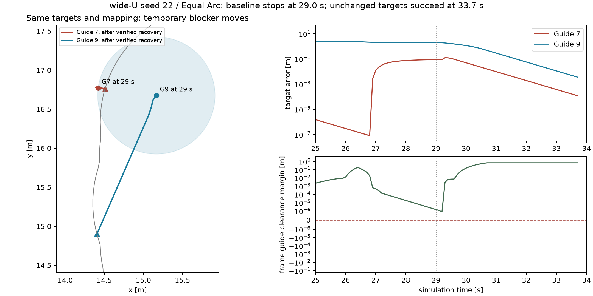
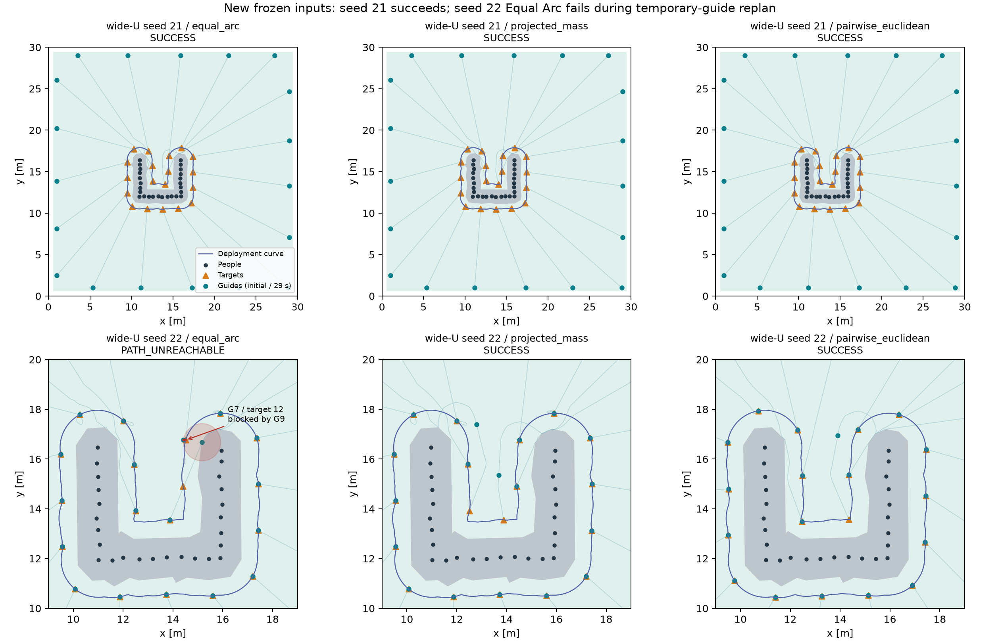

# Step 1 非凸记录重建 v1：固定目标恢复修复与回归

2026-10-19，Asia/Tokyo。本轮按用户授权依据记录新生成输入，不恢复旧45任务逐坐标证据。45行基线为35成功、9输入失败、1路径失败；修复后36成功、9输入失败。原九案例执行回归9/9成功。全部88条本轮执行轨迹独立复判一致，35条原已成功有效轨迹和原九案例轨迹逐坐标不变。目标调整实验0次。

## 版本和环境

在 `Major-Research-Branches` 上从 `5562d11b` 开始，工作区干净。`git fetch origin` 后正常合并 `origin/Major-Research-Branches`，返回Already up to date，远程仍为 `b5eb3418`。本地成果保留，不再等待旧主机提交；没有修改main、强制reset或推送。

新批次入口/输入接口提交为 `2c12886c`。修复执行版为 `547395f7`，源码哈希 `c55b5f9c00fd9ff53f694c48b797618f0d42a8f7bbd929a910228a14a1d07996`。首批seed20九任务在提交前运行，源码哈希 `580cfdc2b7756ec576221f58538483ec544d577a462ce0f31f9c60bb335c95e1`；与2c版本的精确差异保存在 `seed20_source_delta.patch`，已重建并与当时哈希核对一致，差异限未使用导入和未执行的输入拒绝工件写入。剩余36行基线在2c版本运行。每任务原provenance保留。

最终交付增加只读诊断和已有tag哈希防误用检查，导航/控制/安全与实际执行修复版一致，逐文件核对记录在summary。Windows工作区既有源码使用CRLF、新文件使用LF，字节级源码哈希按实际记录；这与坐标精度无关。

沿用uv 0.13.0、Python 3.12.15、editable本仓库；NumPy2.5.4、SciPy1.18.1、Shapely2.2.0、JuPedSim1.4.2、PedPy1.5.1。设备为Ultra7 258V、8核/8逻辑处理器、31.5GiB内存。首批串行，后续与回归最多2进程，每worker数值线程1；没有升级或重装依赖。

## 冻结协议与历史摘要的差异

配置：`configs/step1/nonconvex_record_rebuild_v1.yaml`。输出：`runs/step1_nonconvex_record_rebuild_v1/`。场景沿用 `scene_closure.scene_people`：细长16人、窄U22人、宽U26人，半径0.20m、demand=1、30m正方形房间、无人群动态。Guide数量固定11/13/19，不按新曲线或方法结果改数量。

每个场景—seed仅生成一次。人员各坐标加N(0,0.04²)m扰动。`SeedSequence([20261019, scene_index, seed]).spawn(3)`分别给人员、Guide和优化器；优化器目前确定性，不消费随机流。生成后人员中心距不足0.40m直接失败，不重抽。每方法共享完全相同的人员/半径/需求、Guide初态、房间和曲线，输入NPZ、SQLite、配置、规则与哈希先于执行保存。

“1.0m内缩”明确为**已知30m房间的内缩周界**，顶点按既有Environment的 `(1,1)→(1,29)→(29,29)→(29,1)` 方向。沿用0.012周长相位，每台Guide弧长再加独立U[-0.35,0.35]m扰动。不是人群内缩，也没有把生成区域交给控制器当边界。

本次人员观测估计1.3m外偏圆盘并集，闭运算0.30m、quad_segs16、采样0.10m。沿用九案例的**常数曲线密度**，不把它混同于人员demand经Gaussian映射的密度。Equal Arc/projected_mass用既有四相位；成对约束用7起点，每起点40迭代/20秒，数量与预算不放宽。以上随机流、方向、相位、密度是依据现有稳定实现补全的具体定义，因此不要求等于丢失的旧输入或22/11/12分布。

目标每方法重新规划一次，保存float64坐标、弧坐标和目标哈希。回归全部复用已保存目标，没有重新进行昂贵成对优化。未改0.75m人/Guide中心距、0.55m墙距、1e-7m安全数值容差、1.94m规划间隙、2.0m验收间隙、贴线阈值、400步/40秒和3次恢复预算。

## 完整45行结果与配对

下表每格顺序为Equal Arc / projected_mass / pairwise_euclidean；S=SUCCESS，INPUT=INITIALIZATION_INVALID，PATH=PATH_UNREACHABLE。每个单元三方法共享同一输入哈希。逐任务45行CSV（含目标哈希、结果、时间、路程、裕量）在 [tasks_45.csv](tasks_45.csv)；完整机器记录在 [summary.json](summary.json)。

| 场景 | seed | Guide数 | 基线三方法 | 修复三方法 | 共享输入SHA-256 |
|---|---:|---:|---|---|---|
| elongated | 20 | 11 | S/S/S | S/S/S | `11c5174778c405a817425496f632da1b5306abb1ad00236074d611a43ad08457` |
| elongated | 21 | 11 | S/S/S | S/S/S | `91035b0b7061be18e6f9c4df9c22f0856cbe547d689c2e45876c743b399a744b` |
| elongated | 22 | 11 | S/S/S | S/S/S | `98505a26d2a7865755a49ecc98f275bef7613ec57c760301b78f85e4864994b3` |
| elongated | 23 | 11 | S/S/S | S/S/S | `62b418eb58ecd3226ed7572d7acdb0e94fa8ddc748835e2ecc17fe50f87999ce` |
| elongated | 24 | 11 | S/S/S | S/S/S | `33d4ed6cb64851787cb02987406207aea35a58562838a416926a90d16f1c1581` |
| tight_u | 20 | 13 | S/S/S | S/S/S | `82423a1948842f776c01c4bd3db4f205a63330dfe9e2ad8c920b9bf2e83fa6d8` |
| tight_u | 21 | 13 | INPUT/INPUT/INPUT | INPUT/INPUT/INPUT | `33bf9920a779d2a2381be49e623e6d106276e6cfe9b6c1df9d73b5a26d599a02` |
| tight_u | 22 | 13 | INPUT/INPUT/INPUT | INPUT/INPUT/INPUT | `7fb3540f47a6f13e9bc5c2c917f82c820c5317fdc58125864f50a581ad836e66` |
| tight_u | 23 | 13 | S/S/S | S/S/S | `d7b3b3821920c030c18e965708e498285fc79bb4059cbc76e4a4f298a4303ec3` |
| tight_u | 24 | 13 | S/S/S | S/S/S | `2b85a5022ab5d62acdd7ab5fa3cee2372d42556a8cdd4e407f49fbddd60d9ece` |
| wide_u | 20 | 19 | S/S/S | S/S/S | `090e5f2370bf6537ba62c7ebd51d2770999df64289928170996cb41a90b740ff` |
| wide_u | 21 | 19 | S/S/S | S/S/S | `257fd9035f82c7935debd4603c038d3f400ea2162314729a8fa8efa3e59ed619` |
| wide_u | 22 | 19 | PATH/S/S | S/S/S | `92b3bd8ec118f5e4b42cf53b72b1c06d27000e58f54a7adcbc8a1912c4d42197` |
| wide_u | 23 | 19 | S/S/S | S/S/S | `17fb2e67a57b05912d12da9aac548437132f6d9442ed11fa4817c021618a6bcf` |
| wide_u | 24 | 19 | INPUT/INPUT/INPUT | INPUT/INPUT/INPUT | `90f15e1776b5ca8d8e0d05ccc5a8cc25b1e373fdf5eef769b4b0332a617f792b` |

45行全部完成，程序错误0，边界失败0，数量证书失败0，规划失败0。12有效输入单元对应36执行任务，全部目标几何接受。方法各15行：基线Equal Arc为11成功/1路径失败/3输入失败，其余各12成功/3输入失败；修复后各12成功/3输入失败。总体成功35/45→36/45，有效输入成功35/36→36/36。9行输入失败始终保留在45分母；这不是正式盲验证或一般成功率保证。

| 输入失败单元 | seed | 最小人员中心距m | 保留方法行 |
|---|---:|---:|---:|
| tight_u | 21 | 0.385470707 | 3 |
| tight_u | 22 | 0.358518504 | 3 |
| wide_u | 24 | 0.375503676 | 3 |

## 唯一路径失败：宽U seed22 Equal Arc

分类为**执行中的重算/恢复流程问题**，不是初始端点、静态分量、初始匹配或目标几何失败。

- 第290帧，29.0s，Guide7→目标12；实际位置 `[14.422197484312115,16.772271038897646]`，目标 `[14.510189630098216,16.762949942081136]`。
- 起终点静态保守域有符号距离分别+0.726955424m、+0.638844692m，均属于分量0；整条原轨迹没有超过1e-7m容差的静态域越界。静态直连已找到并独立核验人/墙安全。
- 目标距Guide9中心0.661545995m，低于0.75m，因而不在“其他Guide固定为临时障碍”的重算域中。Guide7起点仍在该域。若Guide9保持不动，直连独立安全检查失败，不能原样当作安全单Guide通道。
- 原控制器首次route_assigned抛错后即终止，`replan_count=0`、事件表为空；并非没有尝试重算。它未进入已有reachable_reassignment策略。

因此“当前临时障碍域中端点无效”不等于“物理静态环境中不存在路径”。保存数据包含自由空间GeoJSON及哈希、原路径、航点索引、位置、目标、指派、异常与安全残差。完整证据见 [diagnostics.json](diagnostics.json) 及 `runs/.../diagnostics/failure_and_repair.json`。

## 最小修复与固定目标证据

在原3次预算内计入失败查询，实际状态安全时继续尝试既有reachable_reassignment。候选路径集必须完整求出，对实际起点及每条人/墙路径段独立检查后才原子安装；Guide间同时运动仍走原安全速度过滤及逐段安全检查。不安全状态、预算耗尽、匹配或路径验证失败仍终止。没有捕获后盲目继续原路径、瞬移、删除障碍、放宽阈值或增加预算。

修复案例先在29.0s拒绝固定身份重算，再成功调用已有静态域可达匹配接口。**返回的身份映射与原映射完全一致**，目标也逐坐标不变；实际变化是重新生成并验证完整路径集，让既有安全执行继续协调Guide9运动。基线到失败帧的所有位置与修复轨迹前缀逐坐标相同；修复后33.7s完整成功。

失败尝试耗时0.014075s，成功恢复0.183386s，共消耗2次预算。保存前后路径、指派、目标及精确帧；终端最大跟踪误差约0.003623m，最小净距人/Guide/墙为0.045808801 / 5.824917e-8 / 0.45m。

导航只增加同一次指派内的静态可见边复用，几何改变会新构图，不使用跨几何缓存；未将其他Guide加入初始全配对图。重算端点被其他Guide占据时现在显式记录，纯搜索失败改为“未找到”，不宣称严格无路径。



## 宽U seed21与seed22三目标对照

本次seed21三方法基线均SUCCESS，不能延用旧摘要的两失败结论。三套目标初始端点全有效、静态自由域只有一个分量，已有完整匹配的19条路径逐条找到并独立验证。每单元复用一份静态图，仅查询已有匹配；其余同分量边明确标为“未查询”，没有冒充逐对已验证路径，也未声称所有多Guide同时路径组合可行。

seed21的projected_mass和成对目标相对Equal Arc集合Hausdorff距离约0.006406525m，三者均成功。seed22的projected_mass约0.006428533m，成对目标约0.475425310m；它们基线成功，而Equal Arc遇临时阻塞。目标差异影响本次协调轨迹，未呈现静态可达性或完整匹配能力差异。Equal Arc原目标经恢复修复也成功，因此不需要改变目标才能完成这例部署。固定目标恢复与三套不同目标的对照分别记录，新增目标调整实验0次。



## 回归、独立复判与性能

36个有效任务固定输入/固定目标回归全部SUCCESS；9行输入失败仍失败。修复前已成功35条轨迹逐坐标不变，无新增退化。原九稳定案例实际执行9/9成功，人员、初态、目标和完整位置轨迹与原修复结果逐坐标一致，不只是读取旧成功标志。

全部88条执行轨迹都有独立保存复判且差异0：基线36、首轮最小重放6、最终单例1、正式固定输入回归36、原九案例9；独立成功87、原基线失败1。输入失败快照另外保留并复判，不伪装成执行轨迹。主回归执行数量为36+9=45，不把9行输入失败算作执行；首轮/单例诊断重放单独计数。

有效36任务修复后仿真时间范围18.1–36.2s，中位18.8s；实际路程范围143.360709–253.962435m，中位164.096127m。执行墙钟中位0.719908s，最大1.947544s；规划计时另列，不将输入失败时间填零后比较速度。`metrics.path_length`是控制器最近安装导航的路径长度，不等同实际执行路程，CSV按轨迹重新求和。

全36轨迹的最小净安全裕量人/Guide/墙分别为0.0260591707 / 9.95975546e-09 / 0.45m。正常19×19导航（域构造、一次静态图、必要查询与匹配）单次实测0.134958s，1条数值线程；单次测量不作为跨机器速度结论。

| 方法 | 目标规划任务数 | 规划墙钟中位s | 最大s |
|---|---:|---:|---:|
| equal_arc | 12 | 0.011171 | 0.017923 |
| projected_mass | 12 | 0.010679 | 0.015682 |
| pairwise_euclidean | 12 | 3.878297 | 15.739075 |

最终完整测试94 passed（15.10s），uv检查71包兼容，pip check无损坏依赖。新增测试覆盖随机流隔离、全精度初态快照、失败三行记账、旧tag防覆盖、临时目标占据后的恢复、失败预算、不安全实际状态保护、同域图复用及变更几何重构；未为凑主机测试数添加空测试。

## 可复制PowerShell命令

在仓库根目录运行。已有结果可以只读汇总和诊断；旧tag在源码或输入不同时会拒绝复用，要求新标签，防止覆盖证据。

```powershell
git status --short --branch
.\.venv\Scripts\python.exe -c "import udc; print(udc.__file__)"
uv pip check --python .venv/Scripts/python.exe
.\.venv\Scripts\python.exe -m pip check
.\.venv\Scripts\python.exe -m pytest -q
.\.venv\Scripts\python.exe -m udc.experiments.nonconvex_rebuild --output runs/step1_nonconvex_record_rebuild_v1
.\.venv\Scripts\python.exe -m udc.experiments.nonconvex_diagnostics --output runs/step1_nonconvex_record_rebuild_v1
# 若按需重做当前版本执行，复用已有输入/目标，使用尚不存在的新标签：
.\.venv\Scripts\python.exe -m udc.experiments.nonconvex_rebuild --run --tag verification_current --seeds 20 --workers 1
.\.venv\Scripts\python.exe -m udc.experiments.nonconvex_rebuild --run --tag verification_current --seeds 21 22 23 24 --workers 2
# 全新空目录从头建立输入时，先--freeze，再执行；不得覆盖现有本轮目录：
# .\.venv\Scripts\python.exe -m udc.experiments.nonconvex_rebuild --output <new-empty-run-directory> --freeze
```

未创建backups、未复制整个runs、未重做1620正式任务或300曲线、未增加seed/估计器、未进入Step2/3。图和诊断是已保存输入上的独立分析，不是旧45原始证据恢复。

## 当前判断与下一步

本轮唯一执行失败来自临时Guide占据下的恢复流程提前终止，已在原目标、原映射和原安全预算下解决；没有发现静态目标不可达或初始匹配错误。原九案例继续成功。仍保留的9行是一次抽样后真实输入失败，不属于已修复导航问题。

下一轮优先在这份固定目标回归集上完善**临时占据与静态不可达的显式恢复判别和联合执行证据**。本批没有要求把可达性约束加入目标规划的实证，也不能据此证明所有非凸目标均可部署；暂不开发复杂新部署控制器或扩大矩阵。
