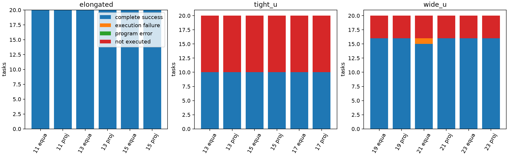
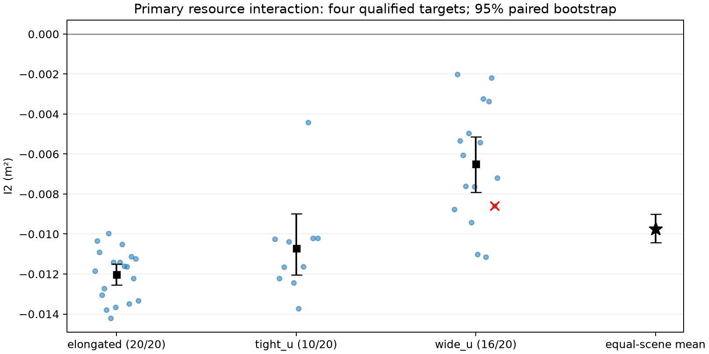
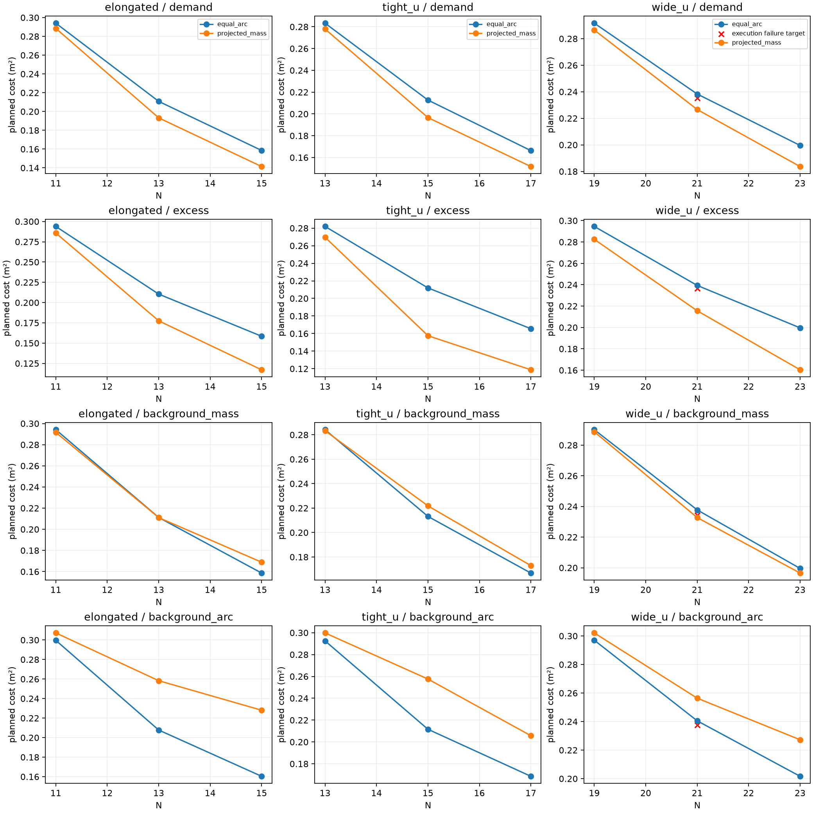
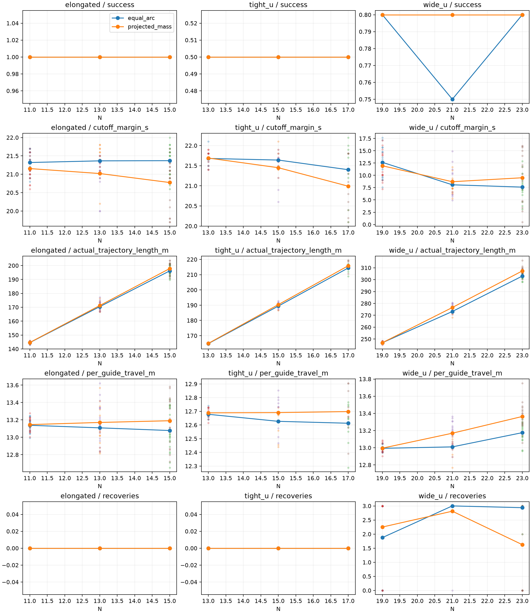

# 非凸需求部署的Guide资源规律：新输入配对确认 v1

本轮按运行前协议完成seed95–114的60份新人员输入、360行主台账和60条共同数量诊断。唯一主要指标I₂的**三场景等权均值为-0.00974503m²，95%配对bootstrap区间[-0.01043372, -0.00901206]m²**，支持本批预定的I₂<0方向；46个有效四目标配对均为负。这里没有使用不等样本量的合并均值-0.00981669替代场景等权值。

实际结果为**275 SUCCESS、78 INITIALIZATION_INVALID、6 BOUNDARY_INVALID、1 TIMEOUT；360条编排状态均OK**。276条新运动轨迹中275条通过独立物理部署验收、1条安全但未完成；62,834个完整运动区间零安全违反。规划资源交互得到本批确认，40秒完整执行仍有边界，不能写全部成功或Guide越多越容易部署。唯一失败wide_u seed113 N21 Equal完整保留，没有重试、修复或追加样本。

## 1. 基线、预注册顺序与新seed审计

分支Major-Research-Branches，起点dafc4aba干净，科学基线865e6a48。先阅读AGENTS、架构、原资源报告及恢复诊断。原65份执行／科学Python文件与865e6a48规范化Git内容一致；布局、需求、相位、导航端点修复、联合安全、优先恢复、进展监测和独立评价不变。唯一已有源码改动是资源统计导出器的锁／元数据适配，未改原数值统计函数；另加本轮编排和统计模块。全部实际运行使用同一提交、同一完整源码SHA，原恢复第二策略失败短路边界保留。

运行前协议／配置／编排／统计／测试先提交为**0433bb194c2d87f8dd61e26fb4d5fd8b6f1d1e0c**，工作区干净后才审计选seed，之后才生成输入，再全量冻结，再首seed18行串行、余342行最多2worker。首批18行全成功，46.264856s，计入360一次；余342行408.497659s，普通科学超时保留继续，无停止／重试／批内科学变更。每worker数值线程1，反事实显式0。

本机审计读取1153份配置、manifest、报告／输入元数据文件并检查现有输入目录标记，相关namespace20261019记录排除60个场景seed单元；其他协议或未归属记录单列，不把重复元数据条数当样本数。从95起按预定“全部三场景均未暴露的首个连续20seed区间”选中95–114，未触发顺延。审计范围仅本仓库本机现存文件，未查其他设备、缺失文件或未记录的运行；同整数不同namespace不自动认定相同输入。没有使用5000–5029。

60次原draw_cell调用、零重抽／替换；新60份全精度人员／半径／场地哈希唯一，与上批60份人员哈希重叠0。种子审计在人员生成前完成，输入和任务选择均在方法结果出现前锁定。[审计](seed_audit.json)、[冻结协议](PROTOCOL.zh.md)、[manifest](manifest_360.json)和[输入／ID映射锁](inputs_frozen.json)可逐项核对。

## 2. 固定物理输入、需求、方法和嵌套初态

同一场景seed的三N共用人员、半径、房间、观测需求、边界、曲线、静态域、rho和热点窗口。需求仅原热点B：背景1，原固定圆盘内5；圆心elongated[12,14.75]、tight_u[12,16.4]、wide_u[11,16.4]，半径1.2m；Gaussian带宽1.2m，原全曲线尺度／归一化／周期插值／2048中点积分。热点成员与“超额质量占局部总质量至少一半”的窗口在目标出现前冻结，不随N或目标重画；背景质量为原总质量减超额质量，背景弧段为冻结窗口外弧长，两者不互换或相加。

方法equal_arc+all_phase_256和projected_mass+all_phase_256；后者是Lloyd迭代、弧间隙约束布局与共用有限相位搜索的组合。四布局初值原顺序、300轮／停止规则、浓度1、双方256相位、原网格／循环索引／接纳／tie-break均冻结。每候选检查原曲线、闭合gap、全成对距和静态入域；原rho评分，目标选定后才导航／指派，失败不得换相位。没有浓度减半、Equal回退或目标重优化。

N为elongated11/13/15、tight_u13/15/17、wide_u19/21/23。基准Guide按原生成器、namespace和独立随机流得到；原Guide位置和零起始ID完整保留。沿保存内缩周界方向与弧原点，逐次拆最大周期弧间隙在中点追加，精确并列取最小起始弧坐标，ID追加。60单元逐位核验基准初态、N₀+2／N₀+4前缀及ID；180组Guide安全检查均通过。这里的初态合法不代表人员源合法；人员另独立拒绝。此政策不等同各N独立均匀重抽。

全部60份输入、180组Guide初态／映射、合法曲线的静态域WKB、rho及窗口、360行manifest和1284个输入工件哈希，均在任何方法结果前写完。13个人员拒绝和1个边界拒绝各保留六行，无曲线单元没有伪造rho／目标／运动。旧资源360行、两条EXPERIMENT_ERROR、原唯一科学失败及276固定目标回归均只读保留，未将开发证据改称本轮新输入结果。

## 3. 数量必要条件、阶段失败与完整分母

|场景|合法曲线|L范围m|ceil(L/1.94)|ceil(L/2)|floor(L/.75)|N₀−1的2m数量未排除|
|---|---|---|---|---|---|---|
|elongated|20|20.5313–20.9544|11|11|27|0|
|tight_u|10|23.9222–24.3012|13|12/13|31/32|1|
|wide_u|16|35.4497–35.8372|19|18|47|16|

60条N₀−1诊断仅共同数量检查，无目标或运动，不按方法重复、不入360成功率；14条曲线缺失为null。有效曲线的低N均违反1.94m规划必要条件，但其中满足2m数量必要条件者不能称资源绝对不足；主N数量未排除也不证明欧氏间距、静态入域、完整可达指派或40秒联合执行。全部180组L/N、1.94−L/N与上下界见台账和输入锁。

|场景|N|物理|人员合法|曲线合法|双方目标合格|双方成功|仅Equal|仅projected|双方失败|成功行/40|
|---|---|---|---|---|---|---|---|---|---|---|
|elongated|11|20|20|20|20|20|0|0|0|40|
|elongated|13|20|20|20|20|20|0|0|0|40|
|elongated|15|20|20|20|20|20|0|0|0|40|
|tight_u|13|20|10|10|10|10|0|0|10|20|
|tight_u|15|20|10|10|10|10|0|0|10|20|
|tight_u|17|20|10|10|10|10|0|0|10|20|
|wide_u|19|20|17|16|16|16|0|0|4|32|
|wide_u|21|20|17|16|16|15|0|1|4|31|
|wide_u|23|20|17|16|16|16|0|0|4|32|

共同物理分母60，人员合法47（20/10/17），曲线合法46（20/10/16）。各N均120行、94个人员合法配置行、92个曲线／目标合格行；主要四目标和全六目标共同子集恰为同46输入，各N自己的规划对子集也同46。故本批规划趋势没有目标子集选择变化。各N双方成功运动子集46/45/46，全六配置共同成功45（20/10/15）；运动比较另固定。

|N增量|完整成功/全部行|成功/实际运动|共同输入／边界拒绝|科学执行失败|程序错误|
|---|---|---|---|---|---|
|0|92/120|92/92|28|0|0|
|2|91/120|91/92|28|1|0|
|4|92/120|92/92|28|0|0|

人员／边界拒绝明细：{'elongated': {'INITIALIZATION_INVALID': [], 'BOUNDARY_INVALID': []}, 'tight_u': {'INITIALIZATION_INVALID': [96, 98, 99, 100, 102, 106, 108, 110, 111, 113], 'BOUNDARY_INVALID': []}, 'wide_u': {'INITIALIZATION_INVALID': [97, 102, 106], 'BOUNDARY_INVALID': [99]}}。数量、布局／相位有限搜索、初始指派路径均无额外拒绝；安全、程序错误和外部中断为0。未执行84行的时间、路程、恢复和安全运动证据为null。全部360行分别保存runner、编排和独立物理状态，不将275/360=76.39%的完整分母替换成条件性275/276=99.64%。



## 4. 唯一主要I₂及配对不确定性

|场景／汇总|有效配对/物理分母|I₂均值m²|95%区间m²|负/零/正|
|---|---|---|---|---|
|elongated|20/20|-0.01202372|[-0.01255376, -0.01150370]|20/0/0|
|tight_u|10/20|-0.01071476|[-0.01204414, -0.00899102]|10/0/0|
|wide_u|16/20|-0.00649662|[-0.00791626, -0.00513867]|16/0/0|
|三场景等权|46/60|-0.00974503|[-0.01043372, -0.00901206]|46/0/0|

统计严格使用运行前锁定RNG2026102003、10000次分层整物理单元配对bootstrap，每层全部20单元（含缺失）一起抽取其全部N、方法及阶段状态，每次重算条件均值后场景等权。五个预定估计量及三个分层均无不可计算重采样（0/10000），各层有效对20/10/16均≥2；不是把360行当独立样本。95%百分位区间描述这些固定模板与条件性合格目标，不代表任意非凸几何。主指标／方向／子集没有因结果改动。



蓝点为有效四目标物理配对，黑方块／星号为分场景／等权均值及95%区间，红×为包含本轮超时配置的配对，其合格规划目标仍保留。全部逐对值见[主要与次要交互CSV](primary_and_secondary_interactions.csv)。其中relative_pct是按基准绝对方法差归一化的探索字段，不是总需求降低百分比，本报告不以它解释I₂。

## 5. 同N布局收益与各方法资源收益分账

|增量|Equal J m²|projected J m²|ΔJ m²|逐对相对差等权|ΔJ的95%区间|改善/持平/恶化|
|---|---|---|---|---|---|---|
|0|0.28965953|0.28429734|-0.00536219|-1.8519%|[-0.00591448, -0.00487503]|46/0/0|
|2|0.22059997|0.20549274|-0.01510723|-6.9321%|[-0.01552387, -0.01470111]|46/0/0|
|4|0.17481984|0.15892640|-0.01589345|-9.1922%|[-0.01614921, -0.01562823]|46/0/0|

|场景|Δ₀ m²|Δ₂ m²|Δ₄ m²|Δ₄−Δ₂ m²|
|---|---|---|---|---|
|elongated|-0.00551906|-0.01754278|-0.01713302|0.00040976|
|tight_u|-0.00538298|-0.01609774|-0.01464009|0.00145765|
|wide_u|-0.00518454|-0.01168116|-0.01590723|-0.00422606|

次要I₄等权均值-0.01053125m²，95%区间[-0.01110448, -0.00994957]。两种交互在全六目标共同子集上的值与本批各自四目标子集严格相同，仍分别导出。N₀+2到N₀+4的绝对优势在elongated和tight_u缩小、wide_u扩大；总量相对百分比可随Equal基准下降而增大，不能称绝对优势持续加速。

|方法|增加Guide|自身有效配对|自身ΔJ m²|逐对相对资源变化等权|降低对数|
|---|---|---|---|---|---|
|Equal|2|46|-0.06905956|-23.8389%|46|
|Equal|4|46|-0.11483968|-39.6447%|46|
|projected|2|46|-0.07880460|-27.7209%|46|
|projected|4|46|-0.12537094|-44.0934%|46|

三档各46配对projected总需求代价均低于Equal；两方法自身增加2或4名Guide也在全部46对降低J。资源带来的共同下降与同N布局差分别记账，不把两者全部算作projected算法优势。最差（收益最小）同N案例：

|增量|物理输入|ΔJ m²|逐对相对差|
|---|---|---|---|
|0|wide_u__seed_110|-0.00227866|-0.7791%|
|2|wide_u__seed_96|-0.00819968|-3.4653%|
|4|tight_u__seed_104|-0.01273192|-7.6366%|

全主矩阵最大合格规划J为elongated__seed_107__N_11__equal_arc，0.30020820m²；这与最小方法收益案例是不同口径。

## 6. 热点和两种背景取舍

|指标|N增量|同N projected−Equal m²|逐对相对差等权|降低/持平/增加|
|---|---|---|---|---|
|excess|0|-0.01086238|-3.7516%|46/0/0|
|excess|2|-0.03703906|-17.0877%|46/0/0|
|excess|4|-0.04246864|-24.6764%|46/0/0|
|background_mass|0|-0.00161223|-0.5542%|40/0/6|
|background_mass|2|0.00115763|0.6280%|26/0/20|
|background_mass|4|0.00444334|2.8691%|16/0/30|
|background_arc|0|0.00665419|2.2732%|1/0/45|
|background_arc|2|0.03745209|17.5882%|0/0/46|
|background_arc|4|0.04349278|25.7223%|0/0/46|

同N背景弧段相对代价随档位约为+2.27%、+17.59%、+25.72%，热点超额收益扩大；背景质量从基准略降转为增加。该取舍不能替代跨N自身背景绝对变化：

|方法|增加Guide|指标|自身绝对变化m²|降低/全部有效对|
|---|---|---|---|---|
|Equal|2|excess|-0.06954480|46/46|
|Equal|2|background_mass|-0.06876975|46/46|
|Equal|2|background_arc|-0.07641639|46/46|
|Equal|4|excess|-0.11558010|46/46|
|Equal|4|background_mass|-0.11445739|46/46|
|Equal|4|background_arc|-0.11951377|46/46|
|projected|2|excess|-0.09572148|46/46|
|projected|2|background_mass|-0.06599989|46/46|
|projected|2|background_arc|-0.04561849|46/46|
|projected|4|excess|-0.14718636|46/46|
|projected|4|background_mass|-0.10840183|46/46|
|projected|4|background_arc|-0.08267517|46/46|

两方法相对N₀增加2或4名Guide后的背景绝对代价在本批全部配对下降，不能把“projected同N背景高于Equal”写成“增加Guide使背景绝对更差”。所有J保持同一冻结需求和归一化、m²不重缩放；图线为各N合格规划目标均值，包含后续失败，红×标出实际执行失败的目标，共同拒绝没有伪代价。



## 7. 部署、截止余量、真实路程与协调成本

下表使用各N自己的双方完整成功配对，两方法严格相同输入集合：

|场景|N|方法|配对n|成功时间s|40s余量s|真实总路程m|每Guide m|恢复均值|
|---|---|---|---|---|---|---|---|---|
|elongated|11|Equal|20|18.680|21.320|144.517|13.138|0.000|
|elongated|11|projected|20|18.845|21.155|144.604|13.146|0.000|
|elongated|13|Equal|20|18.635|21.365|170.410|13.108|0.000|
|elongated|13|projected|20|18.980|21.020|171.217|13.171|0.000|
|elongated|15|Equal|20|18.630|21.370|196.167|13.078|0.000|
|elongated|15|projected|20|19.225|20.775|197.854|13.190|0.000|
|tight_u|13|Equal|10|18.320|21.680|164.817|12.678|0.000|
|tight_u|13|projected|10|18.310|21.690|164.953|12.689|0.000|
|tight_u|15|Equal|10|18.360|21.640|189.401|12.627|0.000|
|tight_u|15|projected|10|18.550|21.450|190.358|12.691|0.000|
|tight_u|17|Equal|10|18.600|21.400|214.417|12.613|0.000|
|tight_u|17|projected|10|19.010|20.990|215.866|12.698|0.000|
|wide_u|19|Equal|16|27.350|12.650|246.869|12.993|1.875|
|wide_u|19|projected|16|28.050|11.950|246.899|12.995|2.250|
|wide_u|21|Equal|15|31.920|8.080|273.206|13.010|3.000|
|wide_u|21|projected|15|31.120|8.880|276.687|13.176|2.800|
|wide_u|23|Equal|16|32.394|7.606|303.034|13.175|2.938|
|wide_u|23|projected|16|30.488|9.512|307.367|13.364|1.625|

全六配置共同成功45输入（20/10/15）的场景等权结果如下，避免把seed113在N21的剔除误作资源趋势。完整分层双子集见[motion_paired_subsets.csv](motion_paired_subsets.csv)。

|N增量|方法|成功时间s|40s余量s|真实总路程m|每Guide m|恢复均值|
|---|---|---|---|---|---|---|
|0|Equal|21.551|18.449|185.421|12.937|0.667|
|0|projected|21.792|18.208|185.506|12.944|0.733|
|2|Equal|22.972|17.028|211.005|12.915|1.000|
|2|projected|22.883|17.117|212.754|13.012|0.933|
|4|Equal|23.108|16.892|237.913|12.957|0.978|
|4|projected|22.756|17.244|240.345|13.083|0.511|

增加N自然增加总路程，每Guide量的变化较小；wide_u的联合执行、恢复和时间余量负担更明显，但不同N／方法不是单调关系。elongated／tight_u本批无需恢复。全276运动恢复次数分布为0次198、2次2、3次76，失败查询共76次；合法重指派全部通过连续事件链，非法变化0。用满三次预算的成功与约1e−8m净裕量不证明噪声鲁棒性或一般收敛。



图中成功率包含该N全部20物理单元；时间等点线是各方法成功行的描述，不把不同成功集合直接解释成配对效应。失败终止40s不进入成功时间或成功截止余量。规划、完整成功、实际失败和未执行由两张图及完整台账区分。

最慢完整成功为wide_u__seed_95__N_23__projected_mass，39.5s，余0.5s、恢复3次，真实总路程316.302379m。接近40秒只说明本次完成，不能称预算宽裕。

## 8. 唯一超时与分开记账

wide_u__seed_113__N_21__equal_arc：runner TIMEOUT、编排OK、独立物理失败；400个区间／40.0s，全部区间安全。目标合格、初始完整指派路径通过，L=35.449691m、平均gap=1.688081m、规划平均余量=0.251919m，最小目标成对距1.599814m、静态入域余量0.458251m。数量和目标余量不能保证联合执行截止。

|时刻s|策略|接纳|路径安装|剩余预算|分类|
|---|---|---|---|---|---|
|14.9|path_recompute|False|False|2|current_guide_occupation|
|14.9|reachable_reassignment|True|True|1|verified_path_set_installed|
|16.9|priority_yield|True|False|0|priority_yield|

priority_yield的路径安装False表示没有替换路径，accepted=True表示原优先模式接纳，不能读作恢复失败。原日志记录该模式231步，进展加强尝试30次、安装28次、拒绝2次；这里只保留观察，不以这些计数宣称已确定超时机制。

末态最大目标误差0.514298m，到达、贴线、gap和覆盖未通过，几何／数量／规划／路径／安全通过。实际终止路程270.655936m、每Guide12.888378m只描述失败过程，不能当同完成度成功成本。三次预算全部使用，已有priority_yield激活，并非本轮修复或绕过第二策略短路；这一运行记录本身不足以证明根因或动态无解。其合格规划J与I₂始终保留。

失败全精度输入、初态、原目标、初始指派、实际轨迹、原metrics、配置和恢复事件只保存在唯一runs路径，固定引用和哈希见[fixed_execution_failures.json](fixed_execution_failures.json)，不从CSV舍入值重建。本轮没有开发诊断干预、目标重优化、延时、增预算或继续重跑。下一轮唯一研究问题应先针对这一冻结超时，检验原优先协调进展与40秒边界的机制；不自动启动新的大型矩阵或外推。

旧资源主台账继续273成功、84拒绝、2程序错误、1科学失败；旧物理275成功与随后固定目标回归276成功分别保留。本轮是新输入275成功＋1科学超时，程序错误0。两条旧编排错误没有被本轮“修复成两个部署成功”，也没有将三类状态合成导航失败。

## 9. 独立复判、积分、终态评分和计算成本

全360行重新独立核查，276实际轨迹逐完整运动区间评价，共62834区间，criteria／diagnostics／success不一致0；独立物理275通过、1未完成、未执行84为null。全部276合格目标从保存NPZ坐标重算2048／8192积分，主／细值均匹配，方法差符号变化0；最大单目标积分变化0.0000142444m²，最大配对差变化0.0000208404m²，不重选相位。总量及热点／背景细值保存为[全量积分核查](all_independent_integrations.json)。

|区间净裕量|最小m|
|---|---|
|crowd|0.012709415952|
|guides|0.000000008293|
|walls|0.450000000000|

全部合格目标的几何边界描述如下（单位m，每格为相应组最小值；最大弧gap列为最大值）。逐目标原值和域／曲线hash在360台账及计划工件中。

|增量|方法|目标最小成对距|静态入域余量|最小弧gap|最大弧gap|
|---|---|---|---|---|---|
|0|Equal|1.521767|0.423383|1.840171|1.904948|
|0|projected|1.132740|0.430501|1.470894|1.940000|
|2|Equal|1.397105|0.133188|1.579330|1.706532|
|2|projected|0.871296|0.170376|1.190391|1.940000|
|4|Equal|1.141578|0.001411|1.368753|1.558138|
|4|projected|0.808514|0.428801|1.052377|1.940000|

保持原人／Guide中心距0.75m、墙0.55m、容差1e−7m、规划裕度0.11m、偏移1.3m、规划／执行gap1.94/2m、最大速度1m/s、400步40s、恢复3次及原到达／速度／保持／贴线／默认严格圆盘覆盖。完整线段、真实起点、数值边界节点修复、原子安装、联合过滤、进展约束和优先监测均保留，没有epsilon或接纳分辨率切换。

实际终态沿原规则投影到同一冻结曲线后评价，另独立检查贴线／覆盖；下面仅该N双方完整成功配对，失败终态代价仍在360台账但不冒充完整部署收益。

|增量|双方成功配对|实际终态需求Δ m²|逐对相对差等权|
|---|---|---|---|
|0|46|-0.00536902|-1.8541%|
|2|45|-0.01509947|-6.9272%|
|4|46|-0.01590147|-9.1966%|

|增量|方法|布局均值s|相位均值s|导航均值s|runner均值s|8192评价均值s|行复判均值s|
|---|---|---|---|---|---|---|---|
|0|Equal|0.0019|0.5224|0.0866|1.5188|0.0046|0.0921|
|0|projected|0.0309|0.5306|0.0873|1.5513|0.0040|0.1011|
|2|Equal|0.0021|0.5950|0.1058|1.8536|0.0039|0.1057|
|2|projected|0.0345|0.5928|0.1023|1.7861|0.0040|0.1097|
|4|Equal|0.0023|0.6349|0.1224|1.9959|0.0045|0.1140|
|4|projected|0.0668|0.6512|0.1285|1.7817|0.0045|0.1180|

计算成本均按实际进入相应阶段的行统计，行复判还含拒绝检查；非算法复杂度或跨机速度证明。首批串行46.264856s、余批408.497659s，最终全量独立复判含积分43.711519s；该机同一冻结环境，无依赖升级。

## 10. 来源、测试、哈希与复现命令

运行前212 passed/28.65s；最终212 passed/29.14s，pip check无冲突，compileall及diff检查通过。测试覆盖I₂四目标与全六子集区别、执行失败保留规划指标、场景等权、整物理单元缺失重采样、区间不可计算规则、运动子集，以及继承的导航数值端点、临时占据、安全、原子安装、合法重指派和编排错误不覆盖raw metrics。测试数不能代替本批案例证据。

Python3.12.15、numpy2.5.4、scipy1.18.1、shapely2.2.0、PyYAML6.0.3、jupedsim1.4.2，其他包版本、解释器与仓库src导入路径见[environment.json](environment.json)。全部276新runner记录clean运行前提交；原65源文件规范化Git一致、原始字节哈希另列，完整新源码聚合SHA及配置／输入锁如下。后续仅生成报告／图和只读身份核对，没有改变冻结src统计或执行源码。

|记录|SHA／值|
|---|---|
|运行提交|0433bb194c2d87f8dd61e26fb4d5fd8b6f1d1e0c|
|完整源码SHA|dcac16daf240271dd34e5694f4f127bbefbe2a9ffe687ab2384dff7327111169|
|配置SHA|c34ea9290a3ceee465ac1a8de30fd8e8f7f14527613e27a3978448ed3aba1bfd|
|protocol SHA|a06c11b2d3a056881cf8fbc9bbbe81cdc195776dec0eb61b1f0596dfafd03b43|
|manifest SHA|f4b3f991c0eb98e33baf5566093558c54569d00c6aaf29964045bdc3bc998a7f|
|inputs lock SHA|4f7fb761035e10088b7f89f6f2c1b4ca7a73c2c83a89ae45118f3429acac93ae|
|本机历史保护文件|12788|

12,788项历史工件／报告保护引用和1,284项新输入工件全部核验未变，360行身份审计、60组嵌套ID核验通过。新计划／目标／轨迹的完整逐文件hash见[raw_checksums.json](raw_checksums.json)，runner／编排／物理分列见[状态审计CSV](runner_orchestration_physical_audit.csv)；没有复制整runs、backups或覆盖旧结果。报告导出脚本仅格式化已冻结统计，独立身份脚本只读核对并另写新目录侧文件。

实际PowerShell流程（各阶段已运行，不能在现有目录重试或覆盖）：

```powershell
$py = ".\.venv\Scripts\python.exe"
$out = "runs/step1_nonconvex_resource_confirmation_v1"
$env:PYTHONUTF8 = "1"
$env:UDC_PRIORITY_STALL_COUNTERFACTUAL = "0"
$env:OMP_NUM_THREADS = "1"
$env:OPENBLAS_NUM_THREADS = "1"
$env:MKL_NUM_THREADS = "1"
$env:NUMEXPR_NUM_THREADS = "1"
# 协议、配置、编排、统计和测试先提交0433bb19，git status干净
& $py -m udc.experiments.resource_confirmation --stage prepare
& $py -m udc.experiments.resource_confirmation --stage freeze
& $py -m udc.experiments.resource_confirmation --stage first --workers 1
& $py -m udc.experiments.resource_confirmation --stage remaining --workers 2
& $py -m udc.experiments.resource_confirmation --stage rejudge
& $py -m udc.analysis.resource_confirmation
& $py reports/step1_nonconvex_resource_confirmation_v1/audit_identity.py
& $py reports/step1_nonconvex_resource_confirmation_v1/export_report.py
& $py -m pytest -q --basetemp=.tmp/pytest-resource-confirmation-final
& $py -m pip check
& $py -m compileall -q src
git diff --check
```

Git保存源码、配置、测试、协议和报告，runs保存唯一原始输入／目标／状态／轨迹，不推送、不合并main。包含本机绝对路径的引用不保证新克隆自动拥有runs；复现需保留唯一工件与相同环境。

## 11. 结论、适用范围与停止

本批新输入重复了同N需求布局收益，也确认预定N₀→N₀+2绝对方法优势扩大的资源交互；两方法自身均获得资源覆盖收益，热点加密伴随同N背景覆盖取舍。目标全成对距离、静态自由空间、弧gap硬约束与需求加密在冻结有限搜索中同时检查，有限结果不证明真实最优或关于N的全局单调性。

原端点一致性修复属于系统正确性，不是新增部署规划算法贡献。本轮未修改科学模块；新TIMEOUT体现规划可行与40秒联合执行间的适用边界，不能用原276回归全成功覆盖它。N多带来更多Guide联合运动／路径／恢复负担，wide_u的恢复和低截止余量与几何、初始化、目标共同相关；本批没有用反事实隔离其因果机制，也不从三个模板推导通用几何定律。

当前证据限静态单人群、已知场地、全局精确观测、无限通信、无Guide–Crowd交互、冻结热点B／Gaussian需求和嵌套周界初态、N11–23。需求是规划优先级，不是真实风险、containment或完整RA-ABDC证据；不称大规模可扩展性，不设任意综合分数，不把N₀+2命名为通用最优。统计区间不覆盖全部非凸几何或观测噪声。

本轮固定批次在360行结束，不追加seed、N、热点强度或恢复预算。先冻结本批规划确认和执行边界证据，下一轮仅为wide_u seed113 N21 Equal的原输入／目标设计开发诊断；论文整合与其他外推另立协议，本轮不启动几何／规模／噪声或Step2/3。一页主线见[RESEARCH_NOTE.zh.md](RESEARCH_NOTE.zh.md)。
