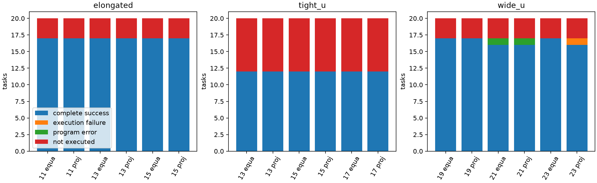
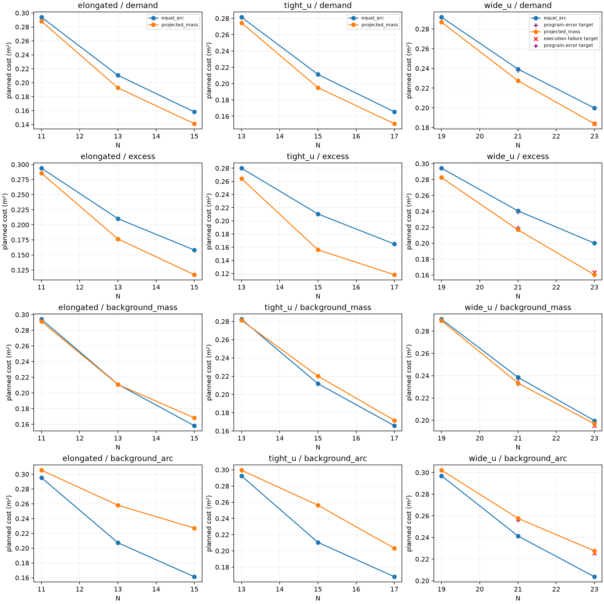
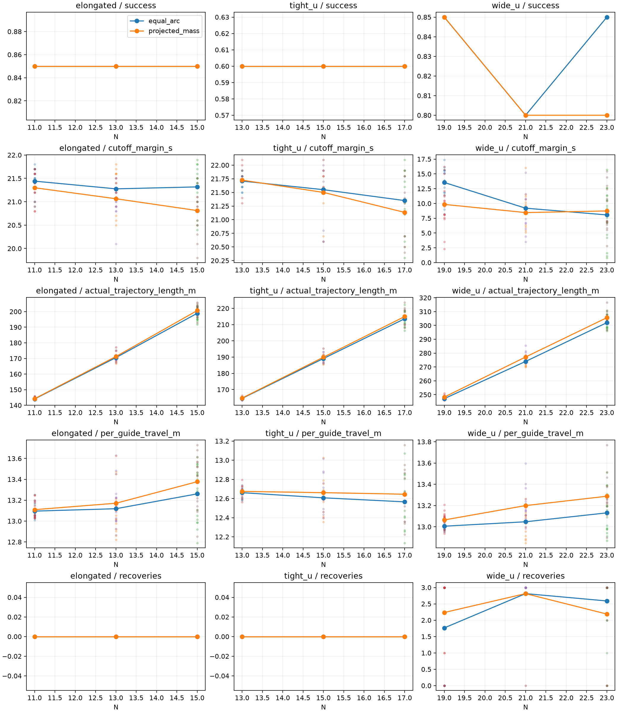

# Guide数量对非凸需求部署的影响：资源响应开发研究 v1

本轮实际完成60个已暴露物理输入、360行主台账、60条N₀−1共同数量诊断。原热点B、人员、需求、曲线、科学规划与控制模块保持冻结，零新增人员draw、零换seed、零重试已完成行。主台账为 **273 SUCCESS、42人员拒绝、42边界拒绝、2 EXPERIMENT_ERROR、1 PATH_UNREACHABLE**。

三档各46个合格规划配对全部降低projected的总需求代价，场景等权配对相对差分别−2.0463%、−7.0419%、−9.1712%。两方法都从增加Guide中获益；同N布局差从N₀到N₀+2明显扩大，N₀+2到N₀+4的绝对差并非每场景继续扩大。背景弧段相对代价上升，wide_u执行成本增加且N23出现一条恢复路径失败，不能称Guide越多越容易部署。

全276条可用运动轨迹均做独立完整区间评价；275条物理验收通过、1条实际部署失败、零实际安全违反。主台账仍只计273成功：两条已受编排错误影响的记录不追改成功数。该差异、停止及继续流程在下文完整披露。

## 1. 基线核对、冻结顺序及偏差披露

分支始终为`Major-Research-Branches`，起点`0dbfc940`，上轮实际执行提交`e9fe1bbb`。工作区起初干净，实际解释器为本仓库`.venv/Scripts/python.exe`，udc来自本仓库`src/udc/__init__.py`。未fetch、merge、push、改main或升级依赖。

阅读AGENTS、`docs/ARCHITECTURE.zh.md`、上一轮报告与配置、统计入口及数据映射。61份原科学源码同时匹配e9fe1bbb的Git规范化内容和旧执行时原始字节哈希，覆盖布局、相位、Gaussian、导航、安全过滤、恢复、进展监测、默认覆盖表示契约和独立验收。控制器仍只读Observation、Guide状态和已知场地，人员静态冻结。

运行前协议／配置／编排／统计／测试先提交为 **57688a1a0750ea7dbc090b0c7a4398672a585472**。干净工作区下才保存全部180组初态／ID、360行manifest、60数量诊断、120条N₀严格复用决定和输入哈希；所有新增N方法结果均发生在此冻结之后。预定elongated seed76的六行串行检查通过，其中四条新N执行计入主矩阵，未重复。

在总计52行时，wide_u seed77 N21两方法被继承的编排断言误判：原控制器的合法reachable_reassignment使最终assignment不同于预定初始assignment。所有物理输入、目标和曲线精确相同，三次预算内恢复事件形成连续哈希链，轨迹31.8/37.5s、九项criteria全通过。原异常处理已将这两行metrics的status/success和state改成程序错误；本轮保留原错误工件，不伪称原在线metrics完全未受影响，不覆盖或重跑。

按协议停止后提交 **125fd6536e90f577a0dba89ac9b657ba7616617f**：仅修正编排的assignment审计为“初始哈希→恢复事件before/after连续→只有合法安装的重指派可改变→最终哈希”，并使后续编排错误写侧文件、不改runner metrics。61份科学模块仍完全不变。52行全部文件做检查点，原protocol、manifest、输入锁和run_stop不改，随后仅继续308条未开始行。[补充记录](AMENDMENT.zh.md)、[补充锁与检查点](orchestration_amendment.json)保存原因和哈希。没有按结果换相位、调算法、加预算或补样本。

统计数值代码已在57688a1a冻结。运行后仅修正本分析模块的异构数量CSV列集合和图例，增设只读分析兼容检查；估计量、配对子集、重采样规则和随机种子未变。分析核对125fd653中除本分析文件以外的全部执行源码，原始锁不改。`analysis.json`保存独立分析源码哈希及dirty状态，不将它冒充执行时clean状态。

## 2. 固定输入、方法和嵌套初始化

复用seed75–94，elongated/tight_u/wide_u各20单元，含全部旧拒绝。N分别11/13/15、13/15/17、19/21/23。只采用原热点B：背景1、原圆盘内5；圆心依次[12,14.75]、[12,16.4]、[11,16.4]，半径1.2m。热点成员从旧向量直接读取，不重新定义。原Gaussian带宽1.2m、全曲线尺度、周期插值、原归一化及2048点中点积分、固定热点超额窗口、背景质量与背景弧段两指标均不变；跨N不重新缩放m²值。

两方法为`equal_arc+all_phase_256`和`projected_mass+all_phase_256`。后者是Lloyd迭代、弧间隙约束布局与共用有限相位搜索组合，不能将全部收益归因于单次投影。原四个布局初值顺序[0,.25,.5,.75]、300轮和停止规则、固定浓度1、各256相位、原相位网格、原J/绝对相位/有符号相位tie-break不变。选中目标才做正常指派和路径检查，失败不重选相位。

N₀的所有原Guide真实位置和零起始行索引ID逐位保留。沿旧保存内缩周界方向与弧原点，每次拆分当前最大周期弧间隙、在中点追加；精确并列选最小起始弧坐标，ID按追加顺序。N₀+2是N₀+4的前缀，180组均通过原人员／Guide／墙安全检查，无重抽或移位。规则不读取目标、方法或轨迹。[全部初态映射和哈希](inputs_frozen.json)包含原周界与逐次拆分记录。本研究只覆盖此嵌套初始化政策，不代表各N独立均匀重抽初态。

N₀的120条热点记录全部在新N结果前通过严格复用核对：旧文件、全精度人／半径／需求／Guide／房间／热点／曲线、静态域、执行配置、目标、指派及科学实现均一致。其中92条引用旧轨迹、28条引用旧拒绝，不复制旧runs，不算新增执行。新240条任务中184条实际执行，56条原共同拒绝；无新的基线执行。旧240行及其报告、输入、目标、轨迹和原online metrics全部保持原哈希。

## 3. 数量必要条件与完整分母

|场景|有效曲线|L范围m|主N|ceil(L/1.94)|ceil(L/2)|floor(L/.75)|N₀−1下2m数量未排除|
|---|---|---|---|---|---|---|---|
|elongated|17|20.3702–20.8975|11/13/15|11|11|27–27|0|
|tight_u|12|23.8494–24.2448|13/15/17|13|12/13|31–32|5|
|wide_u|17|35.4930–35.9079|19/21/23|19|18|47–47|17|

60条诊断中14条无有效曲线、数量指标null；46条有效曲线的N₀−1全部违反1.94m规划数量必要条件。其中22条（wide_u全部17条、tight_u 5条）满足2m数量必要条件，其余24条不满足2m数量下界。特别是wide_u N18的L为35.4930–35.9079m，规划下界19、验收下界18；不能将其写成资源绝对不足。各主N均满足规划数量必要条件，但这没有证明全成对欧氏距离、静态入域、完整指派或40秒完成。满足时仅记“数量条件未排除”。[60条共同数量诊断](quantity_diagnostics_60.csv)不按方法重复、不进入部署成功率，也没有伪轨迹。

全部180组另保存L/N、1.94m规划上限、2m验收上限、0.75m最小间距及1.94−L/N。实际平均规划gap余量如下，不能将这些档位预命名为严重不足／临界／充足。

|场景|N₀余量m|N₀+2余量m|N₀+4余量m|
|---|---|---|---|
|elongated|0.0402–0.0882|0.3325–0.3731|0.5468–0.5820|
|tight_u|0.0750–0.1054|0.3237–0.3500|0.5138–0.5371|
|wide_u|0.0501–0.0719|0.2301–0.2499|0.3788–0.3968|

|场景|N|物理分母|人员合法|曲线合法|双方目标合格|双方全流程成功|仅Equal成功|仅projected成功|双方失败|成功行/40|
|---|---|---|---|---|---|---|---|---|---|---|
|elongated|11|20|20|17|17|17|0|0|3|34|
|elongated|13|20|20|17|17|17|0|0|3|34|
|elongated|15|20|20|17|17|17|0|0|3|34|
|tight_u|13|20|13|12|12|12|0|0|8|24|
|tight_u|15|20|13|12|12|12|0|0|8|24|
|tight_u|17|20|13|12|12|12|0|0|8|24|
|wide_u|19|20|20|17|17|17|0|0|3|34|
|wide_u|21|20|20|17|17|16|0|0|4|32|
|wide_u|23|20|20|17|17|16|1|0|3|33|

共同物理分母60；人员／场地合法53（20/13/20），曲线合法46（17/12/17）。每个N各120行、人员合法106行、曲线及目标合格92行。三档各自目标合格配对子集均为46；六配置共同目标合格也恰为同46，故本轮规划趋势不由目标子集变化造成。双方完整成功运动子集分别46、45、45；三档六配置共同完整成功为44（17/12/15），运动比较另固定此子集。

N₀完整成功92/120=76.67%，N₀+2为90/120=75.00%（含两条保留程序错误），N₀+4为91/120=75.83%。N₀+2的两条不能解释成控制器实际部署失败；独立物理验收分别92/92、92/92、91/92。全部273/360=75.83%是含程序错误的完整流程记账，不用条件性规划收益代替完整分母。每方法180行，Equal成功137、projected成功136。

42 INITIALIZATION_INVALID和42 BOUNDARY_INVALID对应原7人员拒绝和7边界拒绝各六配置；默认16段严格覆盖和原MultiPolygon拒绝均保留，无epsilon或32段替代。原人员拒绝tight_u77/81/86/87/88/92/94；边界拒绝elongated75/77/82、tight_u90、wide_u82/84/86。数量、布局搜索、相位搜索和初始导航在有效曲线主N上均未产生新的阶段拒绝。唯一科学执行失败见第7节。未执行84行的运动时间、路程、恢复和区间裕量为null，不填零。



图将完整成功、实际执行失败、程序错误与未执行分别记账；没有将程序错误画成科学失败或把未执行视为零成本。

## 4. 资源收益与同N布局收益分账

|资源档|Equal J m²|projected J m²|ΔJ m²|逐对相对差场景等权|95%物理单元bootstrap|改善/持平/恶化|
|---|---|---|---|---|---|---|
|N₀|0.28909166|0.28319576|-0.00589590|-2.0463%|[-0.00628235, -0.00550926]|46/0/0|
|N₀+2|0.22041705|0.20510076|-0.01531630|-7.0419%|[-0.01577127, -0.01484888]|46/0/0|
|N₀+4|0.17445309|0.15862639|-0.01582670|-9.1712%|[-0.01606495, -0.01557900]|46/0/0|

以上J先在各场景求合格目标均值再三场景等权；相对差则先逐物理配对计算再分层等权，不是两均值的比值。失败运动的合格规划代价仍在表内，包括wide_u seed92 N23 projected。有限搜索结果不是最优值证明。

|场景|ΔJ₀ m²|ΔJ₊₂ m²|ΔJ₊₄ m²|相对₀|相对₊₂|相对₊₄|
|---|---|---|---|---|---|---|
|elongated|-0.00576257|-0.01795861|-0.01697542|-1.9634%|-8.5307%|-10.7307%|
|tight_u|-0.00689918|-0.01616968|-0.01457026|-2.4535%|-7.6539%|-8.8085%|
|wide_u|-0.00502593|-0.01182061|-0.01593443|-1.7222%|-4.9410%|-7.9742%|

|跨N差中差|场景等权m²|95%区间|elongated|tight_u|wide_u|
|---|---|---|---|---|---|
|ΔJ₊2−ΔJ₀|-0.00942040|[-0.00993516, -0.00888671]|-0.01219604|-0.00927049|-0.00679467|
|ΔJ₊4−ΔJ₀|-0.00993081|[-0.01046790, -0.00939455]|-0.01121285|-0.00767108|-0.01090850|

|方法|资源变化|同方法ΔJ m²|逐对相对资源收益|降低配对|
|---|---|---|---|---|
|Equal|N₀+2 vs N₀|-0.06867460|-23.7566%|46/46|
|projected|N₀+2 vs N₀|-0.07809500|-27.5859%|46/46|
|Equal|N₀+4 vs N₀|-0.11463857|-39.6581%|46/46|
|projected|N₀+4 vs N₀|-0.12456937|-43.9886%|46/46|

两方法所有46个有效输入都因增加Guide而降低总规划需求代价；这部分是资源收益，不全部算作projected算法优势。自己的有效子集和六配置共同目标子集相同，`analysis.json`仍分别保存own/common结果，逐对原值见[pairs_all_metrics.csv](pairs_all_metrics.csv)、[resource_changes.csv](resource_changes.csv)及[共同子集差中差](interactions_common.csv)。

从N₀到N₀+2/4，方法绝对差均比基准扩大。但N₀+2→N₀+4时elongated绝对优势减少0.00098319m²、tight_u减少0.00159942m²，wide_u增大0.00411383m²；总体仅再扩大0.00051041m²。相对百分比仍可随Equal基准J下降而扩大，不能将百分比变化等同绝对收益持续加速。

## 5. 热点与两类背景指标

|指标|N增量|同N projected−Equal m²|逐对相对差场景等权|降低/持平/增加|
|---|---|---|---|---|
|热点超额|0|-0.01189240|-4.1368%|46/0/0|
|热点超额|2|-0.03731781|-17.2702%|46/0/0|
|热点超额|4|-0.04236731|-24.6411%|46/0/0|
|背景质量|0|-0.00184368|-0.6360%|42/0/4|
|背景质量|2|0.00099533|0.5658%|28/0/18|
|背景质量|4|0.00437322|2.8349%|17/0/29|
|背景弧段|0|0.00742534|2.5388%|0/0/46|
|背景弧段|2|0.03762772|17.7154%|0/0/46|
|背景弧段|4|0.04158679|24.5052%|0/0/46|

热点超额收益随N增加，但同N背景弧段代价在所有配对都增加，平均相对增加从2.54%到17.72%和24.51%；背景质量从等权平均略降转为增加。两种背景量定义不同，不相加，也不以前者掩盖后者。

这里的“增加”是同N下projected相对Equal的差；跨N时两方法的背景弧段绝对m²均下降。不能据此说增加Guide使背景绝对覆盖更差。热点与背景trade-off的扩大反映该冻结需求下布局分配的取舍，demand是数值规划权重，不是经验证风险。



折线为各场景该N合格规划目标平均值，包含后续执行失败；红×为实际执行失败的合格目标，紫＋为保留程序错误目标。未执行共同拒绝没有伪代价，见完整阶段图及台账；线条不代表全部已成功部署。

实际终态另按同一冻结需求独立评分，仅在该N双方完整成功配对上汇总如下；不同N的运动子集不同，不以此表替代46个共同目标输入的规划资源响应，失败终态另保留。

|N增量|双方完整成功配对|实际终态总需求Δ m²|逐对相对差场景等权|
|---|---|---|---|
|0|46|-0.00590405|-2.0491%|
|2|45|-0.01535705|-7.0584%|
|4|45|-0.01582301|-9.1703%|

## 6. 完整部署的时间、真实路程和协调成本

|场景|N|方法|成功n|时间均值s|40s余量均值s|真实总路程m|每Guide路程m|恢复均值|
|---|---|---|---|---|---|---|---|---|
|elongated|11|Equal|17|18.559|21.441|144.050|13.095|0.000|
|elongated|11|projected|17|18.700|21.300|144.203|13.109|0.000|
|elongated|13|Equal|17|18.724|21.276|170.539|13.118|0.000|
|elongated|13|projected|17|18.935|21.065|171.221|13.171|0.000|
|elongated|15|Equal|17|18.682|21.318|198.913|13.261|0.000|
|elongated|15|projected|17|19.188|20.812|200.662|13.377|0.000|
|tight_u|13|Equal|12|18.292|21.708|164.593|12.661|0.000|
|tight_u|13|projected|12|18.275|21.725|164.764|12.674|0.000|
|tight_u|15|Equal|12|18.450|21.550|189.110|12.607|0.000|
|tight_u|15|projected|12|18.500|21.500|189.920|12.661|0.000|
|tight_u|17|Equal|12|18.650|21.350|213.608|12.565|0.000|
|tight_u|17|projected|12|18.867|21.133|214.963|12.645|0.000|
|wide_u|19|Equal|17|26.453|13.547|247.105|13.006|1.765|
|wide_u|19|projected|17|30.159|9.841|248.219|13.064|2.235|
|wide_u|21|Equal|16|30.800|9.200|273.988|13.047|2.812|
|wide_u|21|projected|16|31.544|8.456|277.189|13.199|2.812|
|wide_u|23|Equal|17|31.941|8.059|302.013|13.131|2.588|
|wide_u|23|projected|16|31.269|8.731|305.612|13.287|2.188|

此表每方法各自完整成功子集，wide_u样本数随状态改变，不能直接把两列均值之差当配对方法效应。时间余量只对完整成功定义；失败终止20.6s不进入成功时间，也不贡献19.4s成功余量。

固定三档六配置共同完整成功44输入（17/12/15）的三场景等权结果：

|N增量|方法|固定n|时间s|截止余量s|总路程m|每Guide m|恢复|
|---|---|---|---|---|---|---|---|
|0|Equal|44|21.046|18.954|185.268|12.922|0.533|
|0|projected|44|22.352|17.648|185.767|12.951|0.711|
|2|Equal|44|22.567|17.433|211.184|12.923|0.933|
|2|projected|44|22.954|17.046|212.818|13.013|0.933|
|4|Equal|44|22.873|17.127|238.119|12.983|0.889|
|4|projected|44|23.203|16.797|240.364|13.101|0.778|

同N双方完整成功子集内projected−Equal的真实配对运动差：

|场景|N增量|配对n|时间差s|总路程差m|每Guide差m|恢复差|
|---|---|---|---|---|---|---|
|elongated|0|17|0.1412|0.1536|0.0140|0.0000|
|elongated|2|17|0.2118|0.6821|0.0525|0.0000|
|elongated|4|17|0.5059|1.7486|0.1166|0.0000|
|tight_u|0|12|-0.0167|0.1704|0.0131|0.0000|
|tight_u|2|12|0.0500|0.8103|0.0540|0.0000|
|tight_u|4|12|0.2167|1.3548|0.0797|0.0000|
|wide_u|0|17|3.7059|1.1143|0.0586|0.4706|
|wide_u|2|16|0.7438|3.2010|0.1524|0.0000|
|wide_u|4|16|-0.4625|3.3928|0.1475|-0.3750|

固定44输入上，Equal总真实路程从185.268m增到238.119m，projected从185.767m增到240.364m；每Guide均值只从12.922/12.951m变到12.983/13.101m。总路程增加很大部分来自资源数量本身，不能只选总量或只选人均量。全部路程由真实保存轨迹相邻位移求和，不是规划路径估计。

elongated/tight_u全批没有恢复，成功时间约18–20s，增加N没有明显加速；wide_u存在联合协调成本。固定其15个共同成功输入，Equal时间26.287→30.527→31.287s，projected30.080→31.427→31.553s。规划平均gap余量增大并没有带来执行时间单调改善。N23 projected的成功条件均值低于Equal不能称无条件执行优势，因其实际失败的seed92已不在成功时间子集中。



时间／余量／路程／恢复只画完整成功行，散点为单任务，线为该方法自己的成功条件均值；失败和程序错误数量另见阶段图。固定共同子集结果以上表为准。

## 7. 最差需求、最慢执行与固定失败现场

|N增量|场景|seed|N|Equal J|projected J|最不利ΔJ m²|相对差|
|---|---|---|---|---|---|---|---|
|0|elongated|80|11|0.296791779|0.293575138|-0.003216641|-1.0838%|
|2|wide_u|83|21|0.240734747|0.233376071|-0.007358676|-3.0568%|
|4|tight_u|93|17|0.165937364|0.152530417|-0.013406948|-8.0795%|

最大ΔJ是最弱需求改善，并非需求恶化；所有138个同N规划配对均为负。各场景最差配对保存在`analysis.json`的by_scene.worst，没有只挑最有利例子。

最慢完整成功是 **wide_u seed90 N23 Equal：39.2s、距截止0.8s、总路程306.091234m、每Guide13.308315m、3次恢复**。其目标合格、全部区间安全，但截止余量很小。不能把有限40s内成功称为充分鲁棒性。

唯一实际执行失败固定为 **wide_u seed92 N23 projected**。L=35.74064554m，平均gap1.553941m，规划余量0.386059m；目标最小成对距1.013381m，静态入域最小signed clearance0.595703m，全部256相位可接纳，选中φ=0。初始完整指派和路径通过；J=0.1838562515m²，Equal为0.2003592448m²，规划收益仍计入。

执行到20.6s时，Guide8的target12被Guide9暂时占据，中心距0.641935m，小于规划重算要求0.75m。path_recompute记current_guide_occupation；随后reachable_reassignment记search_not_found（可达二分图未找到完整匹配、infeasibility_proven=false）。两次预算消耗后保留1次剩余，但既有错误传播逻辑在此退出，未进入priority_yield。本轮没有增加恢复预算、切换相位或改错误传播控制来消除失败。该记录说明合格目标和初始路径不保证后续完整部署，不能证明静态目标或真实连续可行集无解。

失败实际轨迹总路程288.149317m、每Guide12.528231m；安全通过，人／Guide／墙净裕量分别0.02999255m、1.00005e−8m、0.45m；终态最大目标误差3.825261m，实际终态需求代价0.38243384m²、贴线未通过，不能把规划收益称为已实现部署收益。原metrics、trajectory、state、恢复事件、目标和指派仍在唯一runs目录。[逐行台账](tasks_360.csv)保留全部成本和失败原因。

## 8. 几何余量、安全与独立积分

规划gap平均余量随N上升，但目标全成对欧氏距离的最低值下降。以下是各场景、两方法全部合格目标的最小值，不能从三个模板推导通用几何定律。

|场景|N增量|最小目标全成对距m|最小静态入域signed clearance m|
|---|---|---|---|
|elongated|0|1.690933989|0.004814948|
|elongated|2|1.267464665|0.001447565|
|elongated|4|1.064381517|0.000086423|
|tight_u|0|1.105419606|0.418038701|
|tight_u|2|0.834507042|0.423875334|
|tight_u|4|0.817825090|0.422823163|
|wide_u|0|1.559677930|0.431839882|
|wide_u|2|1.054921898|0.427928427|
|wide_u|4|0.914088965|0.420746245|

安全标准保持0.75m人／Guide中心距、0.55m墙距、1e−7m数值容差、0.11m规划裕度、1.3m偏移、1.94/2m规划／验收gap、1m/s、400步／40s、3恢复及原到达／速度／保持／贴线条件。完整线段检查、端点连接、联合安全过滤、进展约束和优先模式监测不变；默认覆盖接纳未放宽。

全276条运动轨迹完整区间最小净裕量：人员 **0.0127158495455m**、Guide **8.87792706017e-09m**、墙 **0.45m**，实际不安全区间0。Guide约1e−8m及最小目标入域约8.64e−5m都接近活跃约束，不能称为充分鲁棒。

全部360行独立复判，criteria不一致0、diagnostics不一致0；仅上述两条程序错误的success会计标记与独立物理验收不一致，明确保留为2。没有把online标记重写成物理复判结果。[全量核查](all_independent_checks.json)、[最终检查](final_checks.json)保存各行状态。

276个合格选中目标均另用保存坐标与冻结rho／窗口独立计算2048和8192点积分，包含执行失败和保留程序错误目标；与各行原保存评分差≤1e−10m²的检查全部通过。138个同N需求配对符号变化0，单配置最大变化1.5185419e-05m²，配对Δ最大变化2.28207204e-05m²。不重选相位，不追加预算。[全部积分核查](all_independent_integrations.json)和[逐对敏感性](fine_integration.csv)可核对。

10000次percentile bootstrap固定RNG seed2026102002，各场景从全部20物理输入整单元抽20，全部N、两方法和阶段状态共用索引，拒绝仍为缺失配对。五项区间均无不可计算重复；不将360行视为独立样本。本轮区间只描述已暴露输入的资源响应，不能改称新输入独立确认。

## 9. 计算成本、环境、验证及复现命令

|N增量|方法|成本来源|布局均/最大s|256相位均/最大s|初始导航均/最大s|runner均/最大s|
|---|---|---|---|---|---|---|
|0|Equal|historical|0.001849/0.003783|0.582272/0.912306|0.091349/0.268490|1.441753/3.428412|
|0|projected|historical|0.025491/0.178520|0.588174/0.997849|0.095067/0.245733|1.618373/3.552027|
|2|Equal|new|0.001779/0.003622|0.547737/0.904550|0.103923/0.293156|1.708212/4.986738|
|2|projected|new|0.027924/0.060382|0.546902/0.905415|0.106670/0.270411|1.763302/5.142392|
|4|Equal|new|0.002076/0.003996|0.584876/1.056479|0.120195/0.337741|1.820097/4.855119|
|4|projected|new|0.055425/0.091788|0.587973/1.017323|0.126853/0.379057|1.747537/4.654284|

以上每行46条合格目标任务，包括科学执行失败和程序会计错误；旧N₀成本直接引用历史，不算本轮新增计算。各方法仍256相位，不随N增加搜索预算。并行环境的单行墙钟不可相加当批总耗时；runner含联合过滤与恢复，初始导航另列。

首组六行串行、其余及继续阶段最多2进程任务在途，各worker数值线程1；全部新worker观测线程池均1、反事实开关均0。原完整线段和顶点开关保持启用。34条新任务（含拒绝）在57688a1a执行，206条在125fd653执行，全部runner记录dirty=false；引用的120条保持原来源提交e9fe1bbb。独立评价也读取保存工件，不覆盖旧runs。

|阶段|实际行|墙钟s|
|---|---|---|
|first|6|10.043|
|remaining|46|48.155|
|continue|308|247.931|

环境沿用Python3.12.15、numpy2.5.4、scipy1.18.1、shapely2.2.0、PyYAML6.0.3、jupedsim1.4.2、pedpy1.5.1、threadpoolctl3.7.0、pytest9.1.1、matplotlib3.11.2。Windows11、8逻辑CPU；具体CPU/RAM可参照原环境记录，本次CIM硬件查询被沙箱拒绝，未提升权限查询，不冒充重新测量。未升级依赖。[环境详情](environment_details.json)包含解释器和旧环境哈希。

完整测试：基线194 passed/32.62s；首四项资源测试加入后198 passed/25.02s；补充审计后201 passed/27.21s；批后201 passed/25.77s。最终导出／图例修正后完整复测 **201 passed/26.12s**。pip check无冲突、compileall和git diff检查通过。默认pytest临时目录初次因沙箱权限发生37个fixture错误；使用仓库.tmp内--basetemp后全部通过，没有修改测试标准。新增测试覆盖嵌套ID和并列规则、双数量下界、失败规划保留、共同子集、差中差、整单元缺失相关bootstrap、旧拒绝只读评价及合法恢复哈希链。

6115份历史保护文件、708份冻结输入文件和原52行检查点全部通过最终哈希；180组初态和60诊断不变。Git保存源码、配置、测试、报告及摘要；runs保存唯一输入／目标／轨迹／状态工件，不创建backups、不复制历史runs。主清单、输入锁、源码与补充锁见本目录JSON，原始文件清单见[raw_checksums.json](raw_checksums.json)。

以下为本次实际PowerShell流程；freeze要求目录不存在且源码干净，first/remaining/continue均不可重试。冻结运行版本应使用对应提交与本机原始输入依赖；当前分析入口允许仅自身导出层变化，其余执行源码须匹配125fd653。

```powershell
$py = '.\.venv\Scripts\python.exe'
$out = 'runs/step1_nonconvex_resource_response_v1'
$env:UDC_PRIORITY_STALL_COUNTERFACTUAL = '0'
$env:OMP_NUM_THREADS = '1'
$env:OPENBLAS_NUM_THREADS = '1'
$env:MKL_NUM_THREADS = '1'
$env:NUMEXPR_NUM_THREADS = '1'
# 57688a1a，干净工作区
& $py -m udc.experiments.resource_response --stage freeze --output $out
& $py -m udc.experiments.resource_response --stage first --workers 1 --output $out
& $py -m udc.experiments.resource_response --stage remaining --workers 2 --output $out
# 因上述审计错误按协议停止，补充提交125fd653后：
& $py -m udc.experiments.resource_response --stage amend --output $out
& $py -m udc.experiments.resource_response --stage continue --workers 2 --output $out
& $py -m udc.experiments.resource_response --stage rejudge --output $out
# 仅导出层修正后的当前分析源码：
& $py -m udc.analysis.resource_response --output $out --report reports/step1_nonconvex_resource_response_v1
& $py -m pytest -q --basetemp=.tmp/pytest-resource-final-export
& $py -m pip check
& $py -m compileall -q src tests
git diff --check
```

最初统计命令因数量CSV异构列失败，没有改变任何原始状态；修正后的导出结果与原预定数值统计一致。首次和补充执行提交、结果提交分开保存，本轮不推送或合并main。


可读哈希依据：

- 原运行源码SHA-256：`e33ef05457a5e7f939a3f2172b4faff1f299182a7ee50918aeef812890cefcec`。
- 补充后执行源码SHA-256：`d66e24c628eb2eefcbe08e4ce410f05a7b58a15c1862b955ac7f8f72db718f3b`。
- 冻结manifest SHA-256：`57a6b568013dcd971b13d2ef2c0822304b3bd450e8989eb01793843e56866899`。
- 冻结输入锁SHA-256：`d126e415fea6afbcd309a018940beef6d9ea37028bc449aac05a62926d92830f`。
- 原protocol SHA-256：`f33862cd44549f098b0b8b09c11baad435e532f29356cca073cffe8543603ef8`。

## 10. 适用范围、资源取舍与下一轮唯一问题

本轮支持：在60个已暴露输入、三种固定模板、原热点B和嵌套增加Guide政策下，增加N可降低两方法的规划需求代价；projected在所有同N配对更低，但热点收益伴随更高的同N背景弧段代价。N₀+2已取得大部分相对于基准的布局绝对差扩大；N₀+4继续降低两方法绝对J，同时并非各场景继续扩大方法绝对差。

本轮不支持“Guide越多越易完成”。wide_u的规划平均gap余量增加，目标最小成对距离却下降，恢复／联合协调成本增加，N23出现当前Guide占据导致的恢复匹配搜索失败。elongated/tight_u时间成本较温和；不能从三个模板推出通用几何规律，也不能将有限搜索输出当真实最优值或可行集合关于N的单调性证明。

保留N₀+2作为后续诊断的资源参考，暂不宣称存在已独立确认的最佳资源档位：N₀+4的额外需求收益、背景取舍、总路程及wide_u失败必须分别报告。没有建立任意加权综合分数或宣称全局Pareto最优。

**下一轮唯一研究问题：固定wide_u seed92、N23、projected的本轮目标与初态，诊断为何目标暂时占据后原可达重指派搜索未找到完整匹配，以及这一联合协调瓶颈的可验证机制。** 先保留该失败开发诊断，不在本轮增加恢复预算或另挑输入；机制清楚后再另立新输入资源规律确认协议。本轮不同时研究几何复杂度、规模扩展、RA-ABDC完整机制、真实风险、动态反馈、Step2或Step3。

本研究数量范围11–23，属于资源响应开发证据，不是大规模可扩展性证明，也不是新的独立seed确认。
