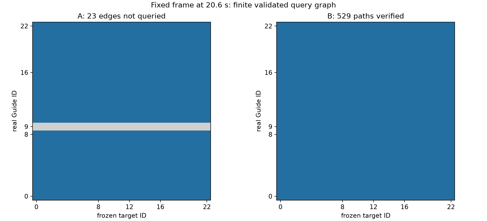
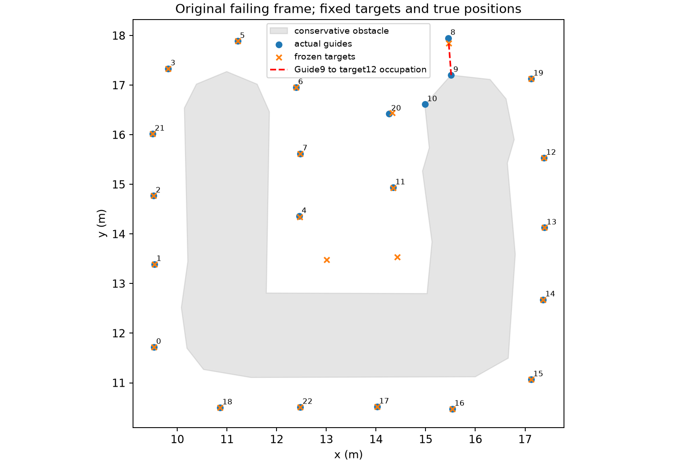

# 固定资源失败的导航与恢复诊断 v1

本轮已在原全精度人员、23名Guide真实初态、目标、原初始指派和执行配置上复现并定位唯一科学失败，采用共享导航的最小数值端点修复。原恢复策略和预算未修改。重点案例从原20.6s的PATH_UNREACHABLE变为38.1s完整成功，仍只消耗原3次恢复、原40s时钟。

冻结候选865e6a48后，对原276份有效输入／目标执行一次完整固定目标回归，**276 SUCCESS、零实际安全违反、全量独立复判一致**。原275条物理成功的完整运动位置、名义／过滤速度、航点、目标和最终指派全部逐位相同，零退化。84条共同拒绝只读保留，没有伪造执行。

原资源研究的360行、273 SUCCESS、84共同拒绝、2 EXPERIMENT_ERROR、1实际科学失败保持原样；没有把273改成275或276。本轮新运行、原科学失败、原编排错误和物理验收分开记账。这是系统一致性修复，不是新的部署规划算法。

## 1. 接续、环境与固定现场

起点Major-Research-Branches / 85277cfd，工作区干净。阅读AGENTS、架构、资源报告、补充协议及导航／控制／恢复／编排审计源码。当前解释器为本仓库`.venv/Scripts/python.exe`，udc来自本仓库`src/udc/__init__.py`。原61份科学模块与125fd653／e9fe1bbb执行时原始字节哈希一致；85277cfd相对原执行版本的后续修改主要是资源统计导出，未改变本案科学决策。

诊断协议和纯观测重放先提交为 **f634725fa686e44e199d72572779cce6690abc63**，干净源码下冻结360原身份、276合格目标、84拒绝引用及全部原始工件哈希。重点身份为wide_u seed92 N23 projected，来自唯一原始runs；人员、半径、需求、房间、初态、曲线、目标和指派直接读取原NPZ／plan，未用报告或CSV舍入值重建。整体相位0、最小目标成对距1.0133813534m、最小静态入域余量0.5957031427m均与原工件核对一致，初始完整指派及路径通过。

新原始工件唯一位置`runs/step1_resource_recovery_diagnostics_v1/`，旧资源报告、轨迹、状态和补充协议只读。未升级依赖，未fetch、merge、push或改main；未增加seed、N、热点、估计器或方法。全部运动从t=0运行，没有仅恢复位置的伪检查点重放。

诊断日志只记录调用、真实位置、指派、完整已安装路径、航点、预算、优先队列／索引／进展样本／基准、域及路径哈希，以及runner的进展窗口、hold和触发步。原runner和科学模块仍做实际决策；观测日志不参与速度或策略选择。A精确复现提供了记录无决策影响的直接证据。

## 2. 原失败确定性重放及调用链

A使用与原执行逐文件一致的科学实现、原配置和固定目标。207帧位置、206步名义速度、过滤速度、航点索引均与原轨迹逐位一致；20.6s终止、2次恢复、最终指派未变。原人员／需求／房间／初态／目标精确一致，独立复判仍失败，真实总路程288.1493167m。这不是因版本、随机状态或浮点环境差异产生的另一条失败。

完整链为：runner在第206个已执行区间后触发stall_window → recover安全预检通过 → path_recompute按其他Guide临时障碍查询 → Guide8的target12被Guide9暂时占据、拒绝且不安装部分路径 → 消耗预算1 → 同一recover调用继续reachable_reassignment → 静态查询未形成完整匹配、拒绝且不安装 → 消耗预算2 → 分支重新抛出第一次PATH_UNREACHABLE并以第二次异常为cause → runner据错误前缀记PATH_UNREACHABLE并退出。

[A原始metrics](A_baseline_metrics.json)、[完整观测链](A_baseline_observation_log.json)和[A独立复判](A_baseline_independent_rejudge.json)分别保留终止消息、异常cause、前后状态和验收；不只从最终状态字符串反推。

实际状态在恢复时安全：最小人中心距0.77999255m，Guide中心距0.7500000100m，墙距1m；相应净裕量0.02999255m、约1e−8m、0.45m。两次失败事件的before／after导航哈希相同，原路径、指派和航点完整保留，没有部分安装。

## 3. 三种域与23×23完整查询矩阵

静态域来自同一navigation_domain：墙内缩0.55m、观测占据环物理缓冲0.55m、simplify0.10m后额外规划缓冲0.11m。静态free为单一Polygon／一个连通分量，域SHA-256为`84caf8c54b0940fddfab84feabf2062fada4fe675f0db21fa27e3e9b17a1f705`。可见图24节点、47条无向边，529个静态对共用该图，不逐对构图。

固定身份重算为每Guide从同一静态域扣除其余22名Guide的原临时占据形状；沿用0.75m半径、原quad_segs=2多边形，未删除临时障碍。本帧23个临时域分别有6–8个分量（6分量4个、7分量6个、8分量13个），不能将其当作静态域分裂。原调用在Guide8终点占据处即退出，Guide9–22未被该固定身份调用查询。

reachable_reassignment的实测构图free／obstacle WKB哈希与静态域完全一致，参数也相同；第三查询没有残留Guide障碍或过期临时域。可见图是调用内局部对象；完整线段的边界边缓存不是跨查询的可见图缓存，不同域回归测试确认隔离。

|检查|A原实现|B仅端点修复|
|---|---|---|
|真实源点／冻结目标|23 / 23|相同23 / 23|
|物理安全起点／静态合法目标|23 / 23|23 / 23|
|已查询且独立验证路径|506|529|
|起点未进入查询的边|23（整行Guide9）|0|
|普通search_not_found边|0|0|
|起终点物理无效／不同静态分量边|0 / 0|0 / 0|
|程序异常边|0|0|
|最大匹配|22|23|
|Hungarian选中边全有限|否|是|

A中所有23个目标都有22个已验证来源；没有某个目标被证明静态不可达。唯一源行Guide9的23条边根本未进入_shortest，不能填成23条不可达。最大匹配的未匹配源为9、一个输出下未匹配目标为22；后者只是匹配输出的选择，不代表target22不可达。有限图Hall见证为来源集合{9}、邻居空集、缺额1，其范围仅限这张已查询图。

原匹配代价把未取得路径的行保留为inf，再替成1e12进行Hungarian；其中选中一条非有限边，于第二个匹配验收分支拒绝。可达边到有限代价的转换及索引本身正确。问题发生在构造可达行之前，不是分配器选择错误。

全部46端点、成分、投影／节点／真实前缀、529条边状态、几何参数与WKB哈希分别见[A端点](A_endpoints_46.json)、[A矩阵CSV](A_matrix_529.csv)、[A完整验证](A_matrix_529.json)、[B矩阵](B_counterfactual_matrix_529.csv)和[A／B摘要](A_summary.json)。未查询、起点无效、终点无效、不同保守分量、搜索未找到、候选验证拒绝、程序异常在诊断代码中分别记账，不混写。

离线临时域的23条原身份路径检查为20条找到路径、2条临时目标占据、1条起点未入查询；第二处占据是Guide20的target13被Guide10占据，距离0.683637m，原固定身份调用尚未查询到它。这些是独立离线检查，不能冒充原调用已执行的查询。



蓝色为已找到并独立验证的路径，灰色为未进入查询；灰色不是不可达证明。所有B路径从真实原位置开始，原目标结束，完整线段通过原静态及人员／墙检查。静态单Guide路径的存在不保证联合运动时间表可行。

## 4. 数值端点根因与遗漏路径见证

Guide9真实位置为[15.51303783646583, 17.202662530362915]，物理free覆盖它，但GEOS的保守free.covers返回false；signed distance为−6.837726719201222e−16m，属于原1e−7m数值接触范围。其静态component_index返回null由这个covers判定造成，不能解读为确证分量不同。

最近投影为[15.513037836465829, 17.202662530362915]，与真实位置之差[−1.7763568394002505e−15, 0]m。旧_boundary_node以1e−15m作为“无方向”的阈值；此差略超阈值，于是把约一个ulp的投影舍入向量归一化为向左，再移动原1e−8m规划节点。该节点位于保守障碍内，free.covers拒绝，_margin_contact／_prepare_start返回None，navigate_and_assign便continue整个源行。

既有_outward_free_direction给出的外法向约[0.11074713,0.99384862]，同样1e−8m节点为[15.5130378375733,17.2026625403014]，被严格free.covers接受。真实起点到此节点的完整前缀处于物理free，并通过原1e−7m完整线段检查。执行状态不被替换成该规划节点。

另有不依赖新节点的遗漏路径见证：从失败帧真实位置到旧已安装航点后缀，再到原分配目标；23条均通过原完整静态线段与物理检查，Guide9→原target15也通过。原指派的23条静态查询只有Guide9未进入查询，其余22条均找到验证路径。[原安装后缀](A_installed_suffixes_23.json)保存真实位置开始的每段，而非凭可视化判断。

这说明执行接受的数值边界状态与导航起点接纳出现实现不一致；不证明所有可见图在任意几何上完备，也不证明临时占据可由任意继续运动解除。



蓝色编号为实际Guide ID，橙×为冻结目标；红虚线表示Guide9与target12的临时占据关系。Guide8当前状态仍安全，目标被占据是对重算终点的正确拒绝，不是实际Guide相撞。

## 5. 剩余预算为何未使用，以及未采用的修改

原recover只对`strategy == path_recompute && safe_state && budget_remaining > 0`允许失败后continue；reachable_reassignment失败后直接执行`raise first_error from error`。因此消耗2次、仍余1次，却未测试priority_yield。该分支没有给出实际不安全、旧路径已损坏、第三策略前置条件不满足或预算耗尽的证据；返回的错误消息仍来自第一次临时占据，第二次缺配保留在cause和事件中。

本案恢复前实际状态安全、旧路径／指派完整、旧后缀全部静态可用、优先模式原先未启用，原第三次预算存在。仍不能只凭这些静态事实无条件捕获异常继续旧路径，因为其他Guide临时占据和联合时间约束仍在。原恢复原子安装、安全拒绝与预算耗尽出口均保留，未知搜索失败也不能改称整个任务连续不可行。

本轮选择有直接实现错误证据的B，不运行C或D。B已经消除错误源行遗漏，使第二策略合法安装，再在后续真实停滞时自然进入第三策略，未证明还需要一个额外恢复政策补丁。原第二次失败短路语义仍是一项明确保留的执行边界；此修复不承诺任意第二次搜索失败都能获得第三策略或最终成功。

生产修改仅navigation/paths.py的12行：保留一切原已接纳节点；仅当原节点失败且最近投影距离≤原ENDPOINT_TOLERANCE_M时，尝试原外法向和原BOUNDARY_NODE_NUDGE_M；必须满足严格节点covers、完整物理前缀covers及原segment_in_free。没有free.buffer(epsilon)，不放宽1e−7m、不降低安全距离，不改边界估计／目标／相位／指派器／恢复流程／安全过滤／进展监测。

## 6. B反事实、首次差异与原联合协调

B运行前先保存假设和分支说明，仅覆盖原边界节点失败分支。原科学文件先按原哈希核验；B与小回归属于已声明变更的dirty开发运行，源SHA及补丁身份保存在各summary，不冒充clean执行。最终共享修复和编排在865e6a48统一提交后才做clean完整回归。

B的20.6s之前公共位置、名义／过滤速度和航点仍逐位相同。首次因果差异为20.6s静态重指派查询接纳Guide9数值边界起点；529条路径验证、匹配23、完整候选验证后原子安装，发生一次合法重指派，目标不变。原基线止于frame206，B第207帧之后没有原对照；“公共帧未发现位置差异”是右删失，不能说两条完整轨迹相同。

20.6s path_recompute仍正确拒绝临时占据，预算1；同一时刻reachable_reassignment成功，预算2；22.6s原监测再次触发stall_window，原priority_yield成功，预算3；38.1s满足完整验收，截止余量1.9s。没有第四次恢复、时钟重置、额外清空停滞窗口、瞬移或去除其他Guide障碍。正常策略安装／优先对象／航点的基准切换均由既有事件记录。

复用原联合速度诊断：20.5s Guide9名义约0.030406m/s、过滤约5.07e−5m/s；22.5s名义0.030035m/s、过滤3.28e−6m/s，Guide9–8间距和规划边界约束同时活跃。22.6s进入原优先模式后的第一步，Guide9请求0.0300318m/s、实际沿程约0.0290355m/s；下一些航点切换记录为正常reference_changed，不把跳变算进展。

原priority模式共128步，原joint_progress_velocity最多80轮接口被调用53次、安装52次、拒绝1次；另外74步投影已经足够、1步无需加强。step230一次加强候选被拒绝时，原安全投影仍有约0.3215m/s沿程速度，不是“未找到任何非零安全速度”。没有新增求解器或增加求解预算。记录的单步进展／一次拒绝不证明全局收敛或动态无解；38.1s整条轨迹的独立验收才是本案完成证据。

[B完整观测](B_navigation_only_observation_log.json)、[B metrics](B_navigation_only_metrics.json)、[速度与进展记录](velocity_progress_diagnostics.json)、[首次因果差异](causal_comparison.json)及[共享修复逐位等价](B_shared_equivalence.json)均保存。

## 7. 九条固定小回归及一次完整回归

|案例|原会计／物理|新状态|时间s|恢复|与原轨迹|
|---|---|---|---|---|---|
|wide_u__seed_92__N_23__projected_mass|PATH_UNREACHABLE/False|SUCCESS|38.1|3|原公共前缀精确，随后延长|
|wide_u__seed_92__N_23__equal_arc|SUCCESS/True|SUCCESS|35.3|3|完整逐位相同|
|wide_u__seed_92__N_21__projected_mass|SUCCESS/True|SUCCESS|33.3|3|完整逐位相同|
|wide_u__seed_92__N_19__projected_mass|SUCCESS/True|SUCCESS|31.9|3|完整逐位相同|
|wide_u__seed_90__N_23__equal_arc|SUCCESS/True|SUCCESS|39.2|3|完整逐位相同|
|wide_u__seed_77__N_21__equal_arc|EXPERIMENT_ERROR/True|SUCCESS|31.8|3|完整逐位相同|
|wide_u__seed_77__N_21__projected_mass|EXPERIMENT_ERROR/True|SUCCESS|37.5|3|完整逐位相同|
|elongated__seed_76__N_15__projected_mass|SUCCESS/True|SUCCESS|18.6|0|完整逐位相同|
|tight_u__seed_76__N_17__projected_mass|SUCCESS/True|SUCCESS|18.2|0|完整逐位相同|

小回归9/9通过，重点案例的全部位置、名义／过滤速度、航点、目标和最终指派又与B反事实逐位相同。其他N／方法只是影响范围的上下文对照，不作为相同目标的因果试验。

候选提交 **865e6a481f3bcc974aa89269eaea666182cc1ade** 后，工作区干净才freeze_candidate。完整回归新attempt固定276个原全精度目标，不重复优化，每条只执行一次；84共同拒绝只读核验。全批最多2进程任务在途、各数值线程1、UDC_PRIORITY_STALL_COUNTERFACTUAL显式0。没有安全／程序停止，没有择优重试或批内修改。

|分类|原资源记录|本轮新完整回归|
|---|---|---|
|原275条物理成功（含2编排错误）|275物理成功|275成功，全部完整轨迹逐位相同|
|唯一实际科学失败|PATH_UNREACHABLE，20.6s|SUCCESS，38.1s，原3次预算|
|原seed77 N21两条编排错误|旧台账EXPERIMENT_ERROR，轨迹物理通过|新执行SUCCESS；与原真实轨迹相同，旧台账不改|
|84共同人员／边界拒绝|42初始化＋42边界拒绝|只读哈希核验，运动指标null|
|原360完整流程成功数|273|仍保留原273；新276是另一次固定目标回归|

完整批次276/276成功、原275物理成功退化0、原275轨迹变化0；原275的部署时间及真实路程配对差均严格为0。完整批次墙钟358.371s，小回归30.756s。它们是同机开发运行成本，不是新的算法速度优势。

本轮实际新轨迹为A基线1＋B反事实1＋小回归9＋完整回归276＝287，其中A预期复现失败，其余286通过；这些重复条件不是287个独立人员输入。主要影响范围结论只用一次完整276固定目标回归。没有重跑1620正式任务、300曲线诊断或其他历史矩阵。

[360行新旧分开台账](fixed_target_ledger_360.csv)、[完整汇总](analysis.json)、[冻结清单](candidate_freeze.json)和[全量复判](all_independent_checks_360.json)可核对。

## 8. 安全、预算和成本

所有原标准保持：人／Guide中心距0.75m、墙距0.55m、数值容差1e−7m、规划裕度0.11m、偏移1.3m、gap1.94/2m、最大速度1m/s、400步／40s、恢复3次及原到达／速度／保持／贴线／默认严格覆盖契约。完整候选验证、原子安装、完整线段与实际运动区间检查均保留。

|成本／安全|重点新完整运行|全部276|
|---|---|---|
|成功仿真时间s|38.1|均值23.044928，范围17.9–39.2|
|截止余量s|1.9|最小0.8，原最慢seed90 N23 Equal不变|
|真实总路程m|306.039253261|均值214.766202|
|每Guide真实路程m|13.306054490|均值13.021472|
|恢复次数|3（1次失败查询＋2次接纳）|0次191行，1次3行，2次3行，3次79行|
|最小人员净裕量m|0.0299925493|0.0127158495455|
|最小Guide净裕量m|9.93809201599e-09|8.87792706017e-09|
|最小墙净裕量m|0.45|0.45|
|实际不安全区间|0|0|
|runner墙钟s|4.508700|均值1.923885，最大5.942264|

全276条独立评价检查63,604个完整运动区间；criteria、diagnostics和success不一致均0。全量输入、目标、初始指派／路径、合法重指派哈希链均核对；新runner全部记录同一clean候选提交和源码SHA。

Guide约1e−8m净裕量和最慢0.8s截止余量仍接近活跃约束，不称鲁棒性保证。失败基线20.6s只是终止时间，不能用它计算成功时间优势；新完成任务路程306.039m与失败终止时288.149m也不作为同完成度成本对比。276有效目标只是46份已暴露物理输入的六配置，不能当276独立样本或新seed确认。

## 9. 测试、来源、哈希与命令

本轮基线201 passed/26.54s；原候选专项33 passed/1.75s；首五项新测试后的完整206 passed/25.45s；补编排metrics保护测试后，冻结前207 passed/29.20s；最终207 passed/30.37s。pip check无冲突、compileall和git diff检查通过。测试覆盖原临时占据／静态失败区分、边界端点与缓存隔离、有限缺配见证、失败状态保留、预算短路、不安全拒绝、原子安装、非法身份变化拒绝、合法事件链及编排异常不覆盖runner metrics。测试数不替代案例和完整回归证据。

环境沿用Python3.12.15、numpy2.5.4、scipy1.18.1、shapely2.2.0、PyYAML6.0.3、jupedsim1.4.2、pedpy1.5.1、threadpoolctl3.7.0、pytest9.1.1、matplotlib3.11.2，Windows11。解释器、导入路径及包版本见[环境](environment.json)，未升级依赖。

第一次small启动在任何行运行前被保护检查拦住：旧历史清单同时记录了当前导航源码路径。修复不能既修改当前源码又声称它仍与旧raw哈希相同。新source_transition.json因此明确记录原125fd653 Git对象／原CRLF字节哈希到候选源码哈希；旧源码通过原Git对象核验，其余历史数据／报告仍逐文件hash保护。没有改写任何旧protocol或旧锁，预检查异常日志保留在新small_console.txt。后续只启动一次九条小回归。

11,465项历史保护引用和1,702项直接工件引用在新锁下核验；唯一有意替换的旧源码路径按上述Git证明单列，其余文件保持原hash。唯一原始输入、目标、轨迹、状态和几何WKB在runs；Git保存源码、配置、测试、协议和本报告／诊断摘要，不创建backups或复制整个旧runs。原始文件哈希清单见[raw_checksums.json](raw_checksums.json)，最终核验见[final_checks.json](final_checks.json)。

|记录|值|
|---|---|
|A原始科学重放源码SHA|5abe51f49f4e05d22c54cc6fead7c023489cadcf7cbac1d8d6be2f2fb7ef96f6|
|B开发运行源码SHA|4c8cc4ec318a4521a5129b5512d95600601f22a995cc63174bb75512bb58a264|
|clean候选源码SHA|12fd97e6f26c28485b7ae306f2163201066f468b33b1a31766788bd8abc0c02a|
|manifest SHA|81ef1a8a467798ba7c91b944477933844a00aaa954b87e102362d6fe7c9669f6|
|原protocol SHA|77122f12f85f2b681d040d9b0f4c6de225b9231cfde63dd554b5dd41596a5d93|
|候选冻结文件SHA|559022b3ca06fc80aa31531b832e6bbe48991087003fd5719054bf260b11b7a7|

实际PowerShell顺序如下。freeze要求新目录／干净协议提交；原目录已有工件，不得重复freeze／baseline／small／full；B是一次有声明分支的开发对照，不能在修复后的科学源码上冒充原版本重新运行。读取历史工件需要本机原路径依赖，Git克隆不自动包含runs。

```powershell
$py = '.\.venv\Scripts\python.exe'
$out = 'runs/step1_resource_recovery_diagnostics_v1'
$env:PYTHONUTF8 = '1'
$env:UDC_PRIORITY_STALL_COUNTERFACTUAL = '0'
$env:OMP_NUM_THREADS = '1'
$env:OPENBLAS_NUM_THREADS = '1'
$env:MKL_NUM_THREADS = '1'
$env:NUMEXPR_NUM_THREADS = '1'
# f634725f，原科学模块核验一致，干净协议提交：
& $py -m udc.experiments.recovery_diagnostics --stage freeze --output $out
& $py -m udc.experiments.recovery_diagnostics --stage baseline --output $out
# 增加离线诊断代码，科学模块仍未修改：
& $py -m udc.analysis.recovery_diagnostics --stage matrix --variant A --output $out
& $py -m udc.experiments.recovery_diagnostics --stage counterfactual_b --output $out
# 实施同等共享修复后，登记源码转换；保留首次small预检查拒绝：
& $py -m udc.experiments.recovery_diagnostics --stage declare_repair --output $out
& $py -m udc.experiments.recovery_diagnostics --stage small --workers 1 --output $out
& $py -m pytest -q --basetemp=.tmp/pytest-recovery-candidate-final
# 865e6a48，提交候选并确认干净：
& $py -m udc.experiments.recovery_diagnostics --stage freeze_candidate --output $out
& $py -m udc.experiments.recovery_diagnostics --stage full --workers 2 --output $out
& $py -m udc.experiments.recovery_diagnostics --stage rejudge --output $out
& $py -m udc.analysis.recovery_diagnostics --stage summarize --output $out
& $py -m pytest -q --basetemp=.tmp/pytest-recovery-final
& $py -m pip check
& $py -m compileall -q src tests
git diff --check
```

B／小回归的开发dirty状态、原A源码和完整批次clean状态均按原记录保留，不以结果后提交追认开发运行时已经clean。结果与候选提交分开保存，本轮不推送或合并main。

## 10. 研究结论与适用边界

本案的临时目标占据是真实且应被拒绝的固定身份重算条件；随后“未找到完整匹配”由一个数值端点源行未进入查询造成，属于导航与执行表示的一致性缺陷。原预算剩余却终止来自第二次查询失败的错误传播短路，不是实际不安全或预算耗尽证明。最小导航修复已使原第二、第三策略在原预算内自然接续，因此没有增加恢复政策补丁。

可支持的贡献是：固定失败、完整域／矩阵／匹配／原路径后缀证据、隔离单分支反事实、原安全标准下的共享端点一致性修复，以及276固定目标回归中的有限影响范围（原275物理成功完全不变、唯一科学失败解决）。不能包装成新的部署布局算法、通用导航完备性、全局动态可行性或大规模可扩展性证明。

资源增加确实改善了旧固定需求的规划代价，却不保证实际位置远离规划边界、不保证临时占据消失或联合协调更快。本轮修复一个实现遗漏，没有消除wide_u的协调成本、紧安全裕量和接近40s截止的现实限制。原热点／背景权衡和已暴露输入适用范围继续成立。

冻结865e6a48作为通过本轮固定目标回归的Step1资源开发版本，原历史资源报告继续冻结。下一轮只应另立新输入资源规律确认协议；本轮不生成新输入、不自动启动该确认，不进入几何复杂度、更多N或更复杂控制器、RA-ABDC完整机制、真实风险、动态反馈及Step2/3。[一页研究说明](RESEARCH_NOTE.zh.md)可用于论文讨论边界。
