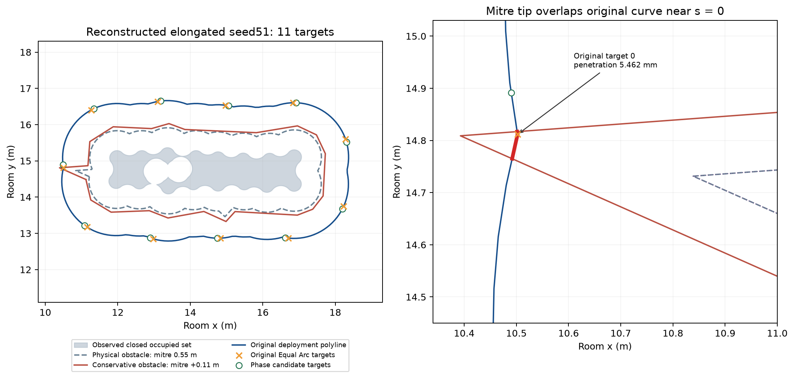
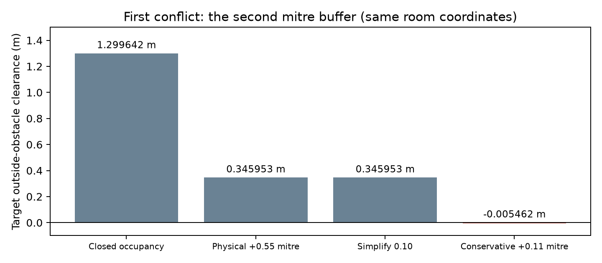

# Step 1 部署目标与静态导航域一致性

2026-10-19，Asia/Tokyo。本轮属于开发诊断与开发回归。原 seed35–54 独立确认的 **138 成功、33 人员输入无效、6 曲线无效、3 初始路径失败** 保持原样。

细长 seed51 的共同目标深入保守障碍 **5.461996 mm**，原因是闭运算侵蚀边界的 28.125° 短尖角经 mitre 缓冲放大。目标在物理导航域和简化后均合法，额外 0.11 m 缓冲首次使它越界。这不是浮点容差问题。

保持全部几何、安全参数及原曲线，在运行前固定的 256 个整体相位中，三方法均找到 −0.080997074041923 m 的合法配置。三例实际执行和独立复判成功。180 行重建开发回归为 **141 成功、33 人员输入无效、6 曲线无效**，只后处理 seed51 三套目标。这不是再次进行的独立确认。

## 1. 本机版本、环境和数据可用性

仓库为 `E:\Adaptive-Guide-Agent-Deployment-for-Unknown-Dynamic-Crowds`，分支 `Major-Research-Branches`，origin 为 `https://github.com/Wu-kaixin/Adaptive-Guide-Agent-Deployment-for-Unknown-Dynamic-Crowds.git`。开始时工作树干净，HEAD 为 `ad56e9ad2776cd5135c51729b006259453839a45`；本地存在完整的 `208080a9`、`9427a2e9` 对象。正常 fetch 后远程研究分支为 `9427a2e98892764905ccb6c657e3a9cac5dd4429`。未 reset、覆盖或切回旧版本。

本地 merge 相对 `9427a2e9` 保留了 i9 探测入口、显式 Guide 初态接口和两个测试；开始时边界、部署、导航、控制、安全及评价源码与该确认提交无差异。本机开始时实际源码哈希为 `6e5a59ee55a50252a359f780d8440ca9efca83c0373559e6cced554848bfb7ae`，不套用笔记本的源码总哈希。首批完整开发回归的哈希为 `1e35312e4871afa1005f520cfa4a8f89238883c0f648403bc6f8c9cbbec7a2c4`；最终修正原规划器搜索耗尽的失败记账后，冻结哈希为 **`62ed86ff66f411ef00d14d151bba0884ca0736c92da7d1e4989dce1d96381ee9`**，复用保存目标再次核验全部执行。逐文件哈希及迁移差异见 [environment.json](environment.json)。

实测 i9-14900KF，24 核、32 逻辑线程、63.762 GiB 可见内存。沿用 `E:\udc-wt\venv312\Scripts\python.exe`，Python 3.12.15，`udc` 导入本仓库 `src\udc\__init__.py`。uv 0.13.1；NumPy 2.5.4、SciPy 1.18.1、Shapely 2.2.0、JuPedSim 1.4.2、PedPy 1.5.1、pytest 9.1.1。没有升级科学依赖或复制虚拟环境。现有 uv 环境没有 pip；用解释器自带的离线 ensurepip 补齐 pip 25.0.1 后完成项目要求的 pip check。

只搜索本仓库及明确的 `E:\udc-wt` 迁移目录，查看了仓库内既有迁移清单。既有 `backups/2026-10-17-kai-14900kf` 是较早资料，没有本次 v3 数据；没有建立新 backups 或复制整个 runs。最新可靠源码、配置、入口、测试、v3 冻结生成代码已迁入，但 **原 v3 manifest、全精度输入、曲线、目标和失败轨迹未迁入**。Git 中 v3 仅有报告及汇总，没有原全精度哈希。

本轮在全新 `runs/step1_target_domain_consistency/reconstructed_v3/` 按冻结协议重建 60 个输入和 180 行 manifest，每个单元只抽一次，拒绝不重抽。重建 seed51 的目标及距离与历史报告一致，但不能仅凭相同 seed 或四舍五入坐标声称逐字节恢复原输入。原数据和重建数据分开，原始数据不可得处明确记为缺失。

本轮 seed51 输入数组哈希为 `32acb4bd28019d0457b9bcd2c632026b8724719cd6032137cb5cfa1c0bb17597`；静态导航域哈希为 `126110f56a62cb268f697d98031b4369cf30fa768b32ba1fd0b96ed2575ce40c`。输入／曲线／目标文件与数组、逐阶段几何哈希见 [几何链](geometry_chain_summary.json)、[原始工件校验表](raw_checksums.json)。这些是重建数据的哈希；原 v3 对应哈希不可获得。

## 2. seed51 完整几何链与首次不一致

共同目标为 `[10.502248302340506, 14.811495174001504]`，弧坐标严格为 0。人员半径 0.20 m，房间 30×30 m；人员、Guide 初态、房间和需求冻结。估计器仅使用人员观测，没有使用 spawn polygon 作为人群边界。

圆盘实际每象限使用 32 段。先并集，再 `buffer(+0.30)`、`buffer(-0.30)`，最后与原圆盘取并恢复覆盖。控制器读取闭合占据区域的外环。部署以 round 连接偏移 1.3 m，以原始外环弧长均匀采样，间距上限 0.10 m，共 208 点；目标随后使用采样折线自身的累积弦长作线性插值。导航读取同一占据外环，再做 mitre 0.55 m 物理缓冲、simplify 0.10 m、mitre 0.11 m 保守缓冲。

| 阶段 | 共同目标相对该阶段的位置 |
|---|---|
| 原圆盘并集 | 占据区外 +1.299642414202 m |
| 闭运算膨胀／侵蚀及恢复原圆盘 | 每阶段参数和几何分别保存；恢复后仍为 +1.299642414202 m |
| 1.3 m 原始偏移外环 | 距离 0，正是第一采样点 |
| 实际部署折线、弧长、插值 | 距离 0，插值坐标误差 0 |
| 物理导航障碍 mitre +0.55 m | 外部净距 +0.345952527774 m |
| simplify 0.10 m | 外部净距仍 +0.345952527774 m |
| 保守障碍再 mitre +0.11 m | **首次在内部：−0.005461995844 m** |
| 序列化与导航读取 | 保存及实际读取目标、占据环逐坐标一致，无坐标转换 |

全部坐标均为房间米制坐标；NPZ 为 float64、禁用 pickle；JSON 保留 Python 浮点回读精度。部署偏移、物理安全距离和额外规划裕度具有不同语义，没有误把同一安全距离重复缓冲。

尖角来自侵蚀后的闭运算边界，顶点约 `[13.069059390493154, 14.344518213083013]`，相邻边仅长 0.005347223 m、0.006165577 m，内角 28.125°。mitre 沿角平分线伸长为 `r/sin(θ/2)`：第一层 0.55 m 伸长约 2.263559 m；第二层 0.11 m 再伸长约 **0.452712 m**。伸长比约 4.116，小于默认 mitre_limit 5，所以没有截断。simplify 保留了该尖角。

去掉简化仍得到相同 −5.461996 mm。只在诊断中把第二层连接改为 round，该点净距约 +0.235965 m；该反事实未用于修复。证据见 [尖角](occupied_corner.json)、[反事实](causal_counterfactuals.json)。

原始偏移外环长 20.764853051098108 m，原规划折线长 20.735250954732287 m，Hausdorff 距离约 0.012559840 m。这是原有采样表示的区别。共同目标同时位于两者上；未采样偏移外环也有约 0.052966853 m 在保守域外。因此采样弦线不是本次失败的必要原因。本轮没有重新采样或缩短原规划曲线。





## 3. 整条原曲线的合法／非法弧段

对全部原始折线边逐一进行与静态自由空间的几何交／差运算。严格非法长度 **0.053147609654287976 m**，合法长度 20.682103345077994 m，长度记账残差 0。

| 原弧坐标起点 m | 原弧坐标终点 m | 长度 m |
|---|---|---|
| 0 | 0.04767000609617557 | 0.04767000609617556 |
| 20.729773351174174 | 20.735250954732287 | 0.005477603558112414 |

两段跨周期缝相连，是正长度区间，不是孤立数值接触。最大穿透范围为 **[0.0258517970773, 0.0258567960293] m**。区间和长度来自 GEOS 双精度交运算；仅最大深度使用离散诊断，实际步长不超过 `1e-5 m`。到固定闭集距离为 1-Lipschitz，故上界为采样最大值加半个实际最大步长，误差不超过 `5e-6 m`。未用稀疏采样证明整曲线合法。严格区间未按 1e-7 m 扩张，目标接纳另按统一端点容差判断。

三方法仅目标 0 非法，其余各 10 个目标均合法；Equal Arc 其余目标最小入域距约 0.482807 m，另两法约 0.482964 m。原曲线、周期原点、方向、顺序、弧长及覆盖定义均保留；没有删除非法弧段再闭合。详见 [曲线诊断](curve_domain_summary.json)。

## 4. 三方法为什么共享一个目标

Equal Arc 的首个可接受 legacy phase 为 0，故第一个 site 为 0。projected_mass 用常曲线密度和原 2048 个中点求积节点；site0 的周期单元有 186 个对称节点，首轮加权 Lloyd 位移约 `−2.95e-17 m`。经既有 gap 投影后首 site 为 0，两轮后收敛，其他 site 因离散求积略有变化。

pairwise_euclidean 的保存 solver 记录选择 `projected_mass_phase0`；该起点已满足原弧间隙和全成对距离约束，SLSQP 一轮未改变目标或代价。所以本例成对法与 projected_mass 的全部目标一致，而 Equal Arc 的其余目标不同。三者原来均未将静态目标入域作为部署验收条件。见 [共享目标来源](shared_target_origin.json)；不能据此推断三方法通常输出相同。

## 5. 前置拒绝与实际部署修复

统一接口为 `udc.navigation.paths.target_domain_check(domain, targets, arc_positions=None)` 和 `require_target_domain`。控制器部署验收、初始指派 `navigate_and_assign`、固定指派重算 `route_assigned` 均使用同一 `navigation_domain` 静态保守域。其他 Guide 的临时占据不进入此静态检查。物理自由域必须覆盖目标；保守域覆盖或仅有原 `1e-7 m` 边界数值接触才接受。原边界规划节点规则保留，真实状态不移动。

拒绝保存编号、全精度坐标、原弧坐标、域名、域哈希、有符号距离及原因。给定计划在控制器中先保存，再于指派、可见图和路径搜索前抛出 `TARGET_DOMAIN_INVALID`。通用导航调用没有曲线时弧坐标为 null；部署调用提供原弧坐标。通用部署搜索把入域加入既有候选验收，不增加原预算。评价器只增加新状态分类，独立安全、路径及覆盖判据未改。

固定原三套目标运行新接口，得到三次 `TARGET_DOMAIN_INVALID`、0 步、**没有新增成功**。这与本轮修改前重建的三次 `PATH_UNREACHABLE` 分开保存，仅改善分类。

真正修复采用单独标记的 `static_domain_phase_v1` 共用后处理。只对原目标入域失败的配置触发，沿原曲线整体平移，不投影到任意自由点。运行前冻结全周期 256 相位，含零；每个候选检查原数量、循环 gap pattern、0.75–1.94 m 弧间隙、闭合缝、全部成对欧氏距和静态域。不做迭代优化，不按结果增加预算。

需求评价保持原样。常密度下精确连续归一代价为 `sum(gap³)/(12L)`，同一 gap pattern 的整体相位代价不变；同时保存原 2048 节点评价。按原需求代价、最小相位绝对值、带符号相位依次选择。非恒定需求未在本轮验证。

每方法固定网格中 249/256 个相位通过几何检查；均选中 −0.080997074041923 m。原 site0 在排序后对应新 site10；[逐目标差异](seed51_target_deltas.csv) 保留循环索引对应。原目标与候选另存，方法标签带 `+static_domain_phase_v1`，不冒充原方法输出。

| 方法 | 原／新离散需求代价 | 连续代价 | 最小成对距 m | 最小入域距 m |
|---|---|---|---|---|
| Equal Arc | 0.296109180198008 / 0.296109180198008 | 0.296109250795955 | 1.762661369 | 0.075304288 |
| projected_mass | 0.296104525076945 / 0.296104525076945 | 0.296110733714791 | 1.761168982 | 0.075304288 |
| pairwise_euclidean | 0.296104525076945 / 0.296104525076945 | 0.296110733714791 | 1.761168982 | 0.075304288 |

独立几何验收从保存坐标重新投影到原曲线，并重查全部 55 对距离。最大贴线误差约 `1.54e-15 m`，循环 gap pattern 最大误差约 `2.67e-15 m`。Equal Arc 间隙约 1.885022814 m，另两法约 1.883181971–1.888244289 m。这里只证明找到可行见证，不证明全局最优或其他曲线必有解；数量必要条件和一个非法目标都不是整体不可行证明。

## 6. 单例与开发回归

| 批次 | 规模 | 结果 | 墙钟 |
|---|---|---|---|
| 修改前重建 seed51 原目标 | 3 | 初始 PATH_UNREACHABLE | 约 4.1 s，含启动 |
| 原目标前置分类 | 3 | TARGET_DOMAIN_INVALID，无新增成功 | 串行 |
| seed51 候选 | 3 | 全成功；18.9 s 仿真、189 步、0 恢复 | 3.69 s |
| 小回归 | 9 | 细长36、窄U36、宽U35，三方法全成功 | 37.31 s |
| v3 开发回归 | 180 行、60 输入 | 141 成功、33 人员拒绝、6 曲线拒绝 | 245.74 s |
| 旧案例补充 | 19 | 全成功 | 41.70 s |
| 最终源码保存目标核验 | 同一 180 行 | 同样 141／33／6，轨迹全部数组与首批相同 | 85.30 s |

所有执行全量离线复判：不一致 0；人员、Guide 初态、半径、需求、房间及目标配对错误 0。v3 每方法 47 成功、11 人员无效、2 曲线无效。拒绝保留 metrics、trajectory、state 等工件并留在分母，没有重抽、更换生成器或 Guide 数。

v3 中 12 行复用本轮单例／小回归保存的重建原目标，129 行因原 v3 目标未迁入而按原预算重算，39 行拒绝不生成目标。仅 seed51 三行进行相位后处理，其他 138 套有效目标原样保留为本轮原规划输出。每行重算标志、原因、算法、版本及原／新哈希见 [180 行清单](tasks_180.csv)。缺少原确认轨迹，不能声称 138 条行为与笔记本逐坐标相同。

最后审阅只修正原规划器预算耗尽的失败分类；本批没有触发该分支。最终源码核验复用全部 141 套保存的原目标，再按相同规则后处理 seed51 三套，不重抽输入、不重新调用原规划器。180 行完整输出及复判一致，所有 trajectory 数组与首批逐坐标相同；[最终源码核验](final_source_verification.json) 记录最终哈希及逐行比对。CSV 同时保留首次目标生成标记和最终复用标记，不把这次版本核验当作新增独立样本。

有效执行时间 17.9–33.4 s，恢复最多 3 次，无安全违反、超时、新停滞、路径失败或程序错误。最小净裕量：人员 0.016370116 m、Guide 约 `9.91e-9 m`、墙 0.45 m。极小 Guide 净裕量表示约束接近活跃，不是充分鲁棒裕量。

完整旧 73 输入未迁入，未声称“73/73 已复现”。补充 19 次为：本机已有的 9 个 scene-closure 原始快照、v2 seed30 三场景三方法 9 个重建案例、v1 宽U seed22 Equal Arc。四个重建输入的数组／input.npz／boundary.npz 哈希和十套目标文件哈希全部匹配旧报告；仍标记重建来源。19 次独立复判一致，未扩大为旧阶段整表重跑。见 [历史哈希比对](legacy_hash_comparison.json)。

## 7. 检查、成本与冻结范围

修改前完整测试 **135 passed / 25.55 s**，比参考 133 多出的两项来自已有 merge 的 scene-probe 测试。本轮增加六项实际测试：尖角及正长度冲突、统一容差和搜索前拒绝、保持循环 gap 的相位配置、失败工件及复判、相位预算耗尽不构成不可行证明、原规划器搜索耗尽仍记为科学失败；更新两个旧测试的新分类预期。最终 **141 passed / 20.63 s**，pip check、uv check（64 包兼容）、compileall、diff 检查通过。首批为 140 passed / 20.58 s；最后增加的是失败记账测试，未改几何、相位选择或控制。首次沙箱测试的 28 个 setup error 来自 pytest 临时目录权限，正常权限重跑全部通过。

seed51 先串行，批次 6 进程，每 worker 数值线程限制 1，没有增加 worker。一次采样六个真实 worker RSS 各约 91–92 MiB，可用内存约 48.6 GiB；没有测峰值。OS 辅助线程数不等于 BLAS 数值线程数。

保持 legacy 300 轮、pairwise 每起点 40 轮／20 s。47 个有效输入的 pairwise 共 329 个起点，全部正常返回，累计 4351 轮，单起点最多 29 轮，超时 0；各起点累计墙钟约 875.12 s，不与六进程整批墙钟混用，也不跨机器解释为算法性能变化。相位检查只在三行触发，每行固定 256 次。

保留原标准：人／Guide 中心距 0.75 m、墙距 0.55 m、容差 1e-7 m、规划裕度 0.11 m、偏移 1.3 m、规划／执行间隙 1.94／2.0 m、速度 1 m/s、400 步／40 s、恢复 3 次，以及原到达和贴线条件。安全协调、优先进展监测和独立评价数值门槛冻结；没有吸附实际位置或恢复五点采样。

可冻结接口：给定原曲线、目标和弧坐标，按 `NavigationDomain` 静态几何哈希及固定端点容差验收；指派前拒绝非法目标，临时占据留给路径查询。可选相位后处理必须显式标记并另存，导航入口不暗中移动目标。有限搜索未命中时只报告未找到配置，保留曲线适用限制。

## 8. 可复制 PowerShell 命令

在仓库根目录运行；完整重跑必须使用空输出目录，不能覆盖本轮证据。历史原 v3 不参与写入。以下 `$out` 与配置中的 input_root 应保持对应。

```powershell
$py = 'E:\udc-wt\venv312\Scripts\python.exe'
$out = 'runs/step1_target_domain_consistency'
$env:OMP_NUM_THREADS = '1'
$env:OPENBLAS_NUM_THREADS = '1'
$env:MKL_NUM_THREADS = '1'
$env:NUMEXPR_NUM_THREADS = '1'
$env:UDC_PRIORITY_STALL_COUNTERFACTUAL = '0'
git status --short
git branch --show-current
git remote -v
git fetch origin
& $py -c "import sys,udc; print(sys.version); print(sys.executable); print(udc.__file__)"
& $py -m pytest -q
& $py -m pip check
uv pip check --python $py
& $py -m udc.experiments.nonconvex_rebuild --spec configs/step1/nonconvex_execution_confirmation_v3.yaml --output "$out/reconstructed_v3" --freeze
# 只规划、诊断细长 seed51，不运行其他 seed51 场景。
& $py -c "from pathlib import Path; import json; from udc.experiments.nonconvex_rebuild import run_task; p=Path('$out/reconstructed_v3'); rows=json.loads((p/'manifest.json').read_text())['tasks']; [print(r['task_id'],run_task((str(p),r,'baseline'))['termination_status']) for r in rows if r['scene']=='elongated' and r['seed']==51]"
& $py -m udc.experiments.target_domain --output $out --stage diagnose
& $py -m udc.experiments.target_domain --output $out --stage original --workers 1
& $py -m udc.experiments.target_domain --output $out --stage seed51 --workers 1
& $py -m udc.experiments.target_domain --output $out --stage small --workers 6
& $py -m udc.experiments.target_domain --output $out --stage regression --workers 6
& $py -m udc.experiments.target_domain_legacy --output "$out/legacy_supplement" --workers 6
# 本轮最终记账修正后的执行核验：复用所有保存目标，不重抽或重复原规划器。
& $py -m udc.experiments.target_domain --output $out --stage regression_final --workers 6
& $py reports/step1_target_domain_consistency/summarize.py
& $py -m compileall -q src tests
git diff --check
```

最终源码运行上面的 baseline 会记录 TARGET_DOMAIN_INVALID。本轮修改前保存的 PATH_UNREACHABLE 来自开始时 ad56e9a，不能用新源码伪造，也不应覆盖本工作树重放旧版本。`reports/step1_target_domain_consistency/summarize.py` 汇总本轮 runs 工件，生成 JSON、CSV 和图。输入 YAML 引用同目录 SQLite 快照，不能只迁移 YAML 后声称恢复人员输入。

## 9. 下一轮唯一优先方向

本例是部署曲线与保守域真实不兼容，已在原曲线上找到合法相位见证。没有缩小障碍、增大容差或删弧段。当前组合仍可能产生部分不可入域曲线；有限相位未找到配置时，不能将搜索失败当成不可行证明。

下一轮只优先**准备边界估计比较协议**，沿用本轮冻结的目标—静态域接口、执行和独立验收，明确共用可入域后处理、失败记账及输入配对。本轮不启动比较、新 seed 确认、1620 重跑或 Step 2/3。源码、配置、测试和报告保存为本地 Git 提交，不推送、不合并 main。
